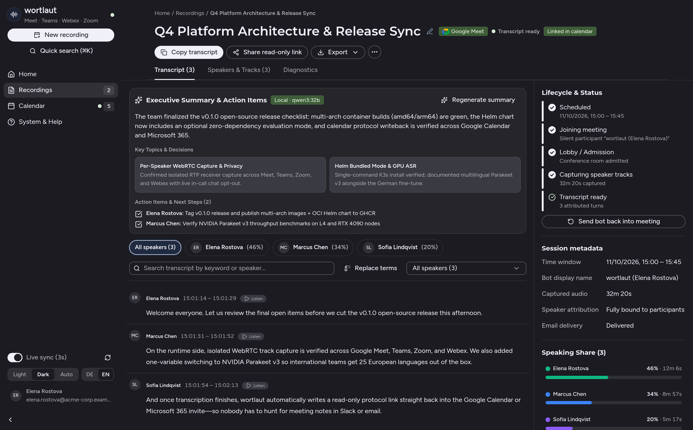
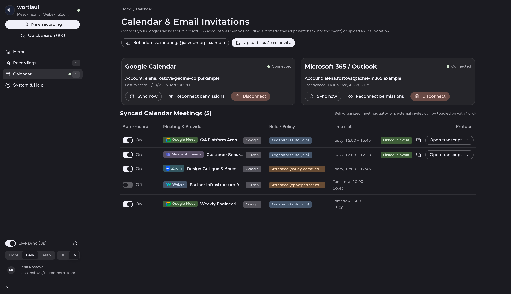

# wortlaut

[](https://github.com/mayflower/wortlaut/actions/workflows/checks.yml)
[](https://github.com/mayflower/wortlaut/pkgs/container/wortlaut-meeting)
[](https://wortlaut.cloud)
[](LICENSE)

**[English](README.md) · Deutsch** | **Website:** [wortlaut.cloud](https://wortlaut.cloud) · **Docker-Quickstart:** [`docker-compose.yml`](docker-compose.yml) · **Helm Chart:** [`charts/wortlaut`](charts/wortlaut/README.md) · **Konfiguration:** [`docs/configuration.md`](docs/configuration.md) · **Changelog:** [`CHANGELOG.md`](CHANGELOG.md) · **Security:** [`SECURITY.md`](SECURITY.md)

**Sprechergenaue Wortprotokolle für Google Meet, Microsoft Teams, Cisco Webex und Zoom — zu 100 % selbstgehostet auf Ihrer eigenen Infrastruktur.**

`wortlaut` nimmt als transparenter Browser-Teilnehmer an Online-Besprechungen teil, zeichnet jeden Sprecher auf seiner eigenen WebRTC-Tonspur **vor dem Abmischen** auf und erstellt lokal (ohne externe Cloud-Sprachdienste) ein durchsuchbares Wortprotokoll inklusive automatischer Verlinkung im Kalendereintrag, Markdown-Export und E-Mail-Versand.



---

## Warum `wortlaut`?

Kommerzielle Meeting-Bots (*Fireflies, Otter, Fathom, Read.ai*) leiten Gesprächsinhalte in Dritt-Clouds weiter, legen biometrische Stimmprofile an und lassen Teilnehmenden nur die Wahl, entweder komplett aufgenommen zu werden oder das Meeting zu verlassen.

`wortlaut` löst dieses Dilemma für datenschutzbewusste Teams, Beratungen, Behörden und Engineering-Organisationen:

| Was Teams im Alltag brauchen | Wie `wortlaut` es löst |
| :--- | :--- |
| **Kein Datenabfluss in Dritt-Clouds** | Spracherkennung (**Qwen3-ASR 1.7B**, **30 Sprachen** mit automatischer Spracherkennung, `3,88 %` deutsche WER im Open ASR Leaderboard) und optionale Zusammenfassungen (**Ollama**) laufen komplett auf eigener Hardware. |
| **Wer hat was gesagt – ohne Raten** | Statt eines gemischten Audiostroms mit fehleranfälliger Stimm-Diarisierung greift `wortlaut` die getrennten WebRTC-Empfangsspuren (`RTCRtpReceiver`) jedes Teilnehmers vor dem Konferenz-Mix ab. |
| **Individueller Opt-out mitten im Call** | Wer nicht protokolliert werden möchte, schreibt im Meeting-Chat einfach **`nein`** oder **`opt out`**. Das Gespräch läuft für alle anderen weiter – die Aussagen dieser Person werden sofort verworfen und rückstandslos gelöscht. |
| **Protokoll direkt dort, wo man sucht** | Nach dem Gespräch trägt `wortlaut` den schreibgeschützten Protokoll-Link automatisch in den **Google-Calendar-** oder **Outlook/M365-Termin** ein, verschickt das Ergebnis per E-Mail und stellt `.md`, `.txt`, `.vtt` und `.json` bereit. |
| **Sekundengenaue Prüfbarkeit** | Jedes Zitat besitzt einen klickbaren Zeitstempel. Innerhalb der 24-stündigen Audio-Aufbewahrungsfrist lässt sich jeder Satz direkt im Browser mit dem Original-Ton gegenhören, bevor das Roh-Audio automatisch gelöscht wird. |
| **Folien-Keyframes nur bei Bildschirmfreigabe (niemals Kameravideo)** | Erfasst statische PNG-Standbilder (`<= 1280 × 720`) ausschließlich von nachgewiesenen Bildschirmfreigabe-Spuren (`WORTLAUT_ENABLE_KEYFRAMES=true`) – Kamerabilder von Teilnehmenden werden strikt fail-closed verworfen. Folien erscheinen chronologisch im Protokoll und über MCP ganz ohne Videoüberwachung. |

---

## So funktioniert `wortlaut` im Alltag

### 1. Besprechung aufzeichnen (3 Wege)

* **Automatisch über den Kalender (Google Calendar & Microsoft 365):**
  Verbinden Sie Ihren Kalender einmalig per OAuth2 in der Web-UI (`/ui#view=calendar`). Eigene Termine mit bestätigten Gästen werden automatisch protokolliert; externe Termine lassen sich per **1-Klick-Schalter** zu- oder abschalten.
* **Sofort im Browser (Ad-hoc):**
  Fügen Sie einen beliebigen **Google Meet-**, **Microsoft Teams-**, **Cisco Webex-** oder **Zoom-Link** auf der Startseite ein – `wortlaut` tritt innerhalb weniger Sekunden bei.
* **Per E-Mail-Einladung (`.ics`):**
  Laden Sie die Bot-Adresse einfach wie einen normalen Teilnehmer zum Kalendereintrag ein oder laden Sie eine `.ics`-Datei hoch.



### 2. Transparente Teilnahme, On-Screen-Anleitung & Live-Steuerung im Chat

* Beim Beitritt erscheint `wortlaut` klar erkennbar mit dem Namen der einladenden Person – z. B. **`wortlaut (Elena Rostova)`** –, zeigt alle verfügbaren **Chat-Befehle direkt auf seiner Live-Videokachel (`1280×720`)** ([video-tile.ts](worker/runtime/video-tile.ts)) und postet im Meeting-Chat einen kurzen Hinweis (`DE` oder `EN`) samt Link zur [Datenschutz-Information (`/privacy`)](services/meeting/src/wortlaut/ui.py) (inklusive explizitem Hinweis bei `WORTLAUT_ENABLE_KEYFRAMES=true`, dass niemals Kameravideos aufgezeichnet werden, sondern lediglich statische Standbilder aktiver Bildschirmfreigaben; siehe [`./docs/configuration.md`](./docs/configuration.md)).
* **Live-Chat-Opt-out:** Schreibt eine teilnehmende Person im Meeting-Chat `no`, `opt out`, `optout`, `stop` oder `widerspruch`, werden Tonspur und Folien-Erfassung dieser Person sofort gestoppt und bereits transkribierte Sätze sowie gespeicherte Bildschirmfreigabe-Folien rückstandslos aus PostgreSQL und S3 gelöscht ([meet-page.ts](worker/src/meet-page.ts), [processing.py](services/meeting/src/wortlaut/processing.py)).
* **Off-the-Record-Pause (`#pause` / `#resume` / `#weiter`):** Mit `#pause` (oder `/pause`, `!pause`, `#pausieren`, `#off-the-record`) im Konferenz-Chat wird die Audio-Erfassung sofort im Worker-RAM genullt, die Folien-Erfassung ausgesetzt und die Videokachel deutlich sichtbar auf **OFF THE RECORD — Aufnahme pausiert** umgeschaltet. `#resume` oder `#weiter` setzt die Aufnahme lückenlos fort ([capture.ts](worker/src/capture.ts), [meet-page.ts](worker/src/meet-page.ts)).
* **Live-Pegelanzeige („Ton wird aufgezeichnet“):** Eine Echtzeit-Wellenform auf der `16:9`-Videokachel und in der Web-UI signalisiert sofort sichtbar, sobald aktiv Ton aufgezeichnet wird.

### 3. Nachbereiten, Prüfen & Teilen

* **Direkt im Kalendereintrag verlinkt:** Sobald das Protokoll fertig ist, trägt `wortlaut` den Lese-Link (`wortlaut-read-…`) automatisch in die Terminbeschreibung in Google Calendar bzw. Microsoft 365 ein ([calendar_oauth.py](services/meeting/src/wortlaut/calendar_oauth.py)).
* **Zweisprachige Web-UI (`DE` / `EN`) & Editor:** Oberfläche jederzeit zwischen Deutsch und Englisch umschaltbar; Volltextsuche über alle Meetings, Umbenennen von Gast-Teilnehmern (`speaker_overrides`) und globale Korrektur von Fachbegriffen per Klick.
* **Exporte für jedes Werkzeug:** Kopieren Sie das Protokoll als **GitHub-Flavored Markdown (`.md`)** nach Confluence, Notion, GitLab oder Jira, laden Sie `.txt`, `.vtt` oder `.json` herunter oder teilen Sie einen schreibgeschützten **Lese-Link (`wortlaut-read-…`)** ([exports.py](services/meeting/src/wortlaut/exports.py)).

---

## Unterstützte Konferenzplattformen

Alle vier Plattformen laufen parallel in derselben `wortlaut`-Instanz:

| Plattform | Beitritt & Funktionsumfang |
| :--- | :--- |
| **Google Meet** | Beitritt als Gast oder mit hinterlegtem Google-Konto ([meet.ts](worker/runtime/meet.ts), [meet-page.ts](worker/src/meet-page.ts), [capture.ts](worker/src/capture.ts)); getrennte WebRTC-Einzelspuren, Teilnehmer-Zuordnung, `1280×720` (`16:9`)-Live-Videokachel ([video-tile.ts](worker/runtime/video-tile.ts)), Bildschirmfreigabe-Keyframes (`a=content:slides` + Screencast-DOM, Kameraspuren ausgeschlossen) und Live-Steuerung im Chat (`no`/`opt out`, `#pause`/`#resume`). |
| **Microsoft Teams** | Beitritt als Gast mit deutscher/englischer Steuerung ([teams-browser.ts](worker/runtime/teams-browser.ts)); getrennte WebRTC-Empfangsspuren, CSI-Sprecher-Bindung, `1280×720` (`16:9`)-Live-Videokachel, `applicationsharing-video`-Folien-Keyframes und Live-Steuerung im Chat (`no`/`opt out`, `#pause`/`#resume`). |
| **Cisco Webex** | Beitritt als Browser-Gast ([webex-browser.ts](worker/runtime/webex-browser.ts)) oder per Service-App-SDK; Multistream-`AUDIO-MAIN`-Erfassung, `activeSpeakerNotification`-Zuordnung, `1280×720` (`16:9`)-Live-Videokachel + `VIDEO`/`SLIDES`-Folien-Keyframes im Browser-Modus (`"unsupported"` im Guest-Issuer-SDK-Modus) und Live-Steuerung im Chat (`no`/`opt out`, `#pause`/`#resume`). |
| **Zoom** | Beitritt über den Zoom Web-Client als Gast oder mit hinterlegter Sitzung ([zoom-browser.ts](worker/runtime/zoom-browser.ts), [zoom-url.ts](worker/src/zoom-url.ts)); Warteraum-Unterstützung, Opus-Audio-Erfassung, `1280×720` (`16:9`)-Live-Videokachel, `.sharing-layout-container`-/`#sharee-container-canvas`-Folien-Keyframes bei eindeutiger Teilnehmer-Zuordnung und Live-Steuerung im Chat (`no`/`opt out`, `#pause`/`#resume`). |

*(Kann eine Tonspur vom Konferenzanbieter nicht eindeutig einer Teilnehmersitzung zugeordnet werden, weist `wortlaut` dies im Protokoll transparent als `attribution_unknown: true` aus, statt Namen zu erraten.)*

---

## Quickstart & Self-Hosting

`wortlaut` unterstützt vier Betriebsarten ([runtime_backends.py](services/meeting/src/wortlaut/runtime_backends.py)) und läuft sowohl mit **NVIDIA-GPU** als auch per **CPU-Fallback**:

### Option 1: Docker Compose (Einzelserver / VM – schnellster Start)

Startet `wortlaut-meeting` (unprivilegiert über isolierten `docker-socket-proxy`), `wortlaut-asr`, PostgreSQL 17 und RustFS S3 ([docker-compose.yml](docker-compose.yml)):

```sh
cp .env.example .env
# WORTLAUT_API_TOKEN und Passwörter in .env setzen, dann starten:
docker compose up -d

# Empfohlen bei vorhandener NVIDIA-GPU (Echtzeit-ASR mit Qwen3-ASR):
docker compose -f docker-compose.yml -f docker-compose.gpu.yml up -d
# Web-UI öffnen: http://127.0.0.1:34601/ui
```

### Option 2: Kubernetes mit Helm Chart (Evaluation & Produktion)

**1-Befehl-Evaluationsmodus** für K3s, kind oder Homelabs (deployt automatisch eingebettetes PostgreSQL 17, RustFS S3 und persistente Zufalls-Secrets):

```sh
helm upgrade --install wortlaut oci://ghcr.io/mayflower/charts/wortlaut \
  --namespace wortlaut --create-namespace \
  --set host=wortlaut.local \
  --set bundled.enabled=true \
  --set asr.backend=parakeet --set asr.device=cpu
```

**Produktiver Cluster-Betrieb** mit externem PostgreSQL, S3, GPU-Node und OIDC-SSO (vollständige Anleitung in [charts/wortlaut/README.md](charts/wortlaut/README.md) und [docs/configuration.md](docs/configuration.md)):

```sh
helm upgrade --install wortlaut oci://ghcr.io/mayflower/charts/wortlaut \
  --namespace wortlaut --create-namespace \
  --set host=wortlaut.example.org \
  --set oidc.issuer=https://auth.example.org
```

### Option 3: Lokal / Bare-Metal (`WORTLAUT_CONTROLLER_BACKEND=local`)

```sh
./scripts/run-local.sh
```

---

## Spracherkennungsmodelle (`Qwen3-ASR` & `Parakeet TDT v3`)

Der `wortlaut-asr`-Dienst ([services/asr/app.py](services/asr/app.py)) unterstützt zwei per Flag umschaltbare lokale ASR-Backends über `WORTLAUT_ASR_BACKEND` (`qwen3` oder `parakeet`), `WORTLAUT_ASR_DEVICE` (`auto`, `cuda`, `cpu`, `mps`) und `WORTLAUT_ASR_QUANTIZATION` (`auto`, `int8`, `fp32`, `bfloat16`, `float16`, `float32`) – jeweils mit gepinnter Hugging-Face-Revision (`WORTLAUT_ASR_MODEL_REPO` und `WORTLAUT_ASR_MODEL_REVISION` überschreiben beides):

| Backend (`WORTLAUT_ASR_BACKEND`) | Standard-Checkpoint | Sprachen | Ideal für |
| :--- | :--- | :--- | :--- |
| **`qwen3`** (Helm-Standard, GPU-Image) | [`Qwen/Qwen3-ASR-1.7B-hf`](https://huggingface.co/Qwen/Qwen3-ASR-1.7B-hf) | **30 Sprachen** (`*`, pro Aufnahme umschaltbar) | NVIDIA-GPU-Cluster, Glossar-/Kontext-Prompts (`WORTLAUT_ASR_GLOSSARY`), außereuropäische Sprachen |
| **`parakeet`** (Compose-CPU-Standard, GPU- & schlankes Multi-Arch-Image `wortlaut-asr-cpu`) | [`istupakov/parakeet-tdt-0.6b-v3-onnx`](https://huggingface.co/istupakov/parakeet-tdt-0.6b-v3-onnx) | **25 europäische Sprachen** (automatisch erkannt) | Schnelle CPU- (`int8`, ~650 MB, amd64 & arm64) oder sehr schnelle GPU-Inferenz (`fp32`) mit nativen Wort-Zeitstempeln & Log-Prob-Konfidenz |

`Qwen3-ASR` unterstützt alle **30 Sprachen** (`WORTLAUT_ASR_LANGUAGES=*`: Chinesisch, Englisch, Kantonesisch, Arabisch, Deutsch, Französisch, Spanisch, Portugiesisch, Indonesisch, Italienisch, Koreanisch, Russisch, Thai, Vietnamesisch, Japanisch, Türkisch, Hindi, Malaiisch, Niederländisch, Schwedisch, Dänisch, Finnisch, Polnisch, Tschechisch, Filipino, Persisch, Griechisch, Ungarisch, Mazedonisch, Rumänisch) sowie Kontext-Prompts über `WORTLAUT_ASR_GLOSSARY="BegriffA, BegriffB"`, Meeting-Titel und bestätigte Teilnehmernamen. `Parakeet TDT 0.6B v3` läuft über ONNX Runtime (`onnx-asr`), liefert native Wort-Zeitstempel und Token-Konfidenzen ohne PyTorch im schlanken `wortlaut-asr-cpu`-Image und verzichtet im Helm-Chart bei `asr.backend=parakeet` und `asr.device=cpu` (oder `asr.allowCpu=true`) automatisch auf `nvidia.com/gpu`-Ressourcen. Überzieht eine aktive Besprechung ihre geplante Endzeit (`ends_at`), verlängert `wortlaut` das Aufnahmefenster automatisch in 15-Minuten-Schritten bis maximal `WORTLAUT_MAX_OVERTIME_SECONDS` (Standard `3600` = 60 Minuten).

Für eine komplett englischsprachige Standard-Oberfläche samt englischem Bot-Chathinweis genügt zusätzlich `WORTLAUT_DEFAULT_LOCALE=en`.

---

## Datenschutz & Aufbewahrungsfristen

1. **Kurze Roh-Audio-Aufbewahrung (24 Stunden):** Aufgezeichnete Audiospuren dienen ausschließlich der Transkription und der kurzen Satz-Überprüfung und werden standardmäßig **24 Stunden nach Meeting-Ende** automatisch aus dem S3-Speicher gelöscht.
2. **Automatische Protokoll- & Folien-Löschfrist (30 Tage):** Transkripte, Bildschirmfreigabe-Keyframes (`keyframes/{recording_id}/`) und Metadaten teilen sich die Frist `WORTLAUT_TRANSCRIPT_RETENTION_DAYS` (standardmäßig **30 Tage** in [settings.py](services/meeting/src/wortlaut/settings.py), angerechnet auf `WORTLAUT_MAX_STORED_AUDIO_BYTES`) und können jederzeit komplett (`DELETE /v1/recordings/{id}`) oder einzeln je Folie (`DELETE /v1/recordings/{id}/keyframes/{keyframe_id}`) gelöscht werden.
3. **Mandantentrennung & Scoped Links:** Über **OIDC** (Dex, Keycloak, Authentik), **Microsoft Entra ID** oder **Google Auth** ([oidc.py](services/meeting/src/wortlaut/oidc.py)) angemeldete Nutzer sehen ausschließlich ihre eigenen Aufnahmen sowie Termine, zu denen sie eingeladen waren. Geteilte Lese-Links (`wortlaut-read-<recording_id>.<hmac>`) gewähren ausschließlich Lesezugriff auf genau ein Protokoll.

---

## Optionale Erweiterungen

### Authentifizierter Model-Context-Protocol-(MCP)-Server (`/mcp` + OAuth 2.1)

`wortlaut` stellt einen integrierten **MCP-Streamable-HTTP**-Server (`POST /mcp`, [mcp_server.py](services/meeting/src/wortlaut/mcp_server.py)) mit vollständiger **OAuth-2.1-Browser-Authentifizierung (`mcp auth`)** bereit (RFC 9728 Protected Resource Metadata, RFC 8414 Authorization Server Metadata, RFC 7591 Dynamic Client Registration, PKCE `S256` und expliziter Nutzerfreigabe in [mcp_oauth.py](services/meeting/src/wortlaut/mcp_oauth.py)):

```sh
claude mcp add --transport http wortlaut https://wortlaut.example.org/mcp
```

Über `mcp:read` und optional `mcp:write` greifen KI-Clients ausschließlich auf die eigenen bzw. freigegebenen Besprechungen des angemeldeten Nutzers zu (`search_protocols` für hybride semantische + Volltext-Suche mittels lokaler CPU-ONNX-Embeddings `multilingual-e5-small` `int8` und PostgreSQL-17-`tsvector`-RRF ohne `pgvector` oder externe `/v1/embeddings`-API, `list_recordings`, `get_recording`, `get_transcript`, `get_keyframe`, `schedule_recording`, `cancel_recording`, `update_protocol` sowie Bildschirmfreigabe-Folien über `wortlaut://recordings/{recording_id}/keyframes/{keyframe_id}.png`); aktive MCP-Clients lassen sich jederzeit unter `/ui#view=mcp` einsehen und widerrufen.

### KI-Zusammenfassung & optionaler OpenAI-kompatibler Endpunkt (Ollama oder OpenAI)

`WORTLAUT_OPENAI_BASE_URL` aktiviert eine begrenzte reine Suchbegriffserweiterung für `search_protocols` (ohne Übertragung von Protokolltexten); Nachbereitungs-Zusammenfassungen und Folien-Textauszüge erfordern immer explizites `WORTLAUT_ENABLE_LLM_SUMMARY=true` und werden auf `/privacy` transparent ausgewiesen:

```dotenv
WORTLAUT_ENABLE_LLM_SUMMARY=true
# Option A — Selbstbetriebenes Ollama (Standard ohne WORTLAUT_OPENAI_BASE_URL):
WORTLAUT_OLLAMA_URL=http://ollama.ollama.svc.cluster.local:11434
WORTLAUT_OLLAMA_MODEL=qwen3.8:latest
# Option B — Einzelner externer OpenAI-kompatibler Chat-Endpunkt (kein /v1/embeddings nötig):
# WORTLAUT_OPENAI_BASE_URL=https://api.openai.com/v1
# WORTLAUT_OPENAI_API_KEY=REPLACE_PRIVATELY
# WORTLAUT_OPENAI_MODEL=gpt-4o-mini
```

### E-Mail-Einladungen (IMAP) & Ergebnisversand (SMTP)

```dotenv
WORTLAUT_ENABLE_IMAP=true
WORTLAUT_IMAP_HOST=imap.example.org
WORTLAUT_IMAP_USERNAME=bot@example.org
WORTLAUT_IMAP_PASSWORD=REPLACE_PRIVATELY
WORTLAUT_MAIL_SENDER_AUTH=dkim
WORTLAUT_MAIL_ALLOWED_SENDER_DOMAINS=["example.org"]
WORTLAUT_MAIL_REPLY_TO_SENDER=true
WORTLAUT_ENABLE_SMTP=true
WORTLAUT_SMTP_HOST=smtp.example.org
WORTLAUT_SMTP_USERNAME=bot@example.org
WORTLAUT_SMTP_PASSWORD=REPLACE_PRIVATELY
WORTLAUT_SMTP_FROM=bot@example.org
```

---

## Technische Architektur & REST-API

* **Meeting-Dienst** ([services/meeting](services/meeting), [app.py](services/meeting/src/wortlaut/app.py), [settings.py](services/meeting/src/wortlaut/settings.py)) — Python/FastAPI (`linux/amd64` & `linux/arm64`), integrierte Web-UI ([ui.py](services/meeting/src/wortlaut/ui.py)), OIDC-PKCE ([oidc.py](services/meeting/src/wortlaut/oidc.py)), Kalender- & OAuth2-Sync ([calendar.py](services/meeting/src/wortlaut/calendar.py), [calendar_oauth.py](services/meeting/src/wortlaut/calendar_oauth.py)), Scheduler, Worker-Reconciliation ([controller.py](services/meeting/src/wortlaut/controller.py)), Audio-Ingest, Exporte ([exports.py](services/meeting/src/wortlaut/exports.py)) und Mail ([mail.py](services/meeting/src/wortlaut/mail.py)).
* **Browser-Worker** ([worker](worker)) — TypeScript, Playwright und gesandboxtes Chromium; ein kurzlebiger Job/Container pro Besprechung.
* **ASR-Dienst** ([services/asr](services/asr), [services/asr/app.py](services/asr/app.py)) — Gemeinsam genutztes lokales **Qwen3-ASR**- oder **Parakeet-TDT-v3-ONNX**-Spracherkennungsmodell (`WORTLAUT_ASR_BACKEND`, `WORTLAUT_ASR_DEVICE`, `WORTLAUT_ASR_QUANTIZATION`, `WORTLAUT_ASR_MODEL_REPO`, `WORTLAUT_ASR_MODEL_REVISION`, `WORTLAUT_ASR_ALLOW_CPU`).

### Zentrale REST- & MCP-Endpunkte (Interaktive OpenAPI-Dokumentation unter `/docs`)

| Endpunkt | Funktion |
| :--- | :--- |
| `POST /v1/recordings` | Besprechungsaufnahme planen oder sofort starten (unterstützt `Idempotency-Key`) |
| `GET /v1/recordings` | Aufnahmen auflisten & Volltext/Sprechernamen durchsuchen (`?q=`) |
| `GET /v1/recordings/{id}` | Aufnahmestatus, Spur-Diagnose (`live_status`, `live_status.paused`) und `opted_out_speakers` |
| `POST /v1/recordings/{id}/cancel` / `/rejoin` | Laufende/geplante Aufnahme beenden oder frischen Worker zum Wiederbeitritt starten |
| `PATCH /v1/recordings/{id}` | Titel, Notizen, `speaker_overrides`, `term_replacements`, Aufgaben oder `opted_out_speakers` aktualisieren |
| `DELETE /v1/recordings/{id}` | Aufnahme, Transkript, S3-Audioschnipsel und Folien-Keyframes sofort löschen |
| `GET /v1/recordings/{id}/transcript` | Sprechergebundene Segmente, Wortkonfidenzen, `keyframes` und `pause_windows` abrufen |
| `GET /v1/recordings/{id}/exports/{format}` | Protokoll als `md`, `txt`, `vtt` oder `json` herunterladen |
| `GET /v1/recordings/{id}/audio-snippet` | Isolierten WAV-Ausschnitt zur Zitatprüfung abrufen (24-h-Fenster) |
| `GET /v1/recordings/{id}/keyframes/{kf_id}.png` (`DELETE …/{kf_id}`) | Statisches Bildschirmfreigabe-Standbild abrufen (`Authorization: Bearer`) oder dauerhaft löschen |
| `POST /v1/recordings/{id}/summary` | Lokale KI-Zusammenfassung & Aufgabenliste über Ollama erzeugen |
| `POST /v1/recordings/{id}/calendar-link` | Protokoll-Link in den verknüpften Google-Calendar- oder M365-Termin schreiben |
| `POST /v1/recordings/{id}/reader-token` | Schreibgeschützten `wortlaut-read-…`-Freigabelink ausstellen |
| `POST /v1/calendar/messages` | `.ics`- oder RFC822-`.eml`-Kalendereinladungen importieren |
| `GET /v1/calendar` | Verbundene OAuth2-Kalender, synchronisierte Termine und `.ics`-Einladungen abrufen |
| `POST /mcp` (`GET/DELETE /v1/mcp/grants`) | Authentifizierter MCP-Streamable-HTTP-Server (OAuth 2.1 `mcp:read` / `mcp:write`) & Client-Widerruf |
| `GET /privacy` / `GET /metrics` | Öffentlicher Datenschutz- & Transparenzhinweis (`?lang=de` / `?lang=en`) und Prometheus-Metriken |

---

## Entwicklung & Mitwirken

Externe Mitwirkende benötigen lokal lediglich Python 3.14 (`uv`), Node.js 22+ und Docker — **kein Kubernetes-Cluster erforderlich** (siehe [CONTRIBUTING.md](CONTRIBUTING.md)):

```sh
make setup-local   # Python- & Node-Abhängigkeiten installieren, Bundles bauen & Git-QA-Hooks einrichten
make qa            # Schnelle Secret-, Lint-, Typecheck- & Helm/Workflow-Prüfungen ausführen
make test-local    # Linter + vollständige PostgreSQL-, S3- & Worker-Tests in Einweg-Containern
```

Alle Konfigurationsparameter sind in [settings.py](services/meeting/src/wortlaut/settings.py) und [docs/configuration.md](docs/configuration.md) dokumentiert. Sicherheitslücken bitte vertraulich gemäß [SECURITY.md](SECURITY.md) melden.
