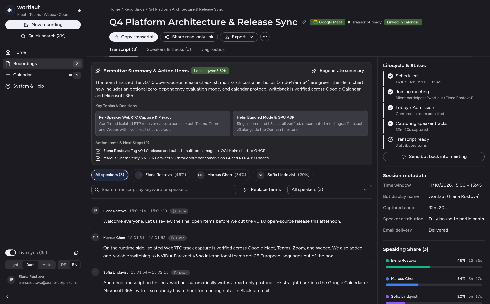
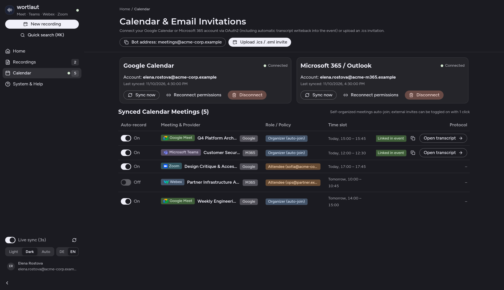

# wortlaut

[](https://github.com/mayflower/wortlaut/actions/workflows/checks.yml)
[](https://github.com/mayflower/wortlaut/pkgs/container/wortlaut-meeting)
[](https://wortlaut.cloud)
[](LICENSE)

**[English](README.md) · Deutsch** | **Website:** [wortlaut.cloud](https://wortlaut.cloud) · **Docker-Quickstart:** [`docker-compose.yml`](docker-compose.yml) · **Helm Chart:** [`charts/wortlaut`](charts/wortlaut/README.md) · **Konfiguration:** [`docs/configuration.md`](docs/configuration.md) · **Changelog:** [`CHANGELOG.md`](CHANGELOG.md) · **Security:** [`SECURITY.md`](SECURITY.md)

**Sprechergenaue Wortprotokolle für Google Meet, Microsoft Teams, Cisco Webex und Zoom — zu 100 % selbstgehostet auf Ihrer eigenen Infrastruktur.**

`wortlaut` nimmt als transparenter Browser-Teilnehmer an Online-Besprechungen teil, zeichnet jeden Sprecher auf seiner eigenen WebRTC-Tonspur **vor dem Abmischen** auf und erstellt lokal (ohne externe Cloud-Sprachdienste) ein durchsuchbares Wortprotokoll inklusive automatischer Verlinkung im Kalendereintrag, Markdown-Export und E-Mail-Versand.



---

## Warum `wortlaut`?

Kommerzielle Meeting-Bots (*Fireflies, Otter, Fathom, Read.ai*) leiten Gesprächsinhalte in Dritt-Clouds weiter, legen biometrische Stimmprofile an und lassen Teilnehmenden nur die Wahl, entweder komplett aufgenommen zu werden oder das Meeting zu verlassen.

`wortlaut` löst dieses Dilemma für datenschutzbewusste Teams, Beratungen, Behörden und Engineering-Organisationen:

| Was Teams im Alltag brauchen | Wie `wortlaut` es löst |
| :--- | :--- |
| **Kein Datenabfluss in Dritt-Clouds** | Spracherkennung (**Qwen3-ASR 1.7B**, **30 Sprachen** mit automatischer Spracherkennung, `3,88 %` deutsche WER im Open ASR Leaderboard) und optionale Zusammenfassungen (**Ollama**) laufen komplett auf eigener Hardware. |
| **Wer hat was gesagt – ohne Raten** | Statt eines gemischten Audiostroms mit fehleranfälliger Stimm-Diarisierung greift `wortlaut` die getrennten WebRTC-Empfangsspuren (`RTCRtpReceiver`) jedes Teilnehmers vor dem Konferenz-Mix ab. |
| **Individueller Opt-out mitten im Call** | Wer nicht protokolliert werden möchte, schreibt im Meeting-Chat einfach **`nein`** oder **`opt out`**. Das Gespräch läuft für alle anderen weiter – die Aussagen dieser Person werden sofort verworfen und rückstandslos gelöscht. |
| **Protokoll direkt dort, wo man sucht** | Nach dem Gespräch trägt `wortlaut` den schreibgeschützten Protokoll-Link automatisch in den **Google-Calendar-** oder **Outlook/M365-Termin** ein, verschickt das Ergebnis per E-Mail und stellt `.md`, `.txt`, `.vtt` und `.json` bereit. |
| **Sekundengenaue Prüfbarkeit** | Jedes Zitat besitzt einen klickbaren Zeitstempel. Innerhalb der 24-stündigen Audio-Aufbewahrungsfrist lässt sich jeder Satz direkt im Browser mit dem Original-Ton gegenhören, bevor das Roh-Audio automatisch gelöscht wird. |

---

## So funktioniert `wortlaut` im Alltag

### 1. Besprechung aufzeichnen (3 Wege)

* **Automatisch über den Kalender (Google Calendar & Microsoft 365):**
  Verbinden Sie Ihren Kalender einmalig per OAuth2 in der Web-UI (`/ui#view=calendar`). Eigene Termine mit bestätigten Gästen werden automatisch protokolliert; externe Termine lassen sich per **1-Klick-Schalter** zu- oder abschalten.
* **Sofort im Browser (Ad-hoc):**
  Fügen Sie einen beliebigen **Google Meet-**, **Microsoft Teams-**, **Cisco Webex-** oder **Zoom-Link** auf der Startseite ein – `wortlaut` tritt innerhalb weniger Sekunden bei.
* **Per E-Mail-Einladung (`.ics`):**
  Laden Sie die Bot-Adresse einfach wie einen normalen Teilnehmer zum Kalendereintrag ein oder laden Sie eine `.ics`-Datei hoch.



### 2. Transparente Teilnahme & Live-Widerspruch im Call

* Beim Beitritt erscheint `wortlaut` klar erkennbar mit dem Namen der einladenden Person – z. B. **`wortlaut (Elena Rostova)`** – und postet im Meeting-Chat einen kurzen Hinweis (`DE` oder `EN`) samt Link zur [Datenschutz-Information (`/privacy`)](services/meeting/src/wortlaut/ui.py).
* **Live-Chat-Opt-out:** Schreibt eine teilnehmende Person im Meeting-Chat `nein`, `no`, `opt out`, `optout`, `stop` oder `widerspruch`, wird ihre Tonspur sofort verworfen und bereits transkribierte Sätze dieser Person werden aus der Datenbank gelöscht ([meet-page.ts](worker/src/meet-page.ts), [processing.py](services/meeting/src/wortlaut/processing.py)).

### 3. Nachbereiten, Prüfen & Teilen

* **Direkt im Kalendereintrag verlinkt:** Sobald das Protokoll fertig ist, trägt `wortlaut` den Lese-Link (`wortlaut-read-…`) automatisch in die Terminbeschreibung in Google Calendar bzw. Microsoft 365 ein ([calendar_oauth.py](services/meeting/src/wortlaut/calendar_oauth.py)).
* **Zweisprachige Web-UI (`DE` / `EN`) & Editor:** Oberfläche jederzeit zwischen Deutsch und Englisch umschaltbar; Volltextsuche über alle Meetings, Umbenennen von Gast-Teilnehmern (`speaker_overrides`) und globale Korrektur von Fachbegriffen per Klick.
* **Exporte für jedes Werkzeug:** Kopieren Sie das Protokoll als **GitHub-Flavored Markdown (`.md`)** nach Confluence, Notion, GitLab oder Jira, laden Sie `.txt`, `.vtt` oder `.json` herunter oder teilen Sie einen schreibgeschützten **Lese-Link (`wortlaut-read-…`)** ([exports.py](services/meeting/src/wortlaut/exports.py)).

---

## Unterstützte Konferenzplattformen

Alle vier Plattformen laufen parallel in derselben `wortlaut`-Instanz:

| Plattform | Beitritt & Funktionsumfang |
| :--- | :--- |
| **Google Meet** | Beitritt als Gast oder mit hinterlegtem Google-Konto ([meet.ts](worker/runtime/meet.ts), [meet-page.ts](worker/src/meet-page.ts), [capture.ts](worker/src/capture.ts)); getrennte WebRTC-Einzelspuren, Teilnehmer-Zuordnung und Live-Chat-Opt-out. |
| **Microsoft Teams** | Beitritt als Gast mit deutscher/englischer Steuerung ([teams-browser.ts](worker/runtime/teams-browser.ts)); getrennte WebRTC-Empfangsspuren, CSI-Sprecher-Bindung und Live-Chat-Opt-out. |
| **Cisco Webex** | Beitritt als Browser-Gast ([webex-browser.ts](worker/runtime/webex-browser.ts)) oder per Service-App-SDK; Multistream-`AUDIO-MAIN`-Erfassung, `activeSpeakerNotification`-Zuordnung und Live-Chat-Opt-out. |
| **Zoom** | Beitritt über den Zoom Web-Client als Gast oder mit hinterlegter Sitzung ([zoom-browser.ts](worker/runtime/zoom-browser.ts), [zoom-url.ts](worker/src/zoom-url.ts)); Warteraum-Unterstützung, Opus-Audio-Erfassung und Live-Chat-Opt-out. |

*(Kann eine Tonspur vom Konferenzanbieter nicht eindeutig einer Teilnehmersitzung zugeordnet werden, weist `wortlaut` dies im Protokoll transparent als `attribution_unknown: true` aus, statt Namen zu erraten.)*

---

## Quickstart & Self-Hosting

`wortlaut` unterstützt vier Betriebsarten ([runtime_backends.py](services/meeting/src/wortlaut/runtime_backends.py)) und läuft sowohl mit **NVIDIA-GPU** als auch per **CPU-Fallback**:

### Option 1: Docker Compose (Einzelserver / VM – schnellster Start)

Startet `wortlaut-meeting` (unprivilegiert über isolierten `docker-socket-proxy`), `wortlaut-asr`, PostgreSQL 17 und RustFS S3 ([docker-compose.yml](docker-compose.yml)):

```sh
cp .env.example .env
# WORTLAUT_API_TOKEN und Passwörter in .env setzen, dann starten:
docker compose up -d

# Empfohlen bei vorhandener NVIDIA-GPU (Echtzeit-ASR mit Qwen3-ASR):
docker compose -f docker-compose.yml -f docker-compose.gpu.yml up -d
# Web-UI öffnen: http://127.0.0.1:34601/ui
```

### Option 2: Kubernetes mit Helm Chart (Evaluation & Produktion)

**1-Befehl-Evaluationsmodus** für K3s, kind oder Homelabs (deployt automatisch eingebettetes PostgreSQL 17, RustFS S3 und persistente Zufalls-Secrets):

```sh
helm upgrade --install wortlaut oci://ghcr.io/mayflower/charts/wortlaut \
  --namespace wortlaut --create-namespace \
  --set host=wortlaut.local \
  --set bundled.enabled=true \
  --set asr.gpuCount=0 --set asr.allowCpu=true
```

**Produktiver Cluster-Betrieb** mit externem PostgreSQL, S3, GPU-Node und OIDC-SSO (vollständige Anleitung in [charts/wortlaut/README.md](charts/wortlaut/README.md) und [docs/configuration.md](docs/configuration.md)):

```sh
helm upgrade --install wortlaut oci://ghcr.io/mayflower/charts/wortlaut \
  --namespace wortlaut --create-namespace \
  --set host=wortlaut.example.org \
  --set oidc.issuer=https://auth.example.org
```

### Option 3: Lokal / Bare-Metal (`WORTLAUT_CONTROLLER_BACKEND=local`)

```sh
./scripts/run-local.sh
```

---

## Spracherkennungsmodell (Qwen3-ASR, 30 Sprachen)

Der `wortlaut-asr`-Dienst ([services/asr/app.py](services/asr/app.py)) lädt [`Qwen/Qwen3-ASR-1.7B-hf`](https://huggingface.co/Qwen/Qwen3-ASR-1.7B-hf) in einer festen Revision über Hugging Face Transformers (`WORTLAUT_ASR_MODEL_REPO` und `WORTLAUT_ASR_MODEL_REVISION` überschreiben beides). Die Sprache wird pro Segment erkannt; unterstützt: Chinesisch, Englisch, Kantonesisch, Arabisch, Deutsch, Französisch, Spanisch, Portugiesisch, Indonesisch, Italienisch, Koreanisch, Russisch, Thai, Vietnamesisch, Japanisch, Türkisch, Hindi, Malaiisch, Niederländisch, Schwedisch, Dänisch, Finnisch, Polnisch, Tschechisch, Filipino, Persisch, Griechisch, Ungarisch, Mazedonisch, Rumänisch.

Das Modell liefert keine Wort-Zeitstempel. Jeder ASR-Job bekommt deshalb nur seinen eigenen, überlappungsfreien Audioabschnitt, und Transkriptsegmente tragen Zeiten auf Segmentebene. Die Wortkonfidenz ist die mittlere Wahrscheinlichkeit der erzeugten Tokens. Stille und Rauschen ergeben ein leeres Transkript; eine Ausgabe, die das Generierungsbudget ohne Endmarker erreicht, wird als Decoder-Schleife verworfen.

Für eine komplett englischsprachige Standard-Oberfläche samt englischem Bot-Chathinweis genügt zusätzlich `WORTLAUT_DEFAULT_LOCALE=en`.

---

## Datenschutz & Aufbewahrungsfristen

1. **Kurze Roh-Audio-Aufbewahrung (24 Stunden):** Aufgezeichnete Audiospuren dienen ausschließlich der Transkription und der kurzen Satz-Überprüfung und werden standardmäßig **24 Stunden nach Meeting-Ende** automatisch aus dem S3-Speicher gelöscht.
2. **Automatische Protokoll-Löschfrist (30 Tage):** Transkripte und Metadaten laufen standardmäßig nach **30 Tagen** ab (konfigurierbar in [settings.py](services/meeting/src/wortlaut/settings.py)) oder können jederzeit sofort gelöscht werden (`DELETE /v1/recordings/{id}`).
3. **Mandantentrennung & Scoped Links:** Über **OIDC** ([oidc.py](services/meeting/src/wortlaut/oidc.py)) angemeldete Nutzer sehen ausschließlich ihre eigenen Aufnahmen sowie Termine, zu denen sie eingeladen waren. Geteilte Lese-Links (`wortlaut-read-<recording_id>.<hmac>`) gewähren ausschließlich Lesezugriff auf genau ein Protokoll.

---

## Optionale Erweiterungen

### Lokale KI-Zusammenfassung & Aufgabenliste (Ollama)

```dotenv
WORTLAUT_ENABLE_LLM_SUMMARY=true
WORTLAUT_OLLAMA_URL=http://ollama.ollama.svc.cluster.local:11434
WORTLAUT_OLLAMA_MODEL=qwen3:32b
```

### E-Mail-Einladungen (IMAP) & Ergebnisversand (SMTP)

```dotenv
WORTLAUT_ENABLE_IMAP=true
WORTLAUT_IMAP_HOST=imap.example.org
WORTLAUT_IMAP_USERNAME=bot@example.org
WORTLAUT_IMAP_PASSWORD=REPLACE_PRIVATELY
WORTLAUT_MAIL_SENDER_AUTH=dkim
WORTLAUT_MAIL_ALLOWED_SENDER_DOMAINS=["example.org"]
WORTLAUT_MAIL_REPLY_TO_SENDER=true
WORTLAUT_ENABLE_SMTP=true
WORTLAUT_SMTP_HOST=smtp.example.org
WORTLAUT_SMTP_USERNAME=bot@example.org
WORTLAUT_SMTP_PASSWORD=REPLACE_PRIVATELY
WORTLAUT_SMTP_FROM=bot@example.org
```

---

## Technische Architektur & REST-API

* **Meeting-Dienst** ([services/meeting](services/meeting), [app.py](services/meeting/src/wortlaut/app.py), [settings.py](services/meeting/src/wortlaut/settings.py)) — Python/FastAPI (`linux/amd64` & `linux/arm64`), integrierte Web-UI ([ui.py](services/meeting/src/wortlaut/ui.py)), OIDC-PKCE ([oidc.py](services/meeting/src/wortlaut/oidc.py)), Kalender- & OAuth2-Sync ([calendar.py](services/meeting/src/wortlaut/calendar.py), [calendar_oauth.py](services/meeting/src/wortlaut/calendar_oauth.py)), Scheduler, Worker-Reconciliation ([controller.py](services/meeting/src/wortlaut/controller.py)), Audio-Ingest, Exporte ([exports.py](services/meeting/src/wortlaut/exports.py)) und Mail ([mail.py](services/meeting/src/wortlaut/mail.py)).
* **Browser-Worker** ([worker](worker)) — TypeScript, Playwright und gesandboxtes Chromium; ein kurzlebiger Job/Container pro Besprechung.
* **ASR-Dienst** ([services/asr](services/asr), [services/asr/app.py](services/asr/app.py)) — Gemeinsam genutztes lokales **Qwen3-ASR**-Spracherkennungsmodell (`WORTLAUT_ASR_MODEL_REPO`, `WORTLAUT_ASR_MODEL_REVISION`, `WORTLAUT_ASR_ALLOW_CPU`).

Vollständige interaktive OpenAPI-Dokumentation unter `/docs`.

---

## Entwicklung & Mitwirken

Externe Mitwirkende benötigen lokal lediglich Python 3.12 (`uv`), Node.js 22+ und Docker — **kein Kubernetes-Cluster erforderlich** (siehe [CONTRIBUTING.md](CONTRIBUTING.md)):

```sh
make setup-local   # Python- & Node-Abhängigkeiten installieren + Bundles bauen
make test-local    # Linter + vollständige PostgreSQL-, S3- & Worker-Tests in Einweg-Containern
```

Alle Konfigurationsparameter sind in [settings.py](services/meeting/src/wortlaut/settings.py) und [docs/configuration.md](docs/configuration.md) dokumentiert. Sicherheitslücken bitte vertraulich gemäß [SECURITY.md](SECURITY.md) melden.
