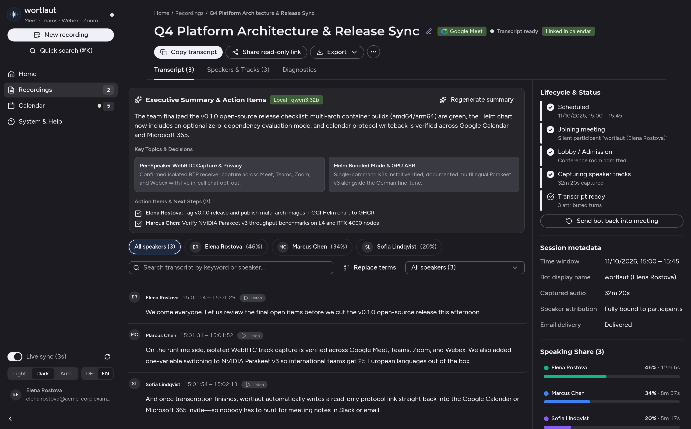
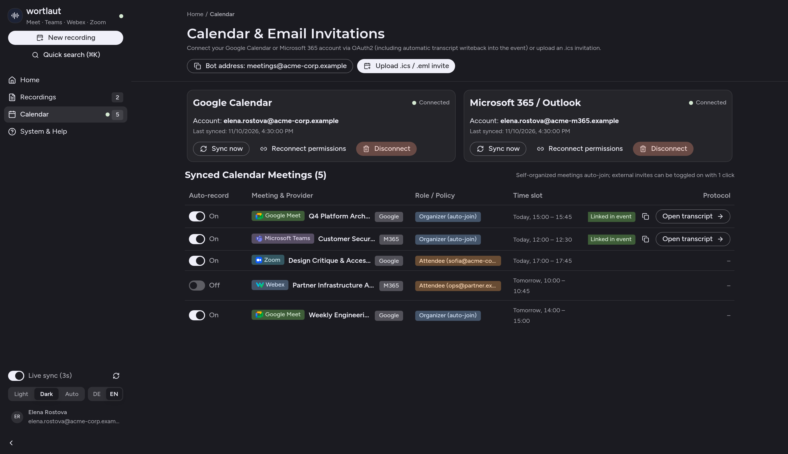

# wortlaut

[](https://github.com/mayflower/wortlaut/actions/workflows/checks.yml)
[](https://github.com/mayflower/wortlaut/pkgs/container/wortlaut-meeting)
[](https://wortlaut.cloud)
[](LICENSE)

**English · [Deutsch](README.de.md)** | **Website:** [wortlaut.cloud](https://wortlaut.cloud) · **Docker Quickstart:** [`docker-compose.yml`](docker-compose.yml) · **Helm Chart:** [`charts/wortlaut`](charts/wortlaut/README.md) · **Configuration Guide:** [`docs/configuration.md`](docs/configuration.md) · **Changelog:** [`CHANGELOG.md`](CHANGELOG.md) · **Security:** [`SECURITY.md`](SECURITY.md)

**Speaker-accurate meeting transcripts and protocols for Google Meet, Microsoft Teams, Cisco Webex, and Zoom — 100% self-hosted on your own infrastructure.**

`wortlaut` joins online calls as a transparent browser participant, captures each speaker’s isolated WebRTC audio stream **before conference mixing**, and transcribes everything locally on your own GPU or CPU — with automatic calendar invite writeback, live in-call chat opt-out, local LLM summaries, and `.md` / `.txt` / `.vtt` / `.json` exports.



---

## Why `wortlaut`?

Commercial meeting bots (*Fireflies, Otter, Fathom, Read.ai*) route confidential conversations through third-party clouds, build biometric voiceprints, and force attendees into an all-or-nothing choice: accept full cloud recording or leave the call.

`wortlaut` is built for privacy-conscious engineering teams, consultancies, enterprises, and public-sector organizations:

| What teams actually need | How `wortlaut` solves it |
| :--- | :--- |
| **Zero third-party cloud leakage** | Speech-to-text (**Qwen3-ASR 1.7B** — **30 languages** with automatic language detection, `3.88%` German WER on the Open ASR Leaderboard) and optional summaries (**Ollama**) run 100% inside your own cluster or server. |
| **True speaker attribution — no guessing** | Instead of recording mixed audio and guessing speakers with brittle voice diarization, `wortlaut` taps isolated per-participant WebRTC receiver tracks (`RTCRtpReceiver`) before mixing. |
| **Individual opt-out right in the call** | Any participant who prefers not to be quoted simply types **`opt out`** or **`no`** (`nein`) in the meeting chat. The call continues seamlessly for everyone else while their track and prior statements are purged immediately. |
| **Protocols right where people look** | As soon as transcription finishes, `wortlaut` writes a read-only transcript link directly back into the **Google Calendar** or **Microsoft 365 / Outlook** event, emails the protocol, and offers `.md`, `.txt`, `.vtt`, and `.json` downloads. |
| **Click-to-listen verification** | Every statement has a clickable timestamp. During the 24-hour raw-audio retention window, operators can play back the exact isolated audio snippet in the browser before raw audio is automatically purged. |

---

## How It Works in Daily Use

### 1. Three Ways to Record a Meeting

* **Automatic Calendar Sync (Google Calendar & Microsoft 365):**
  Connect your calendar once via OAuth2 in the Web-UI (`/ui#view=calendar`). Self-organized meetings with confirmed guests auto-join automatically; external invitations can be toggled on or off with **1 click**.
* **Instant Ad-Hoc Link:**
  Paste any **Google Meet**, **Microsoft Teams**, **Cisco Webex**, or **Zoom** URL on the home screen — `wortlaut` joins within ~15 seconds.
* **Email / `.ics` Invitation:**
  Invite the bot email address to any calendar invite like a regular attendee, or upload an `.ics` / `.eml` file directly.



### 2. Transparent Presence & Live In-Call Chat Opt-Out

* Upon joining, `wortlaut` displays the inviting person’s name — e.g. **`wortlaut (Elena Rostova)`** — and posts a concise notice in the meeting chat with a link to your instance’s [Privacy & Transparency Notice (`/privacy`)](services/meeting/src/wortlaut/ui.py).
* **Live Chat Opt-Out:** If any participant writes `opt out`, `optout`, `no`, `nein`, or `stop` in the meeting chat during the call, their audio stream is discarded on the spot and any already-transcribed segments from that participant are deleted from PostgreSQL ([meet-page.ts](worker/src/meet-page.ts), [processing.py](services/meeting/src/wortlaut/processing.py)).

### 3. Review, Search, Edit & Share

* **Automatic Calendar Writeback:** Once completed, `wortlaut` appends the scoped read-only protocol link (`wortlaut-read-…`) directly into the Google Calendar or Microsoft 365 invite description ([calendar_oauth.py](services/meeting/src/wortlaut/calendar_oauth.py)).
* **Bilingual Web-UI (`EN` / `DE`) & Protocol Editor:** Switch between English and German at any time; search across all transcripts, rename guest speakers (`speaker_overrides`), and apply 1-click domain vocabulary replacements across the entire protocol.
* **Exports for Every Workflow:** Copy **GitHub-Flavored Markdown (`.md`)** straight into Notion, Confluence, GitHub, GitLab, or Jira, download `.txt`, `.vtt`, or `.json`, or share a zero-account **read-only link (`wortlaut-read-…`)** ([exports.py](services/meeting/src/wortlaut/exports.py)).

---

## Supported Conference Platforms

All four platforms work side-by-side in the same `wortlaut` deployment:

| Platform | Join Mode & Capabilities |
| :--- | :--- |
| **Google Meet** | Joins as guest or with a saved Google session ([meet.ts](worker/runtime/meet.ts), [meet-page.ts](worker/src/meet-page.ts), [capture.ts](worker/src/capture.ts)); isolated WebRTC receiver tracks, participant binding, and live chat opt-out. |
| **Microsoft Teams** | Joins via Teams web client in English or German ([teams-browser.ts](worker/runtime/teams-browser.ts)); isolated WebRTC receiver capture, CSI speaker binding, and live chat opt-out. |
| **Cisco Webex** | Joins as browser guest ([webex-browser.ts](worker/runtime/webex-browser.ts)) or via Service App SDK; multistream `AUDIO-MAIN` capture, `activeSpeakerNotification` binding, and live chat opt-out. |
| **Zoom** | Joins via Zoom Web Client as guest or authenticated session ([zoom-browser.ts](worker/runtime/zoom-browser.ts), [zoom-url.ts](worker/src/zoom-url.ts)); waiting-room handling, Opus capture, and live chat opt-out. |

*(Whenever a conference provider does not expose a verified participant binding for a stream, `wortlaut` surfaces `attribution_unknown: true` transparently instead of guessing speaker names.)*

---

## Quickstart & Self-Hosting

`wortlaut` supports four runtime backends ([runtime_backends.py](services/meeting/src/wortlaut/runtime_backends.py)) and runs with either an **NVIDIA GPU** (recommended for real-time throughput) or **CPU fallback**:

### Option 1: Docker Compose (Single Server / VM — Fastest Start)

Starts `wortlaut-meeting` (non-root, isolated via `docker-socket-proxy`), `wortlaut-asr`, PostgreSQL 17, and RustFS S3 ([docker-compose.yml](docker-compose.yml)):

```sh
cp .env.example .env
# Set WORTLAUT_API_TOKEN and passwords in .env, then launch:
docker compose up -d

# Recommended when an NVIDIA GPU is available (real-time Qwen3-ASR):
docker compose -f docker-compose.yml -f docker-compose.gpu.yml up -d
# Open Web-UI: http://127.0.0.1:34601/ui
```

### Option 2: Kubernetes via Helm Chart (1-Command Evaluation & Production)

**Zero-dependency evaluation install** for K3s, kind, or homelabs (automatically provisions embedded PostgreSQL 17, RustFS S3, and persistent random Secrets):

```sh
helm upgrade --install wortlaut oci://ghcr.io/mayflower/charts/wortlaut \
  --namespace wortlaut --create-namespace \
  --set host=wortlaut.local \
  --set bundled.enabled=true \
  --set asr.gpuCount=0 --set asr.allowCpu=true
```

**Production cluster install** with external PostgreSQL, S3, GPU node scheduling, and OIDC SSO (full guide in [charts/wortlaut/README.md](charts/wortlaut/README.md) and [docs/configuration.md](docs/configuration.md)):

```sh
helm upgrade --install wortlaut oci://ghcr.io/mayflower/charts/wortlaut \
  --namespace wortlaut --create-namespace \
  --set host=wortlaut.example.org \
  --set oidc.issuer=https://auth.example.org
```

### Option 3: Bare-Metal / Local Process (`WORTLAUT_CONTROLLER_BACKEND=local`)

```sh
./scripts/run-local.sh
```

---

## Speech-to-Text Model (Qwen3-ASR, 30 Languages)

The `wortlaut-asr` service ([services/asr/app.py](services/asr/app.py)) loads [`Qwen/Qwen3-ASR-1.7B-hf`](https://huggingface.co/Qwen/Qwen3-ASR-1.7B-hf) at a pinned revision through Hugging Face Transformers (`WORTLAUT_ASR_MODEL_REPO` and `WORTLAUT_ASR_MODEL_REVISION` override both). `WORTLAUT_ASR_LANGUAGES` constrains per-segment language detection to expected meeting languages (default `German,English`; set `*` to allow all 30 languages: Chinese, English, Cantonese, Arabic, German, French, Spanish, Portuguese, Indonesian, Italian, Korean, Russian, Thai, Vietnamese, Japanese, Turkish, Hindi, Malay, Dutch, Swedish, Danish, Finnish, Polish, Czech, Filipino, Persian, Greek, Hungarian, Macedonian, Romanian).

The model returns no word timestamps, so each ASR job receives only its own disjoint audio span and transcript segments carry segment-level times. Word confidence is the mean probability of the generated tokens. Silence and noise produce an empty transcript; output that reaches the generation budget without an end marker is discarded as a decoder loop.

Set `WORTLAUT_DEFAULT_LOCALE=en` (already enabled in [`.env.example`](.env.example) and [`docker-compose.yml`](docker-compose.yml)) to default the Web-UI, `/privacy` page, and in-call chat announcements to English.

---

## Privacy & Retention by Design

1. **Short Raw-Audio Window (24 Hours):** Isolated speaker audio chunks are used strictly for asynchronous ASR and short snippet verification, then automatically deleted from S3 **24 hours after the meeting ends**.
2. **Automatic Transcript Expiration (30 Days):** Transcripts and metadata expire after **30 days** by default (configurable in [settings.py](services/meeting/src/wortlaut/settings.py)) and can be deleted immediately at any time (`DELETE /v1/recordings/{id}`).
3. **Multi-Tenant Isolation & Scoped Share Tokens:** Users signed in via **OIDC** ([oidc.py](services/meeting/src/wortlaut/oidc.py) — Dex, Keycloak, Authentik, Zitadel, Entra ID, Google) only see their own recordings and calendar events they were invited to. Shared `wortlaut-read-<recording_id>.<hmac>` links grant read-only access to a single recording.

---

## Optional Integrations

### Local AI Executive Summaries & Action Items (Ollama)

Point `wortlaut` at a self-hosted **Ollama** instance to generate structured summaries, topic breakdowns, and action items with zero external API calls:

```dotenv
WORTLAUT_ENABLE_LLM_SUMMARY=true
WORTLAUT_OLLAMA_URL=http://ollama.ollama.svc.cluster.local:11434
WORTLAUT_OLLAMA_MODEL=qwen3:32b
```

### Email Invitations (IMAP) & Protocol Delivery (SMTP)

Receive `.ics` calendar invitations (with DKIM verification) and automatically email finished transcripts ([mail.py](services/meeting/src/wortlaut/mail.py), [calendar.py](services/meeting/src/wortlaut/calendar.py)):

```dotenv
WORTLAUT_ENABLE_IMAP=true
WORTLAUT_IMAP_HOST=imap.example.org
WORTLAUT_IMAP_USERNAME=bot@example.org
WORTLAUT_IMAP_PASSWORD=REPLACE_PRIVATELY
WORTLAUT_MAIL_SENDER_AUTH=dkim
WORTLAUT_MAIL_ALLOWED_SENDER_DOMAINS=["example.org"]
WORTLAUT_MAIL_REPLY_TO_SENDER=true
WORTLAUT_ENABLE_SMTP=true
WORTLAUT_SMTP_HOST=smtp.example.org
WORTLAUT_SMTP_USERNAME=bot@example.org
WORTLAUT_SMTP_PASSWORD=REPLACE_PRIVATELY
WORTLAUT_SMTP_FROM=bot@example.org
```

---

## Architecture & REST API Overview

`wortlaut` consists of three focused components:

* **Meeting Service** ([services/meeting](services/meeting), [app.py](services/meeting/src/wortlaut/app.py), [settings.py](services/meeting/src/wortlaut/settings.py)) — Multi-arch (`linux/amd64`, `linux/arm64`) Python/FastAPI service hosting the REST API, embedded Web-UI ([ui.py](services/meeting/src/wortlaut/ui.py)), OIDC PKCE auth ([oidc.py](services/meeting/src/wortlaut/oidc.py)), Google/M365 Calendar OAuth2 sync ([calendar_oauth.py](services/meeting/src/wortlaut/calendar_oauth.py)), scheduler, Kubernetes/Docker worker controller ([controller.py](services/meeting/src/wortlaut/controller.py)), audio ingest, exports ([exports.py](services/meeting/src/wortlaut/exports.py)), and IMAP/SMTP mail ([mail.py](services/meeting/src/wortlaut/mail.py)).
* **Browser Worker** ([worker](worker)) — Ephemeral TypeScript + Playwright + sandboxed Chromium job/container spawned per meeting to capture isolated pre-mix WebRTC receiver tracks.
* **ASR Service** ([services/asr](services/asr), [services/asr/app.py](services/asr/app.py)) — Shared local **Qwen3-ASR** speech recognition service (`WORTLAUT_ASR_MODEL_REPO`, `WORTLAUT_ASR_MODEL_REVISION`, `WORTLAUT_ASR_ALLOW_CPU`).

### Key REST Endpoints (Interactive OpenAPI Docs at `/docs`)

| Endpoint | Purpose |
| :--- | :--- |
| `POST /v1/recordings` | Schedule or immediately start a meeting recording (with `Idempotency-Key`) |
| `GET /v1/recordings` | List recordings & search full text or speaker names (`?q=`) |
| `GET /v1/recordings/{id}` | Recording status, track diagnostics (`live_status`), and `opted_out_speakers` |
| `PATCH /v1/recordings/{id}` | Update title, notes, `speaker_overrides`, `term_replacements`, or `opted_out_speakers` |
| `DELETE /v1/recordings/{id}` | Immediately purge recording, transcript, and S3 audio chunks |
| `GET /v1/recordings/{id}/transcript` | Retrieve live or completed speaker-attributed transcript |
| `GET /v1/recordings/{id}/exports/{format}` | Download protocol as `md`, `txt`, `vtt`, or `json` |
| `GET /v1/recordings/{id}/audio-snippet` | Stream isolated WAV snippet for statement verification |
| `POST /v1/recordings/{id}/summary` | Generate local LLM executive summary & action items via Ollama |
| `POST /v1/recordings/{id}/calendar-link` | Write protocol link into the linked Google Calendar / M365 event |
| `POST /v1/recordings/{id}/reader-token` | Issue scoped read-only `wortlaut-read-…` share token |
| `GET /v1/calendar` | List connected OAuth2 calendars, synced events, and `.ics` invitations |
| `POST /v1/calendar/oauth/exchange` | Connect Google Calendar (`calendar.events`) or M365 (`Calendars.ReadWrite`) via PKCE |
| `POST /v1/calendar/oauth/events/{id}/toggle` | Enable or disable auto-recording for a synced calendar event |
| `GET /privacy` / `GET /metrics` | Public privacy notice (`?lang=en` / `?lang=de`) and Prometheus metrics |

#### Example: Dispatch & Export via CLI

```sh
IDEMPOTENCY_KEY=$(uuidgen)
jq -n --arg url "$MEETING_URL" --arg start "$STARTS_AT" --arg end "$ENDS_AT" \
  '{provider:"google_meet", meeting_url:$url, starts_at:$start, ends_at:$end}' |
  curl --fail-with-body http://127.0.0.1:34601/v1/recordings \
    -H "Authorization: Bearer $WORTLAUT_API_TOKEN" \
    -H 'Content-Type: application/json' \
    -H "Idempotency-Key: $IDEMPOTENCY_KEY" --data-binary @-

# Download finished Markdown protocol:
curl --fail-with-body "http://127.0.0.1:34601/v1/recordings/$RECORDING_ID/exports/md" \
  -H "Authorization: Bearer $WORTLAUT_API_TOKEN" -o protocol.md
```

---

## Contributing & Local Development

External contributors only need Python 3.12 (`uv`), Node.js 22+, and Docker — **no Kubernetes cluster required** (see [CONTRIBUTING.md](CONTRIBUTING.md)):

```sh
make setup-local   # Install Python & Node dependencies and build frontend/worker bundles
make test-local    # Run linters + full PostgreSQL, S3, and worker integration tests in disposable containers
```

All configuration variables and defaults are documented in [settings.py](services/meeting/src/wortlaut/settings.py) and [docs/configuration.md](docs/configuration.md). Please report security vulnerabilities privately via [SECURITY.md](SECURITY.md).
