# Hybrid RAG Protocol Search for MCP

*   **Author:** Johann Peter Hartmann
*   **Status:** Reviewed (Ready for Implementation)
*   **Date:** 2026-11-20

--------------------------------------------------------------------------------

## Overview

This design adds a dedicated `search_protocols` tool to Wortlaut's Model Context Protocol (MCP) server (`/mcp` in [`mcp_server.py`](../../services/meeting/src/wortlaut/mcp_server.py)) that retrieves ranked, timestamped passages across a user's accessible meeting protocols using hybrid search, while removing the overlapping `query` substring parameter from `list_recordings`.

Because local deployments connect to at most one external OpenAI-compatible chat endpoint (`/v1/chat/completions`) and expose **no** external `/v1/embeddings` endpoint, dense multilingual embeddings are computed locally on CPU inside `wortlaut-meeting` via `onnxruntime` and fused with PostgreSQL 17 full-text search (`tsvector`) using Reciprocal Rank Fusion (RRF). Query matching expands domain terms locally from Wortlaut's glossary ([`glossary.py`](../../services/meeting/src/wortlaut/glossary.py)) and, when `WORTLAUT_OPENAI_BASE_URL` is configured, uses `/v1/chat/completions` for bounded query-only synonym expansion (zero transcript passages are sent to any external endpoint during search). Post-call protocol summarization and slide text extraction can also use the same OpenAI-compatible endpoint, but remain strictly gated behind explicit `WORTLAUT_ENABLE_LLM_SUMMARY=true` opt-in with dynamic disclosure on `/privacy` ([`ui.py`](../../services/meeting/src/wortlaut/ui.py)).

--------------------------------------------------------------------------------

## The Problem

Today, AI clients connected to Wortlaut over MCP can only search past meetings through case-insensitive `ILIKE` substring matching inside `list_recordings` ([`mcp_server.py`](../../services/meeting/src/wortlaut/mcp_server.py)). That approach fails in four ways:

1.  **Paraphrases and cross-language queries miss relevant discussions:** Conceptual queries (for example, *"what did we decide about feature flag rollouts without redeploys?"* or an English query against a German meeting) return nothing whenever they do not share exact character substrings with the spoken transcript (*"ohne Re-Deploy umschalten"*).
2.  **Meeting-level hits hide individual passages:** Returning whole 60-minute recordings forces the MCP client to make multiple follow-up `get_recording` and `get_transcript` calls to locate relevant turns, consuming context tokens and adding round-trip latency. Moreover, a single meeting containing several distinct discussions on a topic cannot rank those passages independently.
3.  **Overlapping search tools split agent behavior:** Keeping a substring `query` parameter on `list_recordings` alongside a separate retrieval tool leaves MCP clients guessing between two competing search surfaces.
4.  **Local deployment and infrastructure constraints:** Target local setups connect to at most one external OpenAI-compatible `/v1/chat/completions` endpoint (with no external `/v1/embeddings` service), run PostgreSQL 17 without superuser `CREATE EXTENSION vector` privileges in CloudNativePG production and without `pgvector` binaries in standard `postgres:17-bookworm` local/dev containers, and disallow standalone vector-database or queue services under [`AGENTS.md`](../../AGENTS.md).

The proposed solution separates chronological listing (`list_recordings` without `query`) from cross-meeting passage retrieval (`search_protocols`). Completed protocols—decisions, action items, executive summaries, topics, operator notes, extracted slide text, and speaker-turn windows—are chunked from curated export data ([`exports.py`](../../services/meeting/src/wortlaut/exports.py)), embedded locally on CPU in `wortlaut-meeting`, stored alongside a multi-language PostgreSQL `tsvector` GIN index, and ranked via RRF.

--------------------------------------------------------------------------------

## Goals

*   **Single unambiguous MCP search surface:** Expose `search_protocols` (`mcp:read`) to rank individual passages across all completed meetings accessible to the authenticated caller, and restrict `list_recordings` strictly to chronological, provider, and status listing (`since`, `until`, `status`, `provider`, `limit`).
*   **Local hybrid semantic + lexical retrieval without external `/v1/embeddings`:** Compute dense multilingual embeddings in-process on CPU inside `wortlaut-meeting` and fuse cosine similarity with PostgreSQL `tsvector` lexical ranking via RRF, combining conceptual/cross-language recall with exact identifier and partial-term recall (`MAIS-270`, speaker names, domain acronyms).
*   **Single optional external `/v1/chat/completions` integration with explicit privacy gating:** Support one configurable OpenAI-compatible base URL, API key secret, and model name ([`settings.py`](../../services/meeting/src/wortlaut/settings.py)) for bounded query-only synonym expansion on `search_protocols` and—only when `WORTLAUT_ENABLE_LLM_SUMMARY=true` is explicitly enabled—for post-call protocol summarization and slide context extraction, updating `/privacy` ([`ui.py`](../../services/meeting/src/wortlaut/ui.py)) whenever an external endpoint is configured.
*   **Extension-free PostgreSQL 17 storage:** Persist chunks, `tsvector` GIN indexes, and compact `float16` vector bytes in standard PostgreSQL 17 tables (`protocol_chunks` in [`models.py`](../../services/meeting/src/wortlaut/models.py)) without `CREATE EXTENSION vector`, cluster-operator changes, or external vector stores, so `make dev`, `make test`, [`docker-compose.yml`](../../docker-compose.yml), and CloudNativePG production share the exact same schema.
*   **Access control, opt-out, `#pause`, and retention parity:** Apply Wortlaut's recording authorization predicate ([`oidc.py`](../../services/meeting/src/wortlaut/oidc.py), [`domain.py`](../../services/meeting/src/wortlaut/domain.py)) inside SQL *before* both lexical and vector ranking; exclude opted-out speakers (`opted_out_speakers`) and off-the-record `#pause` / `#resume` chat intervals ([`configuration.md`](../configuration.md)); delete chunk rows synchronously on speaker opt-out, keyframe deletion, recording rejoin, or 30-day retention expiry ([`retention.py`](../../services/meeting/src/wortlaut/retention.py)); and re-index asynchronously out-of-lock after protocol edits.

--------------------------------------------------------------------------------

## Non-Goals

*   **Requiring an external `/v1/embeddings` API:** No external embedding endpoint is used or assumed.
*   **Server-side LLM answer synthesis ("Ask AI" prose generation):** `search_protocols` returns ranked, speaker-attributed, timestamped source passages; the calling MCP client model synthesizes answers itself.
*   **New Web-UI search screens or chat panels:** Interactive UI search views are out of scope; only `/privacy` disclosure text and UI boot summary metadata in [`ui.py`](../../services/meeting/src/wortlaut/ui.py) are updated.
*   **Loading extra models onto the `wortlaut-asr` GPU service:** `services/asr` remains dedicated exclusively to the shared `Qwen3-ASR-1.7B` model per [`AGENTS.md`](../../AGENTS.md).
*   **Indexing live mid-call streaming audio per second:** Indexing runs on completed recordings (`processing == "completed"`) and post-call protocol edits.
*   **Deploying standalone vector databases, caches, or queues:** Qdrant, Milvus, Weaviate, Elasticsearch, Redis, Celery, and stateful in-process vector matrix caches are out of scope.

--------------------------------------------------------------------------------

## Critical User Journeys (CUJs)

### CUJ 1: Conceptual & Cross-Language Passage Retrieval via Local Hybrid RRF

*   **Given**: Alice has completed German and English recordings over the past 30 days indexed in PostgreSQL with local CPU ONNX embeddings and `tsvector` lexemes, and connects Claude Code or Cursor to `/mcp` with `mcp:read`.
*   **When**: Alice asks *"What did we decide about feature flag rollouts without redeploys?"* and the MCP client calls `search_protocols(query="feature flag rollout without redeploy")`.
*   **Then**: `wortlaut-meeting` expands matching aliases from Alice's and global glossary entries (and, if `WORTLAUT_OPENAI_BASE_URL` is set, requests bounded query synonyms from `/v1/chat/completions` after releasing its DB read snapshot), embeds the query locally via ONNX, restricts candidate chunks in SQL strictly to Alice's accessible completed recordings, fuses ONNX cosine ranks with PostgreSQL `tsvector` ranks via RRF, and returns top passages carrying recording UUID, title, date, speaker attribution, `[HH:MM:SS / +Ns]` citation, chunk kind, and text.

### CUJ 2: Unconfigured or Unreachable External Chat Endpoint

*   **Given**: `WORTLAUT_OPENAI_BASE_URL` is unset, or the configured external `/v1/chat/completions` endpoint returns HTTP 503 or exceeds the `1.5 s` timeout.
*   **When**: An MCP client calls `search_protocols(query="MAIS-270 Rollout ohne Neustart", since="2026-11-01")`.
*   **Then**: Wortlaut skips external query expansion without failing, expands any matching local glossary aliases, and runs local CPU ONNX cosine similarity + PostgreSQL disjunctive/websearch `tsvector` RRF to return ranked semantic and partial-term/identifier matches (`MAIS-270`, `Rollout`) within the `since` window.

### CUJ 3: Speaker Opt-Out, Protocol Edits, and Retention Purge

*   **Given**: A completed multi-speaker recording has chunks and embeddings stored in `protocol_chunks`.
*   **When**: Either (a) one participant opts out (`opted_out_speakers` via Web-UI `PATCH` or live worker status), (b) an authorized user updates `speaker_overrides`, `term_replacements`, `notes`, or `decisions` via MCP `update_protocol` or Web-UI `PATCH`, or (c) the 30-day transcript retention pass runs.
*   **Then**: On (a), all `protocol_chunks` rows for that recording are deleted synchronously inside the opt-out transaction so the opted-out speaker's statements vanish immediately, and the dirty index marker causes the `5s` background pass (`rag_index_pass`) to rebuild chunks strictly for the remaining consented speakers; on (b), the request marks the recording dirty without holding row locks across CPU inference and `rag_index_pass` refreshes the chunks within one `5s` cycle; on (c), all `protocol_chunks` rows are permanently deleted alongside the expired transcript.

--------------------------------------------------------------------------------

## Technical Plan (Architecture)

### 1. System Data Flow

```mermaid
flowchart TB
    subgraph Indexing["Async Out-of-Lock Indexing (wortlaut-meeting)"]
        Rec["Completed or Edited Recording (rag_indexed_model stale)"] --> Exp["export_data() (Applies Overrides, Term Replacements, Opt-Outs, Keyframe Context)"]
        Exp --> Pause["Exclude #pause Windows & Split Non-Paused Spans"]
        Pause --> Chunker["Chunk Builder (rag.py): Decisions, Actions, Summary, Topics, Notes, Slides, Turn Windows"]
        Chunker --> OnnxIdx["Local CPU ONNX Embedder (multilingual-e5-small int8 -> float16[384])"]
        Chunker --> TsvIdx["PostgreSQL Multi-Config tsvector (Weight A Header + Weight B Content)"]
        OnnxIdx --> PG[("PostgreSQL 17: protocol_chunks (BYTEA float16 + GIN tsvector)")]
        TsvIdx --> PG
    end

    subgraph Retrieval["MCP Query Pipeline (search_protocols)"]
        McpReq["MCP Client: search_protocols(query, filters)"] --> Gloss["Local Glossary Alias Expansion (< 1 ms, Tenant-Scoped)"]
        Gloss --> OAI["Optional External /v1/chat/completions (Query-Only, DB Snapshot Released, <= 1.5s)"]
        McpReq --> OnnxQ["Local CPU ONNX Query Vector ('query: ' + query)"]
        McpReq --> Auth["SQL Pre-Filter (RBAC + completed + date/provider/kind/speaker)"]
        OAI -. "Sanitized Synonyms (or Empty on Skip/Timeout)" .-> LexArm["PostgreSQL GIN ts_rank_cd Top-100 (Websearch + OR-Token Disjunction)"]
        Gloss --> LexArm
        Auth --> LexArm
        Auth --> VecArm["NumPy Exact Cosine Top-100 (Upcast float16 -> float32, <= 20,000 Chunks)"]
        OnnxQ --> VecArm
        LexArm --> RRF["1-Based Reciprocal Rank Fusion (k=60) + <= 3/Recording Diversity Cap"]
        VecArm --> RRF
        RRF --> McpOut["Markdown Passages with [HH:MM:SS / +Ns] Citations"]
    end
```

### 2. Unified External OpenAI-Compatible Endpoint & Privacy Gate

To support deployments running without a local Ollama instance and connecting to at most one external OpenAI-compatible chat endpoint, [`settings.py`](../../services/meeting/src/wortlaut/settings.py) and a new shared client `services/meeting/src/wortlaut/llm.py` separate **transport configuration** (`WORTLAUT_OPENAI_BASE_URL`, `WORTLAUT_OPENAI_API_KEY`, `WORTLAUT_OPENAI_MODEL`) from **full-transcript summarization consent** (`WORTLAUT_ENABLE_LLM_SUMMARY`):

1.  **Mandatory Opt-In Gate for Transcript & Slide Egress:** Post-call `generate_protocol_summary` and `extract_keyframe_visual_context` in [`exports.py`](../../services/meeting/src/wortlaut/exports.py), automatic post-processing in [`asr.py`](../../services/meeting/src/wortlaut/asr.py), and manual `POST /v1/recordings/{recording_id}/summary` in [`app.py`](../../services/meeting/src/wortlaut/app.py) execute **only** when `WORTLAUT_ENABLE_LLM_SUMMARY=true`. When enabled, `llm.py` uses `WORTLAUT_OPENAI_BASE_URL` (`/chat/completions`) if configured, or falls back to `WORTLAUT_OLLAMA_URL` (`/api/chat`) so existing cluster setups remain unchanged. Setting `WORTLAUT_OPENAI_BASE_URL` with `WORTLAUT_ENABLE_LLM_SUMMARY=false` never uploads transcripts or keyframe images.
2.  **Dynamic `/privacy` & UI Boot Transparency:** When `WORTLAUT_OPENAI_BASE_URL` is unset, `/privacy` in [`ui.py`](../../services/meeting/src/wortlaut/ui.py) preserves its *"100% Self-Hosted · Zero External Cloud Transfer"* notice. When `WORTLAUT_OPENAI_BASE_URL` is set, `render_privacy()` updates both the German and English notices to state accurately whether the external endpoint is used strictly for MCP search query-term expansion (zero audio/transcript transfer) or also for post-call summaries and slide text extraction (`WORTLAUT_ENABLE_LLM_SUMMARY=true`, excluding opted-out speakers and `#pause` windows). `_build_instance_info()` in [`ui.py`](../../services/meeting/src/wortlaut/ui.py) reports `llmSummaryEnabled` and `llmModel` from the active summary configuration without exposing URLs or API keys.
3.  **Bounded Query-Only Expansion Contract:**
    *   **Local Glossary First:** `search_protocols` always expands matching domain terms and aliases locally in Python from [`glossary.py`](../../services/meeting/src/wortlaut/glossary.py) (`GlossaryEntry` rows where `disabled == False` and `owner_email` is either global `""` or the authenticated caller's email, plus non-overridden `WORTLAUT_ASR_GLOSSARY` terms—never reading another user's personal glossary).
    *   **OpenAI-Only External Expansion:** Only when `WORTLAUT_OPENAI_BASE_URL` is configured (never falling back to Ollama), Wortlaut ends its read-only SQLAlchemy transaction snapshot (`db.rollback()`) so no database connection sits idle-in-transaction, acquires a non-blocking 4-slot concurrency limiter, and sends only the truncated query (`<= 300` chars) plus up to `40` caller-visible canonical glossary terms to `POST {base_url}/chat/completions` (`follow_redirects=False`, `1.5 s` timeout) requesting up to `6` German/English synonyms or abbreviations. Any timeout, HTTP error, saturation, or missing URL returns `[]` and proceeds with local hybrid RRF.
    *   **Dynamic `openWorldHint`:** `search_protocols` advertises `openWorldHint=True` when `WORTLAUT_OPENAI_BASE_URL` is configured and `openWorldHint=False` when running purely locally.

### 3. Local CPU ONNX Embedding Engine

*   **Model & Provisioning:** `wortlaut-meeting` runs `int8`-quantized `multilingual-e5-small` (`384` dimensions, `512`-token context window, trained across 100 languages with asymmetric `"query: "` and `"passage: "` prefixes) on CPU via `onnxruntime` and the standalone Rust `tokenizers` wheel (zero `torch` or `transformers` dependency). [`Dockerfile`](../../services/meeting/Dockerfile) downloads and SHA-256-verifies the pinned `model_quantized.onnx` (~118 MB) and `tokenizer.json` (~17 MB) into `/app/models/multilingual-e5-small-int8` at image build time using Python's standard library, with zero runtime Hugging Face download code inside the service.
*   **Bare-Host & Offline CI Behavior:** If the ONNX model files are absent on a bare host outside Docker, `wortlaut-meeting` logs a startup warning, indexes `protocol_chunks` with `tsvector` lexemes (`lexical-only`), and degrades `search_protocols` to PostgreSQL full-text ranking rather than failing or fetching weights over the internet. Automated tests in `make test` inject a deterministic offline 384-d unit-norm embedder by default and verify the real `tokenizers` + `onnxruntime` pooling path against a tiny synthetic ONNX fixture.

### 4. Chunking Strategy, Slide Enrichment, & `#pause` Isolation

[`exports.py`](../../services/meeting/src/wortlaut/exports.py) (`export_data`) is enriched so each non-opted-out entry in `keyframes[]` includes `wall_clock` and normalized `visual_context` (`view`, `items`, `terms`, and combined `summary`, with glossary/recording `term_replacements` applied)—benefiting both RAG indexing and existing `get_recording` / `get_transcript` / `get_keyframe` MCP tools.

`services/meeting/src/wortlaut/rag.py` builds chunks exclusively from `export_data(db, recording)`, discards any transcript segment or keyframe overlapping a `pause_windows` interval (`#pause`..`#resume`), and separates each chunk into a bracketed context `header` (used for ONNX `"passage: {header} {content}"` embedding and weight-`A` `tsvector` indexing) and unprefixed `content` (stored in `protocol_chunks.content` and returned to MCP clients):

| `chunk_kind` | Source in `export_data` | Granularity & Bounds | Context `header` (Weight `A` + ONNX Prefix) | Stored `content` (Weight `B`) |
| :--- | :--- | :--- | :--- | :--- |
| `decision` | `summary.decisions[]` | One chunk per decision | `[{title} \| Decision \| {wall_clock}]` | `{text}` |
| `action_item` | `summary.action_items[]` | One chunk per task (`speaker_label = owner`) | `[{title} \| Action ({owner}) \| {wall_clock}]` | `{owner}: {task}` (+ due date if set) |
| `summary` | `summary.summary` | Executive overview paragraph | `[{title} \| Summary]` | `{summary}` |
| `topic` | `summary.topics[]` | One chunk per agenda topic | `[{title} \| Topic: {topic_title} \| {wall_clock}]` | `{topic_title}: {details}` |
| `notes` | `notes` | Split on Markdown headings and blank lines; sub-split paragraphs `> 900` chars on sentence boundaries | `[{title} \| Notes]` | `{paragraph}` |
| `slide` | `keyframes[]` with `visual_context` | One chunk per non-paused described slide (`speaker_label = presenter`, `keyframe_id` set) | `[{title} \| Slide ({presenter}) \| {wall_clock}]` | `{view}` + visible `items` + `terms` |
| `transcript` | Non-paused `segments[]` via `group_transcript_turns` | Partition segments at `#pause` barriers (zero cross-pause coalescing or overlap); coalesce turns via `group_transcript_turns`, sub-split single turns `> 900` chars on sentence boundaries (`. `, `? `, `! `), and pack consecutive turns within each span into `<= 900` char / `<= 60s` windows (preferring silence gaps `> 4s` once `>= 300` chars, with at most 1 trailing turn `<= 200` chars overlap) | `[{title} \| {speaker_label} \| {wall_clock}]` | `{speaker}: {turn_text}` lines |

### 5. PostgreSQL 17 Storage & Lifecycle (`protocol_chunks`)

Migration `services/meeting/migrations/versions/0031_protocol_rag_chunks.py` creates `protocol_chunks` (foreign key `recording_id -> recordings.id ON DELETE CASCADE`) without any PostgreSQL extension:

*   **Metadata & Text Columns:** `chunk_index`, `chunk_kind` (`decision`, `action_item`, `summary`, `topic`, `notes`, `slide`, `transcript`), nullable unbounded `speaker_label` (`Text`), `start_seconds`, `end_seconds`, `wall_clock`, `keyframe_id`, and unprefixed `content` (`Text`).
*   **Multi-Language Lexical Index:** `search_tsv` (`TSVECTOR` with GIN index) combines weight-`A` tokens from the bound `:header` string and weight-`B` tokens from `content` across PostgreSQL's `'simple'`, `'german'`, and `'english'` configurations simultaneously, indexing exact ticket/code identifiers (`MAIS-270`, `OFREP`) alongside German and English word stems in one GIN index.
*   **Compact `float16` Vector Storage:** `embedding` (`BYTEA`) stores L2-normalized `float16[384]` values (`768` bytes per chunk—half the storage and wire footprint of `float32` with negligible cosine drift when upcast to `float32` in `numpy`), alongside `embedding_model` and `embedding_dim` (`384`, or `0` in bare-host `lexical-only` mode).

#### Incremental Re-Indexing & Purge Lifecycle

To keep `PATCH /v1/recordings/{id}` and MCP `update_protocol` row locks sub-millisecond and avoid canonical-JSON hashing overhead, indexing follows two rules coordinated via `recording.protocol_meta["rag_indexed_model"]`:

*   **Rule 1 — Synchronous `< 1 ms` SQL `DELETE` on Privacy, Destructive, & Lifecycle Transitions:**
    *   *Speaker opt-out* (`PATCH /v1/recordings/{id}` and live worker `POST /v1/attempts/{id}/status` in [`app.py`](../../services/meeting/src/wortlaut/app.py)): immediately `DELETE FROM protocol_chunks WHERE recording_id = :id` and clear `rag_indexed_model` inside the same transaction so opted-out statements disappear immediately and remaining consented speakers are re-indexed on the next background tick.
    *   *Keyframe deletion* (`DELETE /v1/recordings/{id}/keyframes/{kf_id}`): delete the slide's `protocol_chunks` row, remove `kf_id` from `protocol_meta["keyframe_context"]`, and clear `rag_indexed_model`.
    *   *Recording rejoin & retention* (`POST /v1/recordings/{id}/rejoin` in [`app.py`](../../services/meeting/src/wortlaut/app.py), `remove_audio_metadata` and 30-day `transcript_retention_days` expiry in [`retention.py`](../../services/meeting/src/wortlaut/retention.py)): delete all `protocol_chunks` rows for the recording (`DELETE /v1/recordings/{id}` cascades automatically).
*   **Rule 2 — Dirty-Marker Invalidation & Out-of-Lock `5s` Background Indexing:**
    *   `finalize_processing` and `keyframe_context_pass` ([`asr.py`](../../services/meeting/src/wortlaut/asr.py)), `generate_protocol_summary` ([`exports.py`](../../services/meeting/src/wortlaut/exports.py)), `PATCH /v1/recordings/{id}`, and MCP `update_protocol` clear `protocol_meta["rag_indexed_model"]` without running ONNX inside `FOR UPDATE`. (Global/personal `/v1/glossary/entries` edits apply at search time and on future recordings without triggering retroactive cluster-wide re-embedding storms.)
    *   `rag_index_pass(engine)` runs every `5s` in `lifespan` ([`app.py`](../../services/meeting/src/wortlaut/app.py)), processing up to `5` completed, non-expired recordings per tick whose `rag_indexed_model` differs from the active model ID: it snapshots `export_data()` and releases the DB session, computes ONNX embeddings out-of-lock, then atomically replaces `protocol_chunks` and sets `rag_indexed_model` only if the recording was not concurrently modified.

### 6. Hybrid RRF Scoring & MCP Surface (`mcp_server.py`)

1.  **`list_recordings` Cleanup:** Remove `query` from `list_recordings`'s input schema and remove `_extract_query_snippets`, leaving `list_recordings` strictly for chronological, status, and provider browsing (returning a self-correcting error pointing to `search_protocols` if a legacy client passes `query`).
2.  **`search_protocols` (`mcp:read`, `readOnlyHint=True`):**
    *   **Inputs:** `query` (`string`, required), optional `recording_id` (`UUID`), `speaker` (case-insensitive substring), `kind` (enum `["all", "decision", "action_item", "summary", "topic", "notes", "slide", "transcript"]`, default `"all"`), `since` / `until` (`YYYY-MM-DD` or ISO-8601), `provider` (`google_meet`, `teams`, `webex`, `zoom`), and `limit` (`1..30`, default `10`).
    *   **Shared Pre-Filter:** Both retrieval arms apply identical SQL pre-filtering: Wortlaut's RBAC predicate (`apply_recordings_search_filters` in [`domain.py`](../../services/meeting/src/wortlaut/domain.py), granting operators/admins full visibility and OIDC users visibility over recordings they own, organized/attended via calendar sync or `.ics`, or received via delivery), `Recording.processing == "completed"`, `transcript_deleted_at IS NULL`, `metadata_deleted_at IS NULL`, `recording_id`, `since`/`until`, `provider`, `kind`, and `speaker` (matching `speaker_label`, or `content` when `speaker_label IS NULL`).
    *   **Lexical Arm (Top 100):** Combines `websearch_to_tsquery` (`'simple'`, `'german'`, `'english'`) on `query` with an OR-disjunction `tsquery` over extracted query tokens/identifiers (`MAIS-270`) and local/OpenAI expansion terms, ordered by `ts_rank_cd` descending so partial matches still retrieve candidates while multi-term co-occurrence ranks highest.
    *   **Dense Vector Arm (Top 100):** Encodes `"query: " + query` via local ONNX, loads `(id, embedding)` for up to the `20,000` most recent matching chunks (`Recording.starts_at DESC`), upcasts `float16` to `float32`, and ranks by exact cosine dot-product in `numpy`. When the Lexical Arm returns zero hits, vector candidates below `cosine < 0.65` are discarded so unrelated queries return an empty result rather than noise.
    *   **1-Based RRF & Diversity Cap:** Combines 1-based arm ranks using `rrf(id) = (1.0 / (60 + rank_vec) if in_vec else 0.0) + (1.0 / (60 + rank_lex) if in_lex else 0.0)`. When `recording_id` is omitted, at most `3` chunks per recording are selected in the primary pass (backfilling from remaining hits only if fewer than `limit` total passages exist).
    *   **Markdown Output Format:** Emits one compact block per passage—for example ``1. **Meeting Title** (`recording_id`, 2026-11-18) · `decision` · [10:20:08 / +1221s] ...`` or ``2. **Meeting Title** (`recording_id`, 2026-11-18) · `transcript` · [10:22:15 / +1348s] Speaker: ...``—omitting the timestamp bracket on un-timestamped chunks (`summary`, `notes`), rendering an outer `**Presenter**: ` prefix only on `slide` chunks (since `transcript` and `action_item` `content` already start with inline speaker/owner attribution), appending ``(keyframe_id=`...`)`` on `slide` chunks, and prepending a one-line notice if authorized chunks exceeded the `20,000` vector scan cap or ran in bare-host lexical-only mode.

--------------------------------------------------------------------------------

## Alternatives Considered

### Alternative A: External OpenAI-Compatible `/v1/embeddings` Service

*   **Pros**: Keeps the `wortlaut-meeting` container image smaller by ~135 MB and offloads CPU embedding computation to a remote API.
*   **Cons**: Requires a second external model endpoint beyond `/v1/chat/completions`, transmits every meeting's transcript chunks externally at index time, and couples indexing progress to external rate limits and network availability.
*   **Reason for Rejection**: Target local setups expose at most one external `/v1/chat/completions` endpoint and **no** `/v1/embeddings` endpoint.

### Alternative B: PostgreSQL `pgvector` Extension (`CREATE EXTENSION vector`) or Standalone Vector Store (Qdrant / Milvus)

*   **Pros**: Native ANN (`HNSW` / `IVFFlat`) SQL index operators or dedicated vector-store metadata filtering.
*   **Cons**: Production CloudNativePG runs without superuser privileges (`rolsuper = False`, causing `CREATE EXTENSION vector` in Alembic migrations to fail deployment); local development (`postgres:17.11-bookworm`) and [`docker-compose.yml`](../../docker-compose.yml) (`postgres:17.9-bookworm`) do not include `pgvector` binaries; fixed `vector(N)` columns require `ALTER TABLE` migrations on dimension changes; and standalone vector stores violate [`AGENTS.md`](../../AGENTS.md) infrastructure rules.
*   **Reason for Rejection**: Incompatible with non-superuser production PostgreSQL and standard local Postgres images, whereas exact `numpy` dot-product over `<= 20,000` `float16` vectors (`<= 15 MB`) completes in a few milliseconds on CPU with zero extensions.

### Alternative C: Lexical-Only PostgreSQL Search (`tsvector`) + External `/v1/chat/completions` Reranking (Zero Vectors)

*   **Pros**: Zero local ONNX model weights, zero `tokenizers` dependency, and zero vector bytes in PostgreSQL.
*   **Cons**: Fails whenever a conceptual or cross-language query shares zero word stems even after synonym expansion; transmits candidate transcript excerpts externally on every search; and adds LLM round-trip latency to every query.
*   **Reason for Rejection**: Misses semantic paraphrases whenever `/v1/chat/completions` is unconfigured or when spoken phrasing shares no lexical stems with expanded terms, while sending stored transcript text externally at query time.

### Alternative D: Hosting an Embedding Model on the `wortlaut-asr` GPU Service

*   **Pros**: Reuses the `torch` / `transformers` stack and GPU already present in `services/asr`, avoiding CPU ONNX weights in `wortlaut-meeting`.
*   **Cons**: Consumes ~0.6–1.2 GB of GPU VRAM alongside `Qwen3-ASR-1.7B`, conflicts with the [`AGENTS.md`](../../AGENTS.md) rule dedicating `services/asr` to a single shared ASR model, and stalls MCP search whenever `wortlaut-asr` is draining live audio batches or restarting.
*   **Reason for Rejection**: Violates the single-model `services/asr` boundary and couples interactive MCP read queries to GPU worker availability.

### Alternative E: Search-Time Passage Reranking via External `/v1/chat/completions`

*   **Pros**: Cross-attention reading over top hybrid RRF candidates can break relevance ties on multi-clause questions.
*   **Cons**: Transmits up to 20 transcript excerpts (~1,500–2,500 prompt tokens) per search to the external OpenAI endpoint and adds multi-hundred-millisecond to multi-second latency to interactive MCP tool calls.
*   **Reason for Rejection**: Sends stored transcript passages to an external endpoint during search and increases MCP tool latency compared to local hybrid RRF with bounded query-only expansion.

### Alternative F: Server-Side LLM Answer Synthesis ("Ask Wortlaut") or Retaining `query` on `list_recordings`

*   **Pros**: Returns a pre-written prose answer in one call; keeps backward compatibility for callers passing `query` to `list_recordings`.
*   **Cons**: Connected MCP clients (Claude Code, Cursor, ChatGPT) are already reasoning models—server-side prose generation duplicates LLM inference, adds multi-second latency, and obscures verbatim speaker quotes; keeping `query` on `list_recordings` alongside `search_protocols` exposes two competing search tools in `tools/list`.
*   **Reason for Rejection**: Server-side prose generation adds redundant LLM latency while hiding primary source quotes from the calling model, and dual `query` parameters across `list_recordings` and `search_protocols` cause inconsistent tool selection.

--------------------------------------------------------------------------------

## Non-Functional Requirements

*   **Security & Privacy:**
    *   Recording access control (`apply_recordings_search_filters` / `user_recording_access_predicate` in [`domain.py`](../../services/meeting/src/wortlaut/domain.py) and [`oidc.py`](../../services/meeting/src/wortlaut/oidc.py)) executes in SQL *before* both `ts_rank_cd` and `numpy` cosine scoring.
    *   Zero stored transcript passages, participant names, or meeting titles are sent to any external endpoint during `search_protocols`; when `WORTLAUT_OPENAI_BASE_URL` is set, outbound query expansion sends only the caller's truncated query (`<= 300` chars) and up to `40` caller-visible canonical glossary terms (`disabled == False`, `owner_email` restricted to `""` or the caller's email), with `follow_redirects=False`.
    *   Post-call transcript summarization and slide context extraction require explicit `WORTLAUT_ENABLE_LLM_SUMMARY=true`, and `/privacy` ([`ui.py`](../../services/meeting/src/wortlaut/ui.py)) dynamically discloses external OpenAI endpoint usage whenever `WORTLAUT_OPENAI_BASE_URL` is configured.
    *   `WORTLAUT_OPENAI_API_KEY` is typed as `SecretStr`, loaded only from ignored `.env` files or Kubernetes `Secret` manifests, and never logged or serialized in UI boot payloads.
*   **Target Latency & Storage Footprint (2 vCPU `x86_64` Baseline):**
    *   Within Wortlaut's 30-day transcript retention window, `20,000` chunks occupy ~15 MB of `float16` `BYTEA` vector data (`768` bytes/chunk).
    *   Target local execution per `search_protocols` call (`<= 20,000` authorized chunks on 2 vCPU `x86_64`) is `< 50 ms` total (`< 15 ms` single-query ONNX inference, `< 10 ms` PostgreSQL GIN `tsvector` + `BYTEA` read, `< 5 ms` `float16 -> float32` upcast and matrix-vector dot-product). When `WORTLAUT_OPENAI_BASE_URL` is enabled, outbound query expansion is bounded by a hard `1.5 s` HTTP client timeout (default `WORTLAUT_RAG_QUERY_EXPANSION_TIMEOUT_SECONDS=1.5`).
    *   Background `rag_index_pass` embeds a 60-minute recording (~30–60 chunks) in ~150–400 ms on 2 vCPU threads (`intra_op_num_threads=2`) outside database locks.
*   **Rollout & Backward Compatibility:**
    *   Existing completed recordings without `protocol_meta["rag_indexed_model"]` are backfilled incrementally by `rag_index_pass` (`<= 5` recordings per `5s` tick, newest first) after migration `0031` runs, without blocking service startup.
    *   Reverting the application image leaves capture, ASR, and export tables unaffected (`protocol_chunks` is strictly additive).

--------------------------------------------------------------------------------

## Risks & Mitigations

| Risk / Edge Case | Impact | Concrete Mitigation |
| :--- | :--- | :--- |
| Slow or hanging external `/v1/chat/completions` endpoint during concurrent MCP searches | Could hold PostgreSQL connections idle-in-transaction (`QueuePool` exhaustion) or tie up single-worker `uvicorn` threads | Release SQLAlchemy read snapshot (`db.rollback()`) before any outbound HTTP call; enforce `1.5 s` timeout and `follow_redirects=False`; guard outbound expansion with a non-blocking 4-slot `BoundedSemaphore` that skips external expansion immediately when saturated. |
| Configuring `WORTLAUT_OPENAI_BASE_URL` unintentionally exports full transcripts or slides | Violates participant expectations and `/privacy` zero-cloud statement | Require explicit `WORTLAUT_ENABLE_LLM_SUMMARY=true` before any summary or keyframe LLM call executes; dynamically update `/privacy` (`ui.py`) in German and English whenever `WORTLAUT_OPENAI_BASE_URL` is set. |
| CPU contention between ONNX embedding and live WebSocket audio ingest | Excess ONNX threads or synchronous re-indexing inside `PATCH` could delay audio chunk handling or hold `FOR UPDATE` row locks | Pin ONNX `intra_op_num_threads=2`, `inter_op_num_threads=1`; forbid ONNX inference inside request locks; batch `<= 5` recordings per `5s` sequential `rag_index_pass` tick out-of-lock. |
| High-volume operator/admin exceeds `20,000` chunks in 30 days, or `int8` E5 cosine compression shifts absolute scores | Older chunks omitted from dense vector scan; rigid score cutoffs drop valid cross-language matches | Store vectors as `float16` (`768` bytes/chunk) so `20,000` rows stay `<= 15 MB` over PostgreSQL wire; prepend an explicit coverage notice when total matching chunks exceed `20,000` (while the GIN `tsvector` arm still searches the full table); use rank-based RRF (`k=60`) with a `0.65` cosine floor applied only when lexical hits are empty. |
| Bare-host `uv run` or GitHub Actions CI (`make test`) runs without Docker-bundled 135 MB ONNX weights | Runtime Hugging Face downloads would break offline/air-gapped hosts and slow every CI run | Include zero runtime download code; degrade `search_protocols` to PostgreSQL `tsvector` lexical ranking with a header notice if model files are absent; test real `tokenizers` + ONNX pooling in `pytest` using a tiny synthetic ONNX + `tokenizer.json` fixture. |
| Race between background `rag_index_pass` and concurrent `opted_out_speakers`, `#pause`, `rejoin`, or keyframe delete | Stale embeddings could be written back after a user revokes consent or deletes a slide | Execute `< 1 ms` synchronous `DELETE FROM protocol_chunks` inside opt-out, keyframe-delete, `rejoin`, and retention transactions; in `rag_index_pass`, re-lock `Recording` `FOR UPDATE SKIP LOCKED` and abort the chunk write if `title`, `protocol_meta`, `processing`, or `transcript_deleted_at` changed since the pre-ONNX snapshot. |

--------------------------------------------------------------------------------

## Detailed Implementation Plan

### Target Files to Create/Modify

#### 1. [`../../services/meeting/pyproject.toml`](../../services/meeting/pyproject.toml) and [`../../services/meeting/uv.lock`](../../services/meeting/uv.lock) (Modify)

*   **Type / Scope**: Python Package Dependencies & Lockfile
*   **Proposed Changes**:
    *   Add `"numpy>=1.26,<3"` (currently installed only transitively via `onnxruntime`) and `"tokenizers>=0.21,<1"` to `[project].dependencies` alongside `"onnxruntime>=1.20,<2"`.
    *   Regenerate `services/meeting/uv.lock` via `uv lock --directory services/meeting` without adding `torch` or `transformers` (`tokenizers` declares `huggingface-hub` in wheel `Requires-Dist` metadata so `uv.lock` records it, while `rag.py` loads `Tokenizer.from_file()` directly from disk without importing `huggingface_hub` or making network requests).

#### 2. [`../../services/meeting/Dockerfile`](../../services/meeting/Dockerfile) (Modify)

*   **Type / Scope**: Container Build Provisioning of Pinned `int8` ONNX Model & Tokenizer
*   **Proposed Changes**:
    *   Add `ARG WORTLAUT_FETCH_EMBEDDING_MODEL=1` and a `RUN` step *before* `COPY services/meeting/pyproject.toml services/meeting/uv.lock ./` so BuildKit caches the 135 MB model layer across dependency and source changes.
    *   When `WORTLAUT_FETCH_EMBEDDING_MODEL=1`, invoke `/usr/local/bin/python3 -c ...` using standard-library `urllib.request` and `hashlib.sha256` (`python:3.12-slim-trixie` has no `curl`/`wget`) to download into `/app/models/multilingual-e5-small-int8` from `https://huggingface.co/Xenova/multilingual-e5-small/resolve/761b726dd34fb83930e26aab4e9ac3899aa1fa78/`:
        *   `onnx/model_quantized.onnx` -> `/app/models/multilingual-e5-small-int8/model_quantized.onnx` (`118,308,185` bytes, expected SHA-256 `f80102d3f2a1229f387d3c81909990d8945513e347b0eab049f7de3c6f98c193`)
        *   `tokenizer.json` -> `/app/models/multilingual-e5-small-int8/tokenizer.json` (`17,082,730` bytes, expected SHA-256 `0b44a9d7b51c3c62626640cda0e2c2f70fdacdc25bbbd68038369d14ebdf4c39`)
    *   Abort the image build on any SHA-256 mismatch and set `chmod -R a+rX /app/models/multilingual-e5-small-int8` so UID `10001` (`wortlaut`) can read both files at runtime.

#### 3. [`../../services/meeting/src/wortlaut/settings.py`](../../services/meeting/src/wortlaut/settings.py) (Modify)

*   **Type / Scope**: Settings Schema & LLM / Embedding Helpers
*   **Proposed Changes**:
    *   Add fields to `Settings` (`env_prefix="WORTLAUT_"`):
        *   `openai_base_url: str | None = None`
        *   `openai_api_key: SecretStr | None = None`
        *   `openai_model: str = "gpt-4o-mini"`
        *   `openai_timeout_seconds: int = Field(default=120, ge=5, le=600)`
        *   `rag_query_expansion_timeout_seconds: float = Field(default=1.5, ge=0.2, le=10.0)`
        *   `embedding_model_dir: Path = Path("/app/models/multilingual-e5-small-int8")`
    *   Add four helper methods on `Settings`:
        *   `openai_chat_configured(self) -> bool`: returns `bool((self.openai_base_url or "").strip())`.
        *   `llm_summary_configured(self) -> bool`: returns `bool(self.enable_llm_summary and (self.openai_chat_configured() or bool((self.ollama_url or "").strip())))` (preserving `enable_llm_summary` as the mandatory gate for full-transcript and keyframe LLM calls).
        *   `active_llm_model(self) -> str`: returns `self.openai_model if self.openai_chat_configured() else self.ollama_model`.
        *   `llm_summary_timeout_seconds(self) -> int`: returns `self.openai_timeout_seconds if self.openai_chat_configured() else self.ollama_timeout_seconds`.

#### 4. [`../../services/meeting/src/wortlaut/models.py`](../../services/meeting/src/wortlaut/models.py) (Modify)

*   **Type / Scope**: SQLAlchemy 2.0 `ProtocolChunk` ORM Mapping
*   **Proposed Changes**:
    *   Import `Any` from `typing`, `LargeBinary` and `Text` from `sqlalchemy`, and `TSVECTOR` from `sqlalchemy.dialects.postgresql`.
    *   Add `ProtocolChunk(Base)` mapped to `__tablename__ = "protocol_chunks"` with columns:
        *   `id: Mapped[uuid.UUID] = mapped_column(Uuid, primary_key=True, default=uuid.uuid4)`
        *   `recording_id: Mapped[uuid.UUID] = mapped_column(ForeignKey("recordings.id", ondelete="CASCADE"))`
        *   `chunk_index: Mapped[int] = mapped_column(Integer)`
        *   `chunk_kind: Mapped[str] = mapped_column(String(24))`
        *   `speaker_label: Mapped[str | None] = mapped_column(Text, nullable=True)`
        *   `start_seconds: Mapped[float | None] = mapped_column(Float, nullable=True)`
        *   `end_seconds: Mapped[float | None] = mapped_column(Float, nullable=True)`
        *   `wall_clock: Mapped[str | None] = mapped_column(String(32), nullable=True)`
        *   `keyframe_id: Mapped[uuid.UUID | None] = mapped_column(Uuid, nullable=True)`
        *   `content: Mapped[str] = mapped_column(Text)`
        *   `search_tsv: Mapped[Any] = mapped_column(TSVECTOR)`
        *   `embedding_model: Mapped[str] = mapped_column(String(80))`
        *   `embedding_dim: Mapped[int] = mapped_column(Integer)`
        *   `embedding: Mapped[bytes] = mapped_column(LargeBinary)`
    *   Define `__table_args__` with `UniqueConstraint("recording_id", "chunk_index", name="uq_protocol_chunks_rec_idx")`, `CheckConstraint("chunk_kind IN ('decision', 'action_item', 'summary', 'topic', 'notes', 'slide', 'transcript')", name="protocol_chunks_kind")`, `Index("ix_protocol_chunks_rec", "recording_id")`, and `Index("ix_protocol_chunks_search_tsv", "search_tsv", postgresql_using="gin")`.

#### 5. `../../services/meeting/migrations/versions/0031_protocol_rag_chunks.py` (Create)

*   **Type / Scope**: Alembic Database Migration (`revision = "0031"`, `down_revision = "0030"`)
*   **Proposed Changes**:
    *   Create `protocol_chunks` matching `ProtocolChunk` in `models.py` (`sa.Uuid()`, `sa.Integer()`, `sa.String(24)`, `sa.Text()`, `sa.Float()`, `sa.String(32)`, `postgresql.TSVECTOR()`, `sa.String(80)`, `sa.LargeBinary()`, `sa.ForeignKeyConstraint(["recording_id"], ["recordings.id"], ondelete="CASCADE")`, `uq_protocol_chunks_rec_idx`, `protocol_chunks_kind`, `ix_protocol_chunks_rec`, and GIN index `ix_protocol_chunks_search_tsv`), without `CREATE EXTENSION` statements.
    *   Implement `downgrade()` dropping `ix_protocol_chunks_search_tsv`, `ix_protocol_chunks_rec`, and `protocol_chunks`.

#### 6. [`../../services/meeting/src/wortlaut/glossary.py`](../../services/meeting/src/wortlaut/glossary.py) and [`../../services/meeting/src/wortlaut/domain.py`](../../services/meeting/src/wortlaut/domain.py) (Modify)

*   **Type / Scope**: Tenant-Scoped Search Glossary Resolution, Local Alias Expansion, & Shared Date-Bound Parsing
*   **Proposed Changes**:
    *   In `glossary.py`, import `Settings` from `wortlaut.settings` and `Principal` from `wortlaut.oidc`, and add `resolve_principal_search_glossary(db: Session, principal: Principal, settings: Settings | None = None) -> tuple[list[str], dict[str, str]]`:
        *   Compute `user_email = (principal.email or "").strip().lower()` and query `GlossaryEntry` with `GlossaryEntry.owner_email.in_(["", user_email])` (excluding other users' personal glossary rows), ordered by `GlossaryEntry.updated_at.desc(), GlossaryEntry.term_key.asc()`.
        *   Merge active (`disabled == False`) personal entries first, active global (`owner_email == ""`) entries second, and non-overridden `settings.asr_glossary` baseline entries third, building `(ordered_terms, alias_to_canonical)` using `normalize_glossary_term`, `glossary_term_key`, and `normalize_glossary_aliases`.
    *   In `glossary.py`, add `expand_query_with_local_glossary(query: str, ordered_terms: list[str], alias_to_canonical: dict[str, str], *, max_terms: int = 8) -> list[str]`:
        *   Match case-insensitive word/phrase occurrences in `query` against `alias_to_canonical` and `ordered_terms`: when an alias appears in `query`, emit its canonical term; when a canonical term appears in `query`, emit its registered aliases (up to `max_terms` distinct terms in memory without network I/O).
    *   In `domain.py`, expose `parse_date_bound(raw: Any, field_name: str, *, is_upper: bool) -> datetime | None` (moving `_parse_date_bound` from `mcp_server.py:452-480` and importing it back in `mcp_server.py` and `rag.py`) so `list_recordings` and `search_protocols` share identical `YYYY-MM-DD` / ISO-8601 `BERLIN_TZ` -> `UTC` conversion.

#### 7. `../../services/meeting/src/wortlaut/llm.py` (Create)

*   **Type / Scope**: Unified OpenAI `/chat/completions` + Ollama `/api/chat` Client & Bounded Query Expansion
*   **Proposed Changes**:
    *   Implement `_extract_json_object(raw_text: str, *, error_code: str = "llm_invalid_json") -> dict[str, Any]` stripping optional Markdown code fences and parsing the outermost `{...}` JSON object via `json.loads`, raising `RuntimeError(error_code)` when no valid JSON object is present.
    *   Implement `chat_completion_json(*, system_prompt: str, user_prompt: str, settings: Settings | None = None, timeout_seconds: float, max_tokens: int = 4096, temperature: float = 0.1, image_png_bytes: bytes | None = None, ollama_num_ctx: int | None = None, allow_ollama_fallback: bool = True) -> dict[str, Any]`:
        *   **OpenAI branch (`settings.openai_chat_configured()`):**
            *   Build URL `f"{settings.openai_base_url.strip().rstrip('/')}/chat/completions"`; include `Authorization: Bearer <key>` only when `settings.openai_api_key is not None and bool(settings.openai_api_key.get_secret_value().strip())`.
            *   Encode multimodal user `content` as `[{"type": "text", "text": user_prompt}, {"type": "image_url", "image_url": {"url": f"data:image/png;base64,{b64}"}}]` when `image_png_bytes` is provided; otherwise send `user_prompt` as a string.
            *   For reasoning-model names (`o1`, `o3`, `o4`, `gpt-5` prefixes after any `/` namespace), omit `temperature` and pass `max_completion_tokens=max(max_tokens, 512)`, `reasoning_effort="low"`, and `response_format={"type": "json_object"}`; for standard models, pass `temperature=temperature`, `max_tokens=max_tokens`, and `response_format={"type": "json_object"}`.
            *   Execute `httpx.post(..., follow_redirects=False, timeout=float(timeout_seconds))`; if HTTP `400` rejects `response_format`, `temperature`, `max_tokens`, `max_completion_tokens`, or `reasoning_effort`, retry once within the remaining timeout budget using minimal `{model, messages}` fields.
            *   Raise `RuntimeError("llm_timeout")` on `httpx.TimeoutException`, `RuntimeError("llm_unreachable")` on other `httpx.HTTPError`, `RuntimeError(f"llm_http_{resp.status_code}")` on non-200 status, and `RuntimeError("llm_invalid_json")` if `choices` is empty or `choices[0].message.content` is null or non-JSON.
        *   **Ollama branch (`allow_ollama_fallback and settings.enable_llm_summary and bool((settings.ollama_url or "").strip())`):**
            *   Send `POST {ollama_url.rstrip('/')}/api/chat` (`follow_redirects=False`, `think=False`, `stream=False`, `format="json"`, `options={"num_ctx": ollama_num_ctx or (8192 if image_png_bytes else 32768), "temperature": temperature}`, attaching `images=[b64]` on the user message when `image_png_bytes` is provided).
            *   Raise `RuntimeError("ollama_timeout")` on `httpx.TimeoutException`, `RuntimeError("ollama_unreachable")` on other `httpx.HTTPError`, `RuntimeError(f"ollama_http_{resp.status_code}")` on non-200 status, and `RuntimeError("ollama_invalid_json")` on invalid JSON in `message.content`.
        *   **Unconfigured branch:** Raise `RuntimeError("llm_not_configured")` when neither backend branch applies.
    *   Implement `expand_search_query(query: str, glossary_terms: list[str], *, settings: Settings | None = None) -> list[str]`:
        *   Return `[]` immediately unless `settings.openai_chat_configured()` and `query.strip()` is non-empty (`allow_ollama_fallback=False`).
        *   Acquire module-level `_EXPANSION_SEMAPHORE = threading.BoundedSemaphore(4)` with `blocking=False`; return `[]` immediately when saturated.
        *   Call `chat_completion_json` (`timeout_seconds=settings.rag_query_expansion_timeout_seconds`, `max_tokens=80`, `temperature=0.0`) with `"JSON"` in the prompt (`system_prompt='Return a JSON object {"terms": ["..."]} with up to 6 concise German or English synonyms, word stems, or domain abbreviations for meeting search. Do not repeat the full query or invent unrelated topics.'`, `user_prompt=f"Query: {query[:300]}\nKnown glossary terms: {', '.join(t[:60] for t in glossary_terms[:40])}\nRespond in JSON."`).
        *   Sanitize `parsed.get("terms")` (`2 <= len(t) <= 60`, strip quotes, backslashes, and control characters, cap at `6` distinct strings) and return `[]` on any exception.

#### 8. `../../services/meeting/src/wortlaut/rag.py` (Create)

*   **Type / Scope**: Local CPU ONNX Embedder, Protocol Chunker, Out-of-Lock Indexer, & Hybrid RRF Engine
*   **Proposed Changes**:
    *   **Constants & Test Override Hooks:**
        *   Define `EMBEDDING_MODEL_ID = "multilingual-e5-small-int8"`, `LEXICAL_ONLY_MODEL_ID = "lexical-only"`, `EMBEDDING_DIM = 384`, `MAX_VECTOR_SCAN_CHUNKS = 20_000`, `RRF_K = 60`, and `VECTOR_ONLY_MIN_COSINE = 0.65`.
        *   Expose `set_embedder_override_for_tests(fn: Callable[[list[str], str], np.ndarray] | None) -> None` and `_reset_embedder_for_tests() -> None` (clearing both the test override and the cached ONNX singleton).
    *   **ONNX Embedder (`embed_texts`):**
        *   Return `np.zeros((0, 384), dtype=np.float32)` immediately when `texts` is empty (`[]`) without invoking the tokenizer or ONNX session.
        *   Lazily load `model_quantized.onnx` and `tokenizer.json` from `settings.embedding_model_dir` under a `threading.Lock()` (`ort.SessionOptions` with `intra_op_num_threads=2`, `inter_op_num_threads=1`, `providers=["CPUExecutionProvider"]`).
        *   Resolve `pad_id = tok_id if (tok_id := tokenizer.token_to_id("<pad>")) is not None else 0`, and configure `tokenizer.enable_truncation(max_length=512)` and `tokenizer.enable_padding(pad_id=pad_id, pad_token="<pad>")`.
        *   Inspect `{inp.name for inp in session.get_inputs()}` and pass `input_ids` (`int64`), `attention_mask` (`int64`), plus `token_type_ids = np.zeros_like(input_ids, dtype=np.int64)` when `"token_type_ids"` is declared; mean-pool `outputs[0]` masked by `attention_mask` and divide by `np.maximum(np.linalg.norm(pooled, axis=1, keepdims=True), 1e-12)` to produce `float32` `(N, 384)`.
        *   Serialize vectors via `vec.astype("<f2").tobytes()` (`768` bytes) and deserialize via `np.frombuffer(blob, dtype="<f2").astype(np.float32)`. If model files are absent and no test override is set, operate in `LEXICAL_ONLY_MODEL_ID` mode (`embedding_dim=0`, `embedding=b""`) without network downloads.
    *   **Chunk Builder (`build_protocol_chunks`):**
        *   Read from `export_data(db, recording)` using fallback title `effective_title = (recording.title or "").strip() or f"{recording.provider} meeting"`.
        *   Build pause intervals `(float(pw["offset_seconds"]), float(pw["end_offset_seconds"]) if pw.get("end_offset_seconds") is not None else float("inf"))` from `export_payload.get("pause_windows") or []`; exclude any transcript segment overlapping `[p_start, p_end]` (`seg_start < p_end and seg_end > p_start`) and any keyframe or timestamped summary item (`decision`, `action_item`, `topic`) whose `offset_seconds` falls inside `[p_start, p_end]`.
        *   Omit ` | {wall_clock}` from `ChunkSpec.header` whenever `wall_clock` is `None` or empty; map optional `item.get("timestamp")` -> `wall_clock` and `item.get("offset_seconds")` -> `start_seconds = end_seconds = float(off)` (`None` when absent):
            1.  `decision`: `header = f"[{effective_title} | Decision...]"`, `content = d["text"]`, `speaker_label = None`.
            2.  `action_item`: `header = f"[{effective_title} | Action ({owner})...]"`, `content = f"{owner}: {task}" + (f" (due: {due})" if due else "")`, `speaker_label = owner`.
            3.  `summary`: `header = f"[{effective_title} | Summary]"`, `content = summary_text`, `speaker_label = None`, `start_seconds = end_seconds = None`, `wall_clock = None`.
            4.  `topic`: `header = f"[{effective_title} | Topic: {topic_title}...]"`, `content = f"{topic_title}: {details}"` (or whichever field is non-empty), `speaker_label = None`.
            5.  `notes`: split on Markdown `#` headings and blank lines, sub-splitting paragraphs `> 900` chars on `. ` / `? ` / `! ` then whitespace; `header = f"[{effective_title} | Notes]"`, `content = paragraph`, `speaker_label = None`.
            6.  `slide`: for non-paused `keyframes[]` with non-empty `visual_context`, set `speaker_label = presenter`, `keyframe_id = UUID(kf["id"])`, `start_seconds = end_seconds = float(kf["offset_seconds"])`, `wall_clock = kf.get("wall_clock")`, `header = f"[{effective_title} | Slide ({presenter})...]"`, and `content = " | ".join` over non-empty `[vc.get("view"), "Visible: " + "; ".join(items) if items else "", "Terms: " + ", ".join(terms) if terms else ""]`.
            7.  `transcript`: partition non-paused segments into contiguous spans split at `pause_windows` boundaries; run `exports.group_transcript_turns(span_segments, max_turn_chars=900)` on each span; sub-split single turns `> 900` chars on `. ` / `? ` / `! ` then whitespace; pack consecutive turns within each span into `<= 900` char / `<= 60.0s` windows (splitting at silence gaps `> 4.0s` once window text `>= 300` chars, carrying at most `1` trailing turn `<= 200` chars into the next window of the same span); set `speaker_label = ", ".join(distinct_speakers_in_appearance_order)`, `start_seconds = first_turn["start"]`, `end_seconds = last_turn["end"]`, `wall_clock = wall_clock_time_de(origin_utc, start_seconds)` (or `short_timestamp(start_seconds)` when `origin_utc` is `None`), and `content = "\n".join(f"{t['speaker']}: {t['text']}" for t in window_turns)`.
    *   **Lifecycle & `rag_index_batch` / `rag_index_pass`:**
        *   Implement `purge_recording_rag_chunks(db, recording_id, *, keyframe_id=None)` and `invalidate_recording_rag_index(meta)` (`meta.pop("rag_indexed_model", None)`).
        *   Implement `rag_index_batch(engine) -> int` selecting up to `5` `Recording.id` rows (`Recording.starts_at.desc()`) where `processing == "completed"`, `transcript_deleted_at.is_(None)`, `metadata_deleted_at.is_(None)`, and `coalesce(protocol_meta->>'rag_indexed_model', '') != active_model_id`.
        *   For each `rec_id`, copy `snap_title = rec.title` and `snap_meta = copy.deepcopy(rec.protocol_meta or {})` alongside `export_data(db, rec)`, call `db.rollback()`, and compute chunks plus batch-32 embeddings outside any DB transaction.
        *   Acquire `SELECT ... FOR UPDATE SKIP LOCKED`: skip without writing if `rec` is missing, `processing != "completed"`, `transcript_deleted_at is not None`, `metadata_deleted_at is not None`, `rec.title != snap_title`, or `dict(rec.protocol_meta or {}) != snap_meta`.
        *   Execute `DELETE FROM protocol_chunks WHERE recording_id = :id`; when `chunks` is non-empty, bulk-insert rows with SQL `search_tsv = setweight(to_tsvector('simple', :header), 'A') || setweight(to_tsvector('german', :header), 'A') || setweight(to_tsvector('english', :header), 'A') || setweight(to_tsvector('simple', :content), 'B') || setweight(to_tsvector('german', :content), 'B') || setweight(to_tsvector('english', :content), 'B')`; whether `chunks` is non-empty or `[]`, assign `next_meta = dict(rec.protocol_meta or {}); next_meta["rag_indexed_model"] = active_model_id; rec.protocol_meta = next_meta` and `db.commit()` so zero-chunk completed recordings never block older backlog items.
        *   Implement `rag_index_pass(engine) -> bool` calling `rag_index_batch(engine)` and always returning `False` so `processing_loop` (`app.py:160-167`) sleeps `5s` between batches.
    *   **Hybrid Retrieval (`search_protocol_chunks`):**
        *   Validate `query.strip()` (raising `ValueError("query must be a non-empty string.")` if empty), `kind`, `provider`, `recording_id`, `since`/`until` (`domain.parse_date_bound`), and `limit` (`1..30`, default `10`).
        *   Resolve caller glossary via `resolve_principal_search_glossary`, compute `expand_query_with_local_glossary`, call `db.rollback()`, and call `expand_search_query(query, ordered_terms[:40], settings=settings)`.
        *   Build `base_stmt = select(Recording.id).where(Recording.metadata_deleted_at.is_(None), Recording.transcript_deleted_at.is_(None))` with optional `Recording.id == recording_id`, `Recording.ends_at >= since_dt`, and `Recording.starts_at <= until_dt`; invoke `auth_stmt, empty_for_principal = apply_recordings_search_filters(base_stmt, principal=principal, provider=provider, processing="completed", q=None)` and return `SearchResult(hits=[], scanned_capped=False, lexical_only=is_lexical_only)` immediately when `empty_for_principal` is `True`.
        *   Apply identical chunk predicates to **both** arms: `ProtocolChunk.recording_id.in_(auth_stmt)`, optional `ProtocolChunk.chunk_kind == kind` (`kind != "all"`), and optional `or_(ProtocolChunk.speaker_label.ilike(f"%{speaker}%"), and_(ProtocolChunk.speaker_label.is_(None), ProtocolChunk.content.ilike(f"%{speaker}%")))`.
        *   *Lexical Arm:* Extract up to `12` unique query tokens (`r"[0-9A-Za-zÄÖÜäöüß][0-9A-Za-zÄÖÜäöüß._/-]{1,59}"`) plus sanitized local/OpenAI expansion phrases (stripping `"`, `'`, `\`, and standalone `OR`/`AND` keywords, wrapping multi-word terms in `"..."`, joined with `" OR "`), build `combined_tsq` by `||`-combining `func.websearch_to_tsquery(cfg, query)` and `func.websearch_to_tsquery(cfg, or_query_str)` across `'simple'`, `'german'`, and `'english'`, and fetch top `100` `ProtocolChunk.id` ordered by `ts_rank_cd(ProtocolChunk.search_tsv, combined_tsq, 32) DESC, ProtocolChunk.recording_id, ProtocolChunk.chunk_index`.
        *   *Dense Vector Arm:* Count total matching chunks (`COUNT(*)`); set `scanned_capped = total_chunks > MAX_VECTOR_SCAN_CHUNKS`. When the embedder is active, encode `"query: " + query`, fetch up to `20,000` `(ProtocolChunk.id, ProtocolChunk.embedding)` rows (`embedding_dim == 384`) joined with `Recording` ordered by `Recording.starts_at.desc(), ProtocolChunk.chunk_index.asc()`, upcast `float16 -> float32`, rank top `100` by `matrix @ q_vec`, and discard `< 0.65` only when `len(lexical_ranks) == 0`.
        *   *1-Based RRF & Diversity Cap:* Fuse 1-based ranks with `k=60` (tie-breaking by `min(rank_vec, rank_lex) ASC, Recording.starts_at DESC, chunk_index ASC`), enforce `<= 3` chunks per recording in the primary pass when `recording_id is None` (backfilling if `< limit`), and return `SearchResult(hits, scanned_capped, lexical_only)`.

#### 9. [`../../services/meeting/src/wortlaut/exports.py`](../../services/meeting/src/wortlaut/exports.py) (Modify)

*   **Type / Scope**: `export_data()` Keyframe Enrichment & OpenAI Summary/Vision Routing
*   **Proposed Changes**:
    *   Remove unused `import httpx` (`exports.py:15`) and unused `b64` (`exports.py:2020`).
    *   In `export_data()` (`exports.py:998-1033`): attach `"wall_clock": wall_clock_time_de(origin_utc_dt.isoformat(), offset_seconds)` to every non-opted-out `keyframes[]` dict, and when `protocol_meta.get("keyframe_context")` contains a valid `_normalize_keyframe_context_entry` for `str(kf.id)`, apply `effective_term_replacements` to `view`, `items`, and `terms`, compute `summary` (`" | ".join([view, "Sichtbar: " + "; ".join(items[:10])])` over non-empty parts), and attach `"visual_context": {"view": ..., "items": ..., "terms": ..., "summary": ...}`.
    *   In `extract_keyframe_visual_context()` (`exports.py:2009-2068`): route through `llm.chat_completion_json(..., image_png_bytes=png_bytes, timeout_seconds=timeout, max_tokens=600, temperature=0.1)` and return `None` on any `RuntimeError` (including `llm_http_400`/`llm_http_422` when a text-only OpenAI model rejects image blocks).
    *   In `generate_protocol_summary()` (`exports.py:2135-2607`): use `settings.llm_summary_timeout_seconds()` for vision/summary budgets, route the summary prompt through `llm.chat_completion_json(..., timeout_seconds=float(settings.llm_summary_timeout_seconds()), max_tokens=4096, temperature=0.2, ollama_num_ctx=40960 if len(user_prompt) > 48000 else 32768)`, record `"model": settings.active_llm_model()`, raise `RuntimeError("llm_empty_summary" if settings.openai_chat_configured() else "ollama_empty_summary")` if all fields are empty, and call `invalidate_recording_rag_index(meta)` before `locked_rec.protocol_meta = meta; db.commit()`.

#### 10. [`../../services/meeting/src/wortlaut/asr.py`](../../services/meeting/src/wortlaut/asr.py) (Modify)

*   **Type / Scope**: Post-Processing Completion & Keyframe Context Hooks
*   **Proposed Changes**:
    *   In `finalize_processing()` (`asr.py:622-685`): compute `summary_claim_until` using `settings.llm_summary_timeout_seconds()`, gate automatic `generate_protocol_summary` on `settings.llm_summary_configured()`, accept both `"ollama_"` and `"llm_"` `RuntimeError` prefixes in warning logs (`asr.py:647`), and inside `else: rec.processing = "completed"` (`asr.py:680`) construct a fresh `next_meta = dict(rec.protocol_meta or {})`, call `invalidate_recording_rag_index(next_meta)`, and assign `rec.protocol_meta = next_meta` before `db.commit()` (avoiding silent drop after `_streams_and_jobs_ready` autoflushes `rec.protocol_meta` at line `670`).
    *   In `keyframe_context_pass()` (`asr.py:707-910`): gate on `settings.llm_summary_configured()`, pass `min(40.0, float(settings.llm_summary_timeout_seconds()))` as timeout, and call `invalidate_recording_rag_index(meta)` before `locked_rec.protocol_meta = meta; db.commit()` when `extracted is not None`.

#### 11. [`../../services/meeting/src/wortlaut/retention.py`](../../services/meeting/src/wortlaut/retention.py) (Modify)

*   **Type / Scope**: Transcript & Metadata Retention Purge
*   **Proposed Changes**:
    *   Import `ProtocolChunk` in `retention.py` and execute `db.execute(delete(ProtocolChunk).where(ProtocolChunk.recording_id == recording.id))` in both `remove_audio_metadata()` (`retention.py:33-63`) and the 30-day `transcript_retention_days` branch of `retention_pass()` (`retention.py:256-272`).

#### 12. [`../../services/meeting/src/wortlaut/app.py`](../../services/meeting/src/wortlaut/app.py) and [`../../services/meeting/src/wortlaut/ui.py`](../../services/meeting/src/wortlaut/ui.py) (Modify)

*   **Type / Scope**: Lifespan Registration, Synchronous Purge/Dirty Hooks, & Dynamic `/privacy` Notice
*   **Proposed Changes**:
    *   In `app.py`:
        *   Register `(rag_index_pass, 5)` in `lifespan` (`app.py:185-192` when `get_settings().enable_processing` is true).
        *   In `rejoin_recording` (`POST /v1/recordings/{recording_id}/rejoin`, `app.py:1718-1756`): pop `"rag_indexed_model"` alongside `"summary"` on a fresh `meta = dict(recording.protocol_meta or {})` assigned to `recording.protocol_meta`, and call `purge_recording_rag_chunks(db, recording.id)` before `db.commit()`.
        *   In `update_recording_protocol` (`PATCH /v1/recordings/{recording_id}`, `app.py:1811-1953`): when `body.opted_out_speakers is not None`, call `purge_recording_rag_chunks(db, recording.id)` and `invalidate_recording_rag_index(meta)` before `recording.protocol_meta = meta`; when any of `title`, `notes`, `summary`, `speaker_overrides`, `term_replacements`, or `segment_edits` is not `None`, call `invalidate_recording_rag_index(meta)` before `recording.protocol_meta = meta` (never invoking ONNX inside `FOR UPDATE`).
        *   In `create_recording_summary` (`POST /v1/recordings/{recording_id}/summary`, `app.py:1957-1991`): check `get_settings().llm_summary_configured()` and format both `"ollama_"` and `"llm_"` `RuntimeError` prefixes in the 502 error message (`app.py:1980`).
        *   In `delete_recording_keyframe` (`DELETE /v1/recordings/{recording_id}/keyframes/{keyframe_id}`, `app.py:2097-2149`): copy `meta = dict(recording.protocol_meta or {})`, shallow-copy nested `"keyframe_context"` and `"keyframe_context_claims"` dicts before popping `str(kf_id)`, call `invalidate_recording_rag_index(meta)`, assign `recording.protocol_meta = meta`, and call `purge_recording_rag_chunks(db, recording.id, keyframe_id=kf_id)` before `db.commit()` at line `2123`.
        *   In `worker_status` (`POST /v1/attempts/{attempt_id}/status`, `app.py:2488-2505`): when `body.participant_sources.opted_out` is non-empty, run `purge_opted_out_transcript_segments` and `purge_opted_out_keyframes` first (`app.py:2503-2504`), then execute `next_meta = dict(recording.protocol_meta or {}); invalidate_recording_rag_index(next_meta); recording.protocol_meta = next_meta` and `purge_recording_rag_chunks(db, recording.id)` so scrubbed `keyframe_context` is preserved and `"rag_indexed_model"` is cleared even when `changed_opted` is `False`.
    *   In `ui.py`:
        *   In `_build_instance_info()` (`ui.py:526-527`): set `"llmSummaryEnabled": s.llm_summary_configured()` and `"llmModel": s.active_llm_model() if s.llm_summary_configured() else ""`.
        *   In `PRIVACY_HTML`, `PRIVACY_HTML_EN`, and `render_privacy()` (`ui.py:302, 336-341, 577, 605-610, 658-759`): initialize `openai_configured = s.openai_chat_configured()` and `llm_summary_on = bool(s.enable_llm_summary)` inside `try:` with fallback `openai_configured = False; llm_summary_on = False` inside `except Exception:`, and populate placeholders (`__AI_PILL_DE__`, `__AI_CARD_TITLE_DE__`, `__AI_CARD_BODY_DE__`, `__AI_PILL_EN__`, `__AI_CARD_TITLE_EN__`, `__AI_CARD_BODY_EN__`) across the three states (keeping all German copy free of the `"nein"` substring enforced by `test_recordings.py:2115`):
            1.  `not openai_configured`: existing local-only privacy copy (`ui.py:302, 336-341, 577, 605-610`).
            2.  `openai_configured and not llm_summary_on`:
                *   DE pill: `"Self-Hosted Spracherkennung · Externe Suchbegriff-Erweiterung"`
                *   DE card (`"Lokale Spracherkennung &amp; begrenzte Such-KI"`): `"Audioerfassung, Spracherkennung (Qwen3-ASR) und Protokollspeicherung laufen vollständig auf selbstbetriebener Infrastruktur. Für die MCP-Protokollsuche wird nur die kurze Suchanfrage (samt freigegebenen Glossarbegriffen, ohne Audiodaten oder Protokolltexte) an den konfigurierten OpenAI-kompatiblen Dienst gesendet."`
                *   EN pill: `"Self-Hosted ASR · External Search Term Expansion"`
                *   EN card (`"Self-Hosted Speech-to-Text &amp; Query-Only Search AI"`): `"Audio capture, speech-to-text (Qwen3-ASR), and transcript storage run on self-hosted infrastructure. Only short MCP search queries and active glossary terms (never audio or stored transcript passages) are sent to the configured OpenAI-compatible chat endpoint for synonym expansion."`
            3.  `openai_configured and llm_summary_on`:
                *   DE pill: `"Self-Hosted Spracherkennung · Konfigurierter KI-Endpunkt aktiv"`
                *   DE card (`"Lokale Spracherkennung &amp; konfigurierter KI-Endpunkt"`): `"Audioerfassung und Spracherkennung (Qwen3-ASR) laufen auf selbstbetriebener Infrastruktur. Für Nachbereitungs-Zusammenfassungen, Folien-Textauszüge und MCP-Suchbegriffserweiterung überträgt die Instanz bereinigte Protokolltexte und beruhigte Folien-Standbilder (ausgenommen Opt-out-Personen und #pause-Abschnitte) an den vom Betreiber konfigurierten OpenAI-kompatiblen Dienst."`
                *   EN pill: `"Self-Hosted ASR · Configured External AI Endpoint"`
                *   EN card (`"Self-Hosted Speech-to-Text &amp; Configured AI Endpoint"`): `"Audio capture and speech-to-text (Qwen3-ASR) run on self-hosted infrastructure. Post-call protocol summaries, slide text extraction, and MCP search query expansion send curated transcript text and settled slide snapshots (excluding opted-out speakers and #pause intervals) to the operator-configured OpenAI-compatible endpoint."`

#### 13. [`../../services/meeting/src/wortlaut/mcp_server.py`](../../services/meeting/src/wortlaut/mcp_server.py) (Modify)

*   **Type / Scope**: MCP `search_protocols` Tool, `list_recordings` Cleanup, & Dynamic Tool Annotations
*   **Proposed Changes**:
    *   Remove `query` from `list_recordings`'s `inputSchema`, delete `_extract_query_snippets`, remove `q_str` (`mcp_server.py:796`) and the SQL/snippet blocks (`mcp_server.py:843-859, 866, 874-875`), change `for idx, rec in enumerate(rows):` (`mcp_server.py:868`) to `for rec in rows:`, rename `list_recordings` `title` to `"List Recordings"`, update its description to point keyword/conceptual questions to `search_protocols`, and return an actionable `_tool_error("list_recordings no longer accepts 'query'; use search_protocols(query=...) instead.")` if `arguments.get("query")` is passed.
    *   Register `search_protocols` (`required_scope="mcp:read"`, `read_only=True`, `idempotent=True`) with inputs `query` (required), `recording_id`, `speaker`, `kind` (`["all", "decision", "action_item", "summary", "topic", "notes", "slide", "transcript"]`, default `"all"`), `since`, `until`, `provider` (`["google_meet", "teams", "webex", "zoom"]`), and `limit` (`1..30`, default `10`). In `_sdk_list_tools()`, return `tool.model_copy(update={"annotations": tool.annotations.model_copy(update={"openWorldHint": get_settings().openai_chat_configured()})})` for `search_protocols` without mutating `_SCOPED_TOOLS` in place.
    *   Return `_tool_error("query must be a non-empty string.")` when `query.strip()` is empty and `_tool_result("No matching protocol passages found.")` when no chunks match. Format each hit using `title = rec.title or f"{rec.provider} meeting"` and UTC date `rec.starts_at.strftime('%Y-%m-%d')`: omit `[wall_clock / +Ns]` when both `wall_clock` and `start_seconds` are `None` (rendering `[wall_clock]` or `[+Ns]` if only one is present), render `**{speaker_label}**: ` only when `chunk_kind == "slide"` and `speaker_label` is non-null, append ``(keyframe_id=`{keyframe_id}`)`` on `slide` hits, and prepend `"_Note: Vector scan capped at the 20,000 most recent chunks; older matches rely on full-text search._"` (`scanned_capped=True`) and/or `"_Note: Lexical search only (local ONNX embedding model unavailable)._"` (`lexical_only=True`).
    *   In `update_protocol` (`mcp_server.py:1244-1291`): call `invalidate_recording_rag_index(meta)` before `rec.protocol_meta = meta; db.commit()`.
    *   Update `initialize` `instructions` (`mcp_server.py:1465-1470`) to direct keyword/semantic searches to `search_protocols` and chronological/status browsing to `list_recordings`.

#### 14. [`../../.env.example`](../../.env.example), [`../../docker-compose.yml`](../../docker-compose.yml), [`../configuration.md`](../configuration.md), [`../../README.md`](../../README.md), and [`../../README.de.md`](../../README.de.md) (Modify)

*   **Type / Scope**: Compose Environment Wiring & Operator Documentation
*   **Proposed Changes**:
    *   Add `WORTLAUT_OPENAI_BASE_URL=`, `WORTLAUT_OPENAI_API_KEY=`, `WORTLAUT_OPENAI_MODEL=gpt-4o-mini`, and `WORTLAUT_OPENAI_TIMEOUT_SECONDS=120` to `.env.example`, and pass `WORTLAUT_OPENAI_BASE_URL: ${WORTLAUT_OPENAI_BASE_URL:-}`, `WORTLAUT_OPENAI_API_KEY: ${WORTLAUT_OPENAI_API_KEY:-}`, `WORTLAUT_OPENAI_MODEL: ${WORTLAUT_OPENAI_MODEL:-gpt-4o-mini}`, and `WORTLAUT_OPENAI_TIMEOUT_SECONDS: ${WORTLAUT_OPENAI_TIMEOUT_SECONDS:-120}` into `services.meeting.environment` in `docker-compose.yml`.
    *   Document the local CPU ONNX + PostgreSQL `tsvector` hybrid RAG search, `search_protocols` MCP tool, `WORTLAUT_OPENAI_*` configuration, and `WORTLAUT_ENABLE_LLM_SUMMARY` privacy boundary in `docs/configuration.md`, `README.md`, and `README.de.md`.

#### 15. [`../../services/meeting/tests/conftest.py`](../../services/meeting/tests/conftest.py), `../../services/meeting/tests/test_rag.py` (Create), [`../../services/meeting/tests/test_mcp.py`](../../services/meeting/tests/test_mcp.py), [`../../services/meeting/tests/test_recordings.py`](../../services/meeting/tests/test_recordings.py), [`../../services/meeting/tests/test_keyframes.py`](../../services/meeting/tests/test_keyframes.py), and [`../../services/meeting/tests/test_asr.py`](../../services/meeting/tests/test_asr.py) (Modify)

*   **Type / Scope**: Offline-Safe Unit & PostgreSQL 17 Integration Tests
*   **Proposed Changes**:
    *   In `conftest.py` (`reset_settings_cache`): call `rag._reset_embedder_for_tests()` on setup and teardown and register a default offline 384-d unit-norm test embedder via `rag.set_embedder_override_for_tests` (accumulating signed SHA-256 projections of lowercased alphanumeric tokens and 4-char character n-grams into `float32[384]` and dividing by L2 norm) so `make test` in GitHub Actions CI runs without external downloads.
    *   Update `httpx.post` monkeypatch targets in `test_recordings.py:747`, `test_keyframes.py:1334`, and `test_asr.py:1005` from `exports_module.httpx` to `wortlaut.llm.httpx`.
    *   Create `test_rag.py` covering:
        1.  Real `tokenizers.Tokenizer` + `onnxruntime.InferenceSession` execution against a minimal synthetic `tokenizer.json` (`WordLevel` JSON) and ONNX `ModelProto` encoded directly as raw Protobuf wire bytes in `tmp_path` without an `onnx` package dependency (verifying `embed_texts([])` empty handling, `token_type_ids` inspection, attention-mask mean pooling, L2 unit norm, `float16` `<f2` round-trip, and `lexical-only` fallback when model files are absent).
        2.  Migration `0031_protocol_rag_chunks` and multi-config `'simple' || 'german' || 'english'` GIN `tsvector` + punctuation-safe `websearch_to_tsquery` OR-disjunction matching on partial queries, multi-word glossary phrases, and punctuated IDs (`MAIS-270`, `S/4HANA`).
        3.  Semantic-only paraphrase retrieval fused with lexical hits via 1-based RRF (`k=60`), `0.65` vector-only noise guard when lexical hits are empty, `<= 3` per-recording diversity cap + backfill, and `scanned_capped` header notice when candidate chunks exceed `MAX_VECTOR_SCAN_CHUNKS`.
        4.  Tenant-isolated local `GlossaryEntry` alias expansion (`disabled == False`, `owner_email` isolation) plus external `/v1/chat/completions` query-only expansion (asserting no transcript or speaker text in outbound JSON, `"JSON"` prompt presence, `follow_redirects=False`, reasoning-model `max_completion_tokens` handling, DB transaction released before HTTP call, and fallback on HTTP `503`, timeout, or semaphore saturation).
        5.  `WORTLAUT_ENABLE_LLM_SUMMARY` privacy gate + dynamic `/privacy` rendering across all three configuration states (default local-only, OpenAI query-only, and OpenAI + `enable_llm_summary=True`, including `assert "nein" not in html.lower()`).
        6.  `#pause` window exclusion and turn-splitting boundary (excluding paused segments, keyframes, and timestamped summary items, and preventing cross-pause turn coalescing or overlap), `slide` chunking from `export_data()` `visual_context`, and zero-chunk completed recording handling (`chunks == []` advancing `rag_indexed_model` without blocking older recordings).
        7.  Synchronous in-transaction chunk purge on `opted_out_speakers` (`PATCH` and worker `status`, followed by `rag_index_batch` re-indexing remaining consented speakers), keyframe delete, `rejoin_recording`, `remove_audio_metadata`, and 30-day retention, plus out-of-lock `rag_index_batch` refresh after `PATCH` and `update_protocol`.
    *   Update `test_mcp.py` (calling `rag_index_batch(database)` explicitly since `conftest.py` sets `WORTLAUT_ENABLE_PROCESSING=false`) and `test_recordings.py` for chronological `list_recordings` (plus actionable error on `query`), `search_protocols` RBAC/OAuth scope enforcement (including `empty_for_principal`), dynamic `openWorldHint` `model_copy`, null-safe citations without speaker duplication, and OpenAI summary generation.

### Phasing & Checkpoints

1.  **Phase 1 — Dependencies, Schema, Glossary/Domain/LLM Helpers, & Core RAG Engine (Targets #1–#8):**
    Update `pyproject.toml`/`uv.lock`, `Dockerfile`, `settings.py`, `models.py`, `0031_protocol_rag_chunks.py`, `glossary.py`, `domain.py`, `llm.py`, and `rag.py`.
    *   *Checkpoint:* `uv run --directory services/meeting ruff check src tests` and `uv run --directory services/meeting alembic upgrade head` against local dev PostgreSQL.
2.  **Phase 2 — Export Enrichment, Lifecycle Hooks, `/privacy` Disclosure, MCP `search_protocols`, & Existing Suite Compatibility (Targets #9–#13 + `conftest.py`, `test_mcp.py`, `test_recordings.py`, `test_keyframes.py`, `test_asr.py` updates):**
    Update `exports.py`, `asr.py`, `retention.py`, `app.py`, `ui.py`, `mcp_server.py`, and existing test fixtures/monkeypatches so existing suites pass immediately.
    *   *Checkpoint:* `make lint` and `uv run --directory services/meeting pytest tests/test_mcp.py tests/test_recordings.py tests/test_keyframes.py tests/test_asr.py`.
3.  **Phase 3 — Dedicated RAG Integration Suite & Operator Documentation (Target #14 + `test_rag.py` in Target #15):**
    Add `test_rag.py` and update `.env.example`, `docker-compose.yml`, `docs/configuration.md`, `README.md`, and `README.de.md`.
    *   *Checkpoint:* `make lint` and full `make test` verification against real PostgreSQL 17 and S3.

### Verification Plan

*   **Compilation/Build**: `npm --prefix worker run build` and `docker build -f services/meeting/Dockerfile .` (verifies SHA-256 ONNX model + tokenizer provisioning inside the image).
*   **Static Analysis & Linting**: `make lint` (`uv run --directory services/meeting ruff check src tests ../../services/asr` and `npm --prefix worker run typecheck` without lint or type errors).
*   **Unit & PostgreSQL Integration Tests**: `uv run --directory services/meeting pytest tests/test_rag.py tests/test_mcp.py tests/test_recordings.py tests/test_keyframes.py tests/test_asr.py` exercising real PostgreSQL 17 `protocol_chunks` migrations, GIN `tsvector` ranking, `float16` `numpy` cosine RRF fusion, RBAC pre-filtering, `#pause` and opt-out/retention purges, `/privacy` disclosure states, and `/v1/chat/completions` timeout/503 fallback behavior.
*   **Full Regression Suite**: `make test` across `services/meeting` and `worker`.

--------------------------------------------------------------------------------

<!-- Provenance: Indicates initial structural drafting via EGM. -->

*Drafted with EGM*
