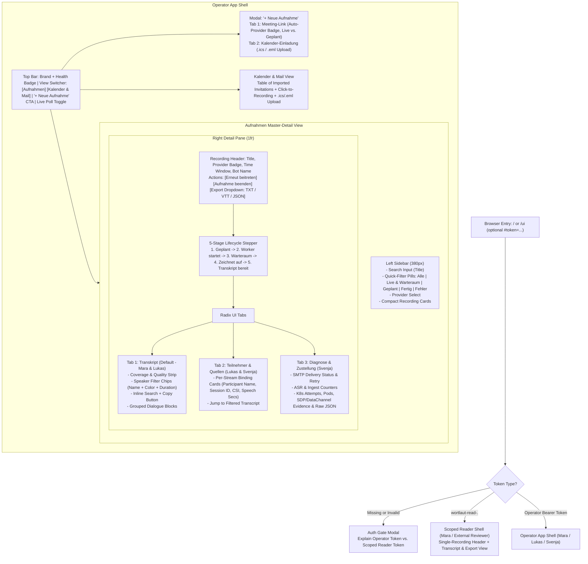
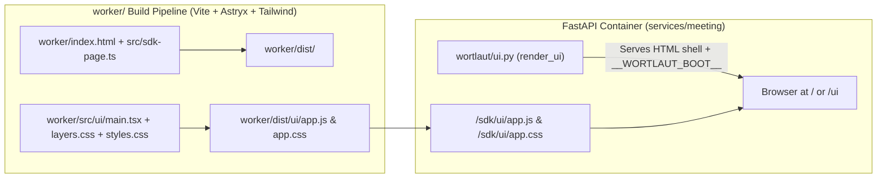

# Persona-Driven Information Architecture and Web UI Redesign

*   **Author:** wortlaut Engineering
*   **Status:** Implemented
*   **Date:** 2026-11-09

--------------------------------------------------------------------------------

## Overview

`wortlaut` records and transcribes Google Meet, Microsoft Teams, Webex, and Zoom meetings inside a self-hosted Kubernetes cluster using isolated Chromium workers and a local Parakeet ASR model. While the backend supports all six core personas defined in [`personas.md`](file:///data/wortlaut/personas.md)—**Mara** (Project/Account Lead), **Lukas** (Consultant/Tech Lead), **Svenja** (Platform Operator), **Dr. Thomas** (External Host/Privacy Officer), **Nina** (Invited Participant/Reader), and **Tim** (API Consumer)—the original web interface in [`services/meeting/src/wortlaut/ui.py`](file:///data/wortlaut/services/meeting/src/wortlaut/ui.py) was a single 920-line inline HTML/JavaScript string originally built as an internal developer debug console.

This design replaces the inline debug page with a structured, persona-aligned Web UI built with **React 19**, **Astryx Design System (`@astryxdesign/core`, `@astryxdesign/theme-stone`, `@stylexjs/stylex`)**, **Tailwind CSS**, **TanStack Query**, and **Lucide Icons**, compiled inside the existing `worker/` build pipeline and served directly by the FastAPI meeting service at `/` and `/ui`.

## The Problem

Opening `https://wortlaut.data.mayflower.zone/ui` currently presents four usability and information-architecture failures:

1.  **Collapsed Persona Boundaries (Reader vs. Operator Collision)**: Selecting a recording renders a single vertical dump where raw internal identifiers (36-character UUIDs, WebRTC track identifiers such as `webrtc:0:receiver:1:track:audio-0`, SDP description counts, CSRC values, and ASR sample counters) appear *above* the transcript. **Mara** and **Lukas** must parse WebRTC debugging telemetry just to read or export meeting notes, while **Svenja** has operational diagnostics split across three banners and a raw JSON `<details>` tag.
2.  **Destructive Full-DOM Polling**: The current UI runs `setInterval(refreshAll, 3000)` and overwrites `panel.innerHTML` on every tick. If **Mara** or **Lukas** selects text in the transcript to copy a quote, expands a diagnostic drawer, or focuses an interactive control, the 3-second poll wipes out their selection, scroll state, and open disclosures.
3.  **Unusable Scoped Reader-Token Flow & Missing Auth Onboarding**: On first load without a token, the UI renders all forms and panels in a broken state with a small password input in the header (`API Bearer Token`). Worse, when **Mara** or **Tim** receives a recording-scoped `export_reader_token` (`wortlaut-read-<id>.<mac>`), entering it into the UI fails with `401 Unauthorized` because the UI unconditionally calls `GET /v1/recordings` and `GET /v1/recordings/{id}`, which only accept the global operator token.
4.  **Opaque Live Join Progression & Buried Calendar Intake**:
    *   The ad-hoc dispatch form permanently occupies the top of the viewport even when browsing historical recordings.
    *   When **Lukas** dispatches a bot into a live call, there is no visual progress stepper indicating whether the bot is booting a worker pod, loading the provider page, waiting in the meeting lobby for host admission (`waiting_admission`), or actively capturing audio.
    *   **Mara**'s primary workflow—calendar and email invitations—is hidden inside a non-interactive `<details>` element at the bottom of the left column with no link to the resulting recording and no way to upload or test an `.ics` or `.eml` invitation from the browser (`POST /v1/calendar/messages`).

## Goals

*   **Persona-Segmented Information Architecture**: Separate the primary workspace via a collapsible Astryx `SideNav` ([`HeaderBar.tsx`](file:///data/wortlaut/worker/src/ui/components/HeaderBar.tsx)) into three clear sections (*Übersicht & Aufnahmen* / [`RecordingSidebar.tsx`](file:///data/wortlaut/worker/src/ui/components/RecordingSidebar.tsx), *Kalender-Automatik* / [`CalendarWorkspace.tsx`](file:///data/wortlaut/worker/src/ui/components/CalendarWorkspace.tsx), and *Hilfe & Systemstatus* / [`SystemView.tsx`](file:///data/wortlaut/worker/src/ui/components/SystemView.tsx)), plus a global `Cmd+K`/`Ctrl+K` `CommandPalette` and a full-page Recording Detail view ([`MeetingDetailView.tsx`](file:///data/wortlaut/worker/src/ui/components/MeetingDetailView.tsx)) with:
    1.  **2-Column Transcript & Speaker Breakdown** (70% [`TranscriptTab.tsx`](file:///data/wortlaut/worker/src/ui/components/TranscriptTab.tsx) on the left, 30% sticky Speaker Talk-Time Breakdown & `.md`/`.txt`/`.vtt`/`.json` Export + Share-Link sidebar on the right — default view for **Mara**, **Lukas**, and **Nina**).
    2.  **Collapsible Technical Disclosure (`Technische Details, Audio-Quellen & Worker-Diagnose`)** housing [`SourcesTab.tsx`](file:///data/wortlaut/worker/src/ui/components/SourcesTab.tsx) (source-to-participant binding verification for **Lukas** and **Svenja**) and [`DiagnosticsTab.tsx`](file:///data/wortlaut/worker/src/ui/components/DiagnosticsTab.tsx) (WebRTC signaling, Kubernetes attempt/pod lifecycle, ASR queue metrics, and SMTP retry controls for **Svenja**).
*   **Dex OIDC User Authentication, Operator Token & Scoped Reader Mode**:
    *   Support browser SSO login via **Dex OIDC Authorization Code + PKCE** ([`oidc.py`](file:///data/wortlaut/services/meeting/src/wortlaut/oidc.py), [`WelcomeLandingView.tsx`](file:///data/wortlaut/worker/src/ui/components/WelcomeLandingView.tsx), [`AuthGateDialog.tsx`](file:///data/wortlaut/worker/src/ui/components/AuthGateDialog.tsx)) issuing `wortlaut-user-…` tokens with per-user recording/calendar isolation (`owner_sub` / `owner_email`, or full operator view via `WORTLAUT_OIDC_ADMIN_EMAILS`).
    *   Support the global operator `WORTLAUT_API_TOKEN` for automation and full administration.
    *   Allow users with a per-recording `export_reader_token` (or URL hash `#token=wortlaut-read-...`) to open `/ui` directly in a focused single-recording Transcript & Export view without requiring an account or operator token, keeping the reader token isolated in `sessionStorage` so a logged-in SSO user can return to their account with one click (*Zurück zu meinem Konto*).
*   **Non-Destructive Reactive Updates via TanStack Query**: Replace full-panel `innerHTML` replacement with React 19 + TanStack Query background polling so text selection, scroll position, active tabs, and open dialogs never reset during live 3-second updates.
*   **Five-Stage Live Participation Stepper**: Provide an explicit visual progress indicator (*Scheduled* $\rightarrow$ *Starting Worker* $\rightarrow$ *Lobby / Waiting for Admission* $\rightarrow$ *Capturing Audio* $\rightarrow$ *Transcript Ready*) in [`ParticipationStepper.tsx`](file:///data/wortlaut/worker/src/ui/components/ParticipationStepper.tsx) with prominent action callouts when host admission or a one-click *Rejoin* (`POST /v1/recordings/{id}/rejoin`) is needed.
*   **Dialog-Grouped Transcript, Full-Text Search & Speaker Filtering**: Group consecutive utterances from the same speaker (within 6.0s pause threshold) into readable dialogue blocks with deterministic speaker avatars/colors, clickable speaker filter chips showing speaking time, server-backed cross-meeting full-text search (`GET /v1/recordings?q=`), inline transcript search highlighting, and one-click Markdown/text clipboard copy.
*   **Interactive Calendar Intake, OAuth2 Calendar Sync & `.ics`/`.eml` Upload**: Elevate Calendar & Mail events to a first-class view ([`CalendarWorkspace.tsx`](file:///data/wortlaut/worker/src/ui/components/CalendarWorkspace.tsx)) with OAuth2 Google Calendar (`calendar.readonly`) and Microsoft 365 (`Calendars.Read`) connections, per-event auto-record toggles (`POST /v1/calendar/oauth/events/{id}/toggle`), direct click-through to linked recordings, and a browser upload/paste dialog for `.ics` and `.eml` invitations (`POST /v1/calendar/messages`).
*   **Single-Container Build Integration**: Compile the React 19 + Astryx Design System + Tailwind application inside the existing `worker/` build stage of [`services/meeting/Dockerfile`](file:///data/wortlaut/services/meeting/Dockerfile) so the runtime architecture remains a single FastAPI container with no separate frontend server.

## Non-Goals

*   **Audio Playback or Waveform Streaming in the Browser**: Raw PCM audio is retained only for ASR segmentation and deleted after 24 hours per privacy requirements (**Dr. Thomas**); the UI will not stream or play back raw meeting audio.
*   **Post-Hoc Manual Speaker Renaming or Voiceprint Diarization**: Speaker attribution strictly reflects verified provider participant bindings ([`AGENTS.md`](file:///data/wortlaut/AGENTS.md)); the UI displays binding evidence and coverage status rather than manual speaker overrides.
*   **Separate Frontend Microservice**: No standalone Node.js or Nginx container will be introduced in Kubernetes or ArgoCD.

## Open Questions

*   **None currently open**: The UI library stack (Option C: React 19 + shadcn/ui + TanStack Query built via the existing `worker/` pipeline) was selected in Step 1.

## Critical User Journeys (CUJs)

### CUJ 1: Lukas Dispatches an Ad-Hoc Bot and Monitors Lobby Admission

*   **Given**: Lukas is in an unplanned Google Meet or Microsoft Teams call and opens `https://wortlaut.data.mayflower.zone/ui` authenticated with the operator token.
*   **When**: Lukas clicks **"+ New Recording"**, pastes the meeting URL (which immediately auto-detects and badges the provider), enters a title and bot display name (`guest_name`), selects *Join Now (Live)*, and submits.
*   **Then**: The modal closes, selects the newly created recording, and displays the 5-stage lifecycle stepper. When the worker reaches `waiting_admission`, the stepper pulses amber with the instruction *"Bot is waiting in the meeting lobby—admit it in your meeting window."* Once admitted, the stepper transitions to *Capturing Audio*, live participant counts and bound speaker chips appear, and transcribed dialogue blocks stream into the *Transcript* tab without resetting Lukas's scroll position or text selection.

### CUJ 2: Mara Reviews a Transcript via Scoped Reader Token or Calendar Intake

*   **Given**: Mara forwarded a customer meeting invitation to `wortlaut` (or uploaded an `.ics` file via the *Calendar & Mail* view) and received a completion notification or a scoped `export_reader_token` (`wortlaut-read-<recording_id>.<mac>`).
*   **When**: Mara opens `/ui` and enters the `wortlaut-read-...` token (or follows a link carrying `#token=wortlaut-read-...`), or clicks the accepted calendar entry in Operator mode.
*   **Then**: The UI detects the recording-scoped token (or selects the linked recording), bypasses the operator-only list endpoint, and opens the *Transcript & Speakers* view directly. Mara filters segments by clicking a speaker chip (e.g., *Anna Schmidt · 4m 12s*), searches for action items, copies formatted dialogue to the clipboard, or downloads the `TXT`, `WebVTT`, or `JSON` export.

### CUJ 3: Svenja Diagnoses a Failed Join or Unbound Audio Source

*   **Given**: A meeting recording ended with `human_verification_required`, `teams_auth_required`, or `attribution_unknown: true`.
*   **When**: Svenja filters the sidebar by *Failed / Warning*, selects the recording, and switches from the *Transcript* tab to the *Participants & Audio Sources* and *Diagnostics & Delivery* tabs.
*   **Then**: Svenja sees the human-readable failure explanation and machine reason code, inspects the per-receiver WebRTC binding table (`provider_source_id`, `signaled_participant_id`, `csi`, speech seconds), checks Kubernetes job/pod UIDs and ASR job queues, triggers a manual SMTP delivery retry (`POST /v1/recordings/{id}/delivery/retry`) if mail failed, or copies the structured diagnostic JSON without the view collapsing during background polling.

## Technical Plan (Architecture)

### 1. High-Level Information Architecture

The UI separates **navigation between top-level domains** from **persona-specific depth inside a selected recording**. Users are never shown raw WebRTC or Kubernetes internals unless they explicitly open the *Participants & Audio Sources* or *Diagnostics & Delivery* tabs.



### 2. Screen Layout & Visual Wireframe

```text
+--------------------------------------------------------------------------------------------------+
| [●] wortlaut   [ Aufnahmen (12) | Kalender & Mail (4) ]      [+ Neue Aufnahme] [Live 3s] [Token] |
+---------------------------------------+----------------------------------------------------------+
| [🔍 Titel suchen...        ] [Prov v] | [Google Meet]  Architektur-Review Q4          [ID kop.]  |
| [Alle] [🔴 Live] [⏳ Geplant] [✅ Fertig] | 07.11.2026, 13:00–14:00 · Bot: wortlaut                  |
|---------------------------------------| Aktionen: [Aufnahme beenden]  [Exporte: TXT | VTT | JSON]|
| > [Meet] Architektur-Review Q4        |----------------------------------------------------------|
|   🔴 Im Warteraum · 07.11. 13:00      | (✓ Geplant)──(✓ Startet)──(● Warteraum!)──(○ Aufnahme)   |
|   ⚠️ Bitte Bot im Meeting zulassen    | ⚠️ Bot wartet im Meeting-Warteraum auf Einlass durch Host|
|---------------------------------------|----------------------------------------------------------|
|   [Teams] Weekly Sync                 | [ Transkript (42) ] [ Teilnehmer & Quellen (3) ] [ Diag ]|
|   ✅ Fertig · 07.11. 11:00 · 34m 12s  |----------------------------------------------------------|
|---------------------------------------| Sprecher: [Alle (42)] [🟢 Anna S. 18m] [🔵 Lukas M. 14m] |
|   [Webex] Kunden-Jour-Fixe            | [🔍 Im Transkript suchen...          ] [📋 Kopieren]     |
|   ⚠️ Abgebrochen · 06.11. 16:00       |                                                          |
|   Grund: Zeitüberschreitung Warteraum | [AS] Anna Schmidt                            00:01:12    |
|                                       |      Willkommen zum Architektur-Review. Lassen Sie uns   |
|                                       |      direkt mit dem Datenmodell starten.                 |
|                                       |                                                          |
|                                       | [LM] Lukas Meyer                             00:01:28    |
|                                       |      Ja, ich teile dazu kurz die aktuellen Metriken.     |
+---------------------------------------+----------------------------------------------------------+
```

### 3. Frontend Component Architecture ([`worker/src/ui/`](file:///data/wortlaut/worker/src/ui))

The UI is structured as a modular TypeScript React 19 application under [`worker/src/ui/`](file:///data/wortlaut/worker/src/ui) using Astryx Design System (`@astryxdesign/core`, `@astryxdesign/theme-stone`, `@stylexjs/stylex`), Tailwind CSS, and `@tanstack/react-query`:

*   **State & Data Fetching ([`worker/src/ui/api.ts`](file:///data/wortlaut/worker/src/ui/api.ts), [`worker/src/ui/types.ts`](file:///data/wortlaut/worker/src/ui/types.ts) & [`worker/src/ui/App.tsx`](file:///data/wortlaut/worker/src/ui/App.tsx))**:
    *   Token & OIDC helpers (`parseTokenAuthMode`, `loadInitialToken`, `saveTokenToStorage`, `getSavedAccountToken`, `exitReaderModeToAccount`, `startOidcLogin`, `completeOidcCallbackIfPresent`, `fetchAuthMe`): Manage token persistence in `localStorage` (`wortlaut_api_token`) and `sessionStorage` (`wortlaut_reader_token`), handle `/auth/callback` PKCE code exchange (`POST /v1/auth/oidc/exchange` and `POST /v1/calendar/oauth/exchange`), and parse the discriminated `AuthMode` union (`{ kind: 'unauthenticated' } | { kind: 'operator'; token: string; user?: OidcUser | null } | { kind: 'reader'; token: string; recordingId: string }`).
    *   Typed API fetchers (`fetchRecordings`, `fetchRecordingDetail`, `fetchTranscript`, `fetchCalendar`, `createRecording`, `cancelRecording`, `deleteRecording`, `rejoinRecording`, `issueReaderToken`, `retryMailDelivery`, `importCalendarPayload`, `startCalendarOAuthLogin`, `syncCalendarConnection`, `updateCalendarConnection`, `deleteCalendarConnection`, `toggleCalendarSyncedEvent`, `downloadExportFile`) consumed by TanStack Query `useQuery` hooks in [`App.tsx`](file:///data/wortlaut/worker/src/ui/App.tsx#L160-L274).
*   **Core View Components**:
    *   [`WelcomeLandingView.tsx`](file:///data/wortlaut/worker/src/ui/components/WelcomeLandingView.tsx) & [`AuthGateDialog.tsx`](file:///data/wortlaut/worker/src/ui/components/AuthGateDialog.tsx): Displayed when unauthenticated; offers one-click **Dex OIDC SSO login** (`Mit Mayflower-Account anmelden (SSO)`) alongside manual token entry for Operator and Scoped Reader tokens.
    *   [`HeaderBar.tsx`](file:///data/wortlaut/worker/src/ui/components/HeaderBar.tsx): Collapsible Astryx `SideNav` with the 3 workspace sections (*Übersicht & Aufnahmen*, *Kalender-Automatik*, *Hilfe & Systemstatus*), `Meeting planen / .ics` modal trigger, `Schnellsuche (⌘K)` CommandPalette trigger, live 3s poll switch, Light/Dark/Auto `SegmentedControl` theme switcher, and user/session profile footer (plus `ReaderTopBar` for Scoped Reader Mode).
    *   [`NewRecordingDialog.tsx`](file:///data/wortlaut/worker/src/ui/components/NewRecordingDialog.tsx): Astryx `Modal` triggered by **"Meeting planen / .ics"** with two tabs:
        1.  *Per Meeting-Link*: URL input with live regex provider detection (`meet.google.com`, `teams.microsoft.com` / `teams.live.com`, `*.webex.com`, `*.zoom.us`), optional title, optional `guest_name`, and mode toggle (*Sofort beitreten* with duration presets vs. *Termin planen* with start/end datetime pickers).
        2.  *Per Kalendereinladung (.ics / .eml)*: File upload or raw text paste submitting to `POST /v1/calendar/messages`.
    *   [`RecordingSidebar.tsx`](file:///data/wortlaut/worker/src/ui/components/RecordingSidebar.tsx): Unified *Übersicht & Aufnahmen* workspace with instant meeting-link dispatch bar, First-Run orientation checklist for new users, upcoming calendar strip, full-text/title/speaker search (`GET /v1/recordings?q=`), provider filter (`google_meet`, `teams`, `webex`, `zoom`), status pills, and recording list table.
    *   [`MeetingDetailView.tsx`](file:///data/wortlaut/worker/src/ui/components/MeetingDetailView.tsx): Full-page recording workspace with a 70/30 2-column layout (`TranscriptTab` on the left; sticky speaker talk-time breakdown, `.md`/`.txt`/`.vtt`/`.json` export buttons, and *Lese-Link teilen* button on the right) and a collapsible technical section at the bottom containing [`SourcesTab.tsx`](file:///data/wortlaut/worker/src/ui/components/SourcesTab.tsx) and [`DiagnosticsTab.tsx`](file:///data/wortlaut/worker/src/ui/components/DiagnosticsTab.tsx).
    *   [`ParticipationStepper.tsx`](file:///data/wortlaut/worker/src/ui/components/ParticipationStepper.tsx): Visual 5-step progress bar mapping `participation`, `processing`, and `participation_reason` / `end_reason` to clear German status stages and recovery buttons (*Erneut beitreten*).
    *   [`TranscriptTab.tsx`](file:///data/wortlaut/worker/src/ui/components/TranscriptTab.tsx):
        *   Computes deterministic speaker colors and two-letter initials from `speaker_label`.
        *   Renders clickable speaker filter chips from `sources_summary` with speech duration.
        *   Groups consecutive segments from the same speaker (where `seg.start - prev.end <= 6.0` seconds and `speaker_label` matches) into cohesive dialogue turns while preserving per-segment timestamps and providing one-click copy as Markdown or plain text.
    *   [`SourcesTab.tsx`](file:///data/wortlaut/worker/src/ui/components/SourcesTab.tsx): Displays per-stream WebRTC receiver bindings (`provider_source_id`, `participant_name`, `signaled_participant_id`, `csi`, `speech_seconds`, `sample_text`) and a one-click filter jump into `TranscriptTab`.
    *   [`DiagnosticsTab.tsx`](file:///data/wortlaut/worker/src/ui/components/DiagnosticsTab.tsx): Displays SMTP delivery status (`retryMailDelivery`), ASR queue metrics, Kubernetes job/pod attempt history, WebRTC signaling counters, and a copyable JSON inspector.
    *   [`CalendarWorkspace.tsx`](file:///data/wortlaut/worker/src/ui/components/CalendarWorkspace.tsx): Manage OAuth2 Google Calendar and Microsoft 365 connections (`auto_record_own`, `auto_record_all`), toggle per-event recording (`toggleCalendarSyncedEvent`), and inspect imported `.ics`/mail invitations (`events`) with one-click navigation to linked recordings.
    *   [`SystemView.tsx`](file:///data/wortlaut/worker/src/ui/components/SystemView.tsx): Operator capacity, provider readiness (`google_meet`, `teams`, `webex`, `zoom`), retention policy, and health status overview.

### 4. Backend API Adjustments (`services/meeting/src/wortlaut/app.py`)

To support the new UI workflows without workarounds:

1.  **Multi-Value `participation` Filter on `GET /v1/recordings`**:
    *   Allow `participation` query parameter in [`list_recordings`](file:///data/wortlaut/services/meeting/src/wortlaut/app.py#L750-L754) to accept comma-separated values (e.g., `participation=scheduled,joining,waiting_admission,capturing`) using `Recording.participation.in_(values)`, while [`App.tsx`](file:///data/wortlaut/worker/src/ui/App.tsx#L199-L231) also supports instant client-side status pill filtering across the loaded recordings page.
2.  **Scoped Reader Token Support on `GET /v1/recordings/{recording_id}`**:
    *   Update `get_recording` in [`services/meeting/src/wortlaut/app.py`](file:///data/wortlaut/services/meeting/src/wortlaut/app.py#L1018-L1150) to accept either the global operator `api_token`, a Dex OIDC owner token, or that recording's `export_reader_token(recording)`. When authenticated via `export_reader_token`, return the recording metadata, `live_status`, and `asr`/`ingest` summary while omitting internal Kubernetes pod/job UIDs and SMTP recipient addresses.

### 5. Build & Asset Serving Pipeline



*   [`worker/package.json`](file:///data/wortlaut/worker/package.json) runs `vite build && vite build --config vite.meet.config.ts && vite build --config vite.ui.config.ts` to compile browser bundles into `worker/dist/`. The dedicated [`worker/vite.ui.config.ts`](file:///data/wortlaut/worker/vite.ui.config.ts) configuration bundles `worker/src/ui/main.tsx` (React 19 + Astryx Design System + TanStack Query + Lucide Icons) and Tailwind CSS into `worker/dist/ui/app.js` and `worker/dist/ui/app.css`.
*   [`services/meeting/Dockerfile`](file:///data/wortlaut/services/meeting/Dockerfile#L1-L16) runs `npm run build` in the `sdk` stage and copies `/worker/dist` to `/app/sdk`, which FastAPI mounts at `/sdk` ([`app.py`](file:///data/wortlaut/services/meeting/src/wortlaut/app.py#L118-L119)). Thus `/sdk/ui/app.js` and `/sdk/ui/app.css` are automatically packaged and served with zero Dockerfile stage additions.
*   [`services/meeting/src/wortlaut/ui.py`](file:///data/wortlaut/services/meeting/src/wortlaut/ui.py) serves the HTML host document that injects `window.__WORTLAUT_BOOT__ = { failureReasons: FAILURE_REASONS, instance: _build_instance_info() }` and loads `/sdk/ui/app.css` and `/sdk/ui/app.js`.

## Alternatives Considered

### Alternative A: Zero-Build Vanilla JavaScript + CSS Custom Properties in `ui.py`

*   **Pros**: Zero npm packages added to `worker/package.json`; no frontend build step required before running Python unit tests; smallest possible payload size.
*   **Cons**: Requires hand-written keyed DOM reconciliation to prevent 3-second polling from wiping text selection, scroll position, and open disclosures. Lacks accessible, keyboard-navigable UI primitives for modals, tabs, dropdowns, and tooltips without re-implementing ARIA state machines from scratch.
*   **Reason for Rejection**: The existing 920-line inline script in [`services/meeting/src/wortlaut/ui.py`](file:///data/wortlaut/services/meeting/src/wortlaut/ui.py) demonstrated that imperative DOM manipulation and string-template re-rendering become brittle and cause destructive polling bugs as soon as multi-tab navigation, speaker filtering, and modal workflows are introduced.

### Alternative B: Preact + `@preact/signals` + Tailwind CSS

*   **Pros**: Very small bundle footprint (~10–15 kB gzipped) while still providing virtual-DOM diffing and reactive state updates inside the existing `worker/` build stage.
*   **Cons**: Requires compatibility shims (`preact/compat`) when integrating Radix UI primitives (`shadcn/ui`) and TanStack Query, which can introduce subtle ref-forwarding and portal focus-trap issues in React 19 ecosystems.
*   **Reason for Rejection**: Since [`services/meeting/Dockerfile`](file:///data/wortlaut/services/meeting/Dockerfile) already runs an `esbuild` pipeline in `node:22-bookworm-slim` for a self-hosted intranet appliance (`wortlaut.data.mayflower.zone`), saving ~100 kB of cached JavaScript does not justify losing native compatibility with Radix UI (`shadcn/ui`) and `@tanstack/react-query`.

### Alternative C: Standalone Next.js / Nginx Frontend Container

*   **Pros**: Complete separation between Python backend and frontend build/runtime lifecycles; supports server-side rendering (SSR) and independent frontend deployments.
*   **Cons**: Violates the single-process architecture defined in [`AGENTS.md`](file:///data/wortlaut/AGENTS.md), requires an additional Kubernetes Deployment, Service, and Ingress path routing in `deploy/dev/` and `data-cluster`, and complicates CORS and token handling.
*   **Reason for Rejection**: `wortlaut` is designed as a single-service meeting appliance where FastAPI serves both the REST API and the Web UI from the same origin and container. Building static assets in the existing `worker` stage of [`services/meeting/Dockerfile`](file:///data/wortlaut/services/meeting/Dockerfile) achieves a modern React 19 UI without adding runtime infrastructure.

--------------------------------------------------------------------------------

## Non-Functional Requirements

*   **Security & Credential Hygiene**:
    *   Neither the Operator Bearer Token nor any `export_reader_token` may ever be sent as a URL query parameter in API requests or logged by the server. If a user opens `/ui#token=wortlaut-read-...`, the token stays in the browser fragment (which is never transmitted in HTTP requests), is read into memory/`localStorage`, and is immediately stripped from `window.location.hash` via `history.replaceState`.
    *   In Scoped Reader Mode (`wortlaut-read-...`), `GET /v1/recordings/{id}` must omit Kubernetes job/pod identifiers and SMTP recipient addresses so external or project-level readers only see meeting metadata, speaker coverage, and transcript data.
*   **Performance & Polling Efficiency**:
    *   Live 3-second polling via TanStack Query must pause automatically when the user unchecks the *Live (3s)* toggle or when the browser tab is hidden (`refetchIntervalInBackground: false`).
    *   Transcript rendering must preserve 60fps scrolling and zero layout shift during polling updates by keying `DialogueGroup` and segment elements deterministically.
*   **Testability & Backward Compatibility**:
    *   Existing API and UI smoke tests (`GET /ui` returning HTTP 200 HTML containing expected root markers and failure reason mappings) must continue to pass even in environments where `sdk/ui/app.js` has or has not been pre-built.

--------------------------------------------------------------------------------

## Detailed Implementation Plan

### Target Files to Create/Modify

#### 1. [`worker/package.json`](file:///data/wortlaut/worker/package.json) & [`worker/package-lock.json`](file:///data/wortlaut/worker/package-lock.json) (Modify)

*   **Type / Scope**: Frontend Build & Dependency Configuration
*   **Proposed Changes**:
    *   Add runtime UI libraries required for the React 19 + Astryx Design System + TanStack Query architecture: `react`, `react-dom`, `@tanstack/react-query`, `@astryxdesign/core`, `@astryxdesign/theme-stone`, `@stylexjs/stylex`, `lucide-react`, `clsx`, and `tailwind-merge`.
    *   Add devDependencies: `@astryxdesign/cli`, `@types/react`, `@types/react-dom`, `@vitejs/plugin-react`, `@tailwindcss/vite`, and `tailwindcss`.
    *   Update the `"build"` script to include `vite build --config vite.ui.config.ts` so the UI bundle is built alongside the Webex SDK and Meet capture bundles.
*   **Rationale**: Integrates the React 19 + Astryx Design System + TanStack Query dependency tree into the existing `worker` package that [`services/meeting/Dockerfile`](file:///data/wortlaut/services/meeting/Dockerfile) already builds.

#### 2. [`worker/tsconfig.json`](file:///data/wortlaut/worker/tsconfig.json) (Modify)

*   **Type / Scope**: TypeScript Compiler Configuration
*   **Proposed Changes**:
    *   Add `"jsx": "react-jsx"` to `compilerOptions` and include `"src/**/*.tsx"` in the `include` array so `npm --prefix worker run typecheck` validates all React UI components strictly.
*   **Rationale**: Ensures all UI components and API response types are statically checked during `make lint`.

#### 3. [`worker/vite.ui.config.ts`](file:///data/wortlaut/worker/vite.ui.config.ts) (Create)

*   **Type / Scope**: Vite Build Configuration
*   **Proposed Changes**:
    *   Configure Vite with `@vitejs/plugin-react` and Tailwind CSS to compile `src/ui/main.tsx` into `dist/ui/app.js` and `dist/ui/app.css` with deterministic asset filenames (`entryFileNames: "app.js"`, `assetFileNames: "app.[ext]"`).
*   **Rationale**: Produces predictable static bundle paths (`/sdk/ui/app.js` and `/sdk/ui/app.css`) that [`services/meeting/src/wortlaut/ui.py`](file:///data/wortlaut/services/meeting/src/wortlaut/ui.py) can reference directly without manifest parsing.

#### 4. [`worker/src/ui/layers.css`](file:///data/wortlaut/worker/src/ui/layers.css) & [`worker/src/ui/styles.css`](file:///data/wortlaut/worker/src/ui/styles.css) (Create)

*   **Type / Scope**: Design System Layers & Tailwind Stylesheet
*   **Proposed Changes**:
    *   Declare CSS cascade layers (`@layer priority1, ...`) in `layers.css` for `@astryxdesign/core` StyleX rules and import Tailwind CSS and theme variables in `styles.css`.
*   **Rationale**: Establishes consistent visual hierarchy, typography, spacing, and Light/Dark/System theme variables across all views and modals.

#### 5. [`worker/src/ui/types.ts`](file:///data/wortlaut/worker/src/ui/types.ts) & [`worker/src/ui/api.ts`](file:///data/wortlaut/worker/src/ui/api.ts) (Create)

*   **Type / Scope**: TypeScript API Client & Auth/OAuth Helpers
*   **Proposed Changes**:
    *   Define TypeScript interfaces for `Provider` (`'google_meet' | 'teams' | 'webex' | 'zoom'`), `RecordingSummary`, `RecordingDetail`, `TranscriptExport`, `TranscriptSegment`, `SourceSummary`, `CalendarEvent`, `CalendarConnection`, `CalendarSyncedEvent`, and `AuthMode` (`{ kind: 'unauthenticated' } | { kind: 'operator'; token: string; user?: OidcUser | null } | { kind: 'reader'; token: string; recordingId: string }`).
    *   Implement token parsing logic (`parseTokenAuthMode`, `loadInitialToken`) that detects `wortlaut-read-<uuid>.<mac>` vs. `wortlaut-user-...` OIDC and operator tokens, extracts `#token=...` from `window.location.hash` on startup into `sessionStorage`, and strips the hash via `history.replaceState`.
    *   Provide typed API fetchers and mutation helpers (`fetchRecordings`, `fetchRecordingDetail`, `fetchTranscript`, `fetchCalendar`, `createRecording`, `cancelRecording`, `deleteRecording`, `rejoinRecording`, `issueReaderToken`, `retryMailDelivery`, `importCalendarPayload`, `startCalendarOAuthLogin`, `syncCalendarConnection`, `updateCalendarConnection`, `deleteCalendarConnection`, `toggleCalendarSyncedEvent`, `downloadExportFile`).
*   **Rationale**: Centralizes authentication, OAuth2 PKCE flows, error formatting, and non-destructive 3-second polling via `@tanstack/react-query`.

#### 6. [`worker/src/ui/components/ui/primitives.tsx`](file:///data/wortlaut/worker/src/ui/components/ui/primitives.tsx) (Create)

*   **Type / Scope**: Reusable Domain Status & Theme Primitives
*   **Proposed Changes**:
    *   Implement `ThemeModeContext` / `useThemeMode` (`'light' | 'dark' | 'system'`), `ProviderBadge` (`google_meet`, `teams`, `webex`, `zoom` via `@astryxdesign/core/Token`), `StatusIndicator`, and `StatusBadge` (via `@astryxdesign/core/StatusDot`).
*   **Rationale**: Provides shared provider and participation status badges across tables, headers, and detail views.

#### 7. [`worker/src/ui/components/HeaderBar.tsx`](file:///data/wortlaut/worker/src/ui/components/HeaderBar.tsx) & [`worker/src/ui/components/AuthGateDialog.tsx`](file:///data/wortlaut/worker/src/ui/components/AuthGateDialog.tsx) (Create)

*   **Type / Scope**: Side Navigation, Reader Header, Session Control & Onboarding Modal
*   **Proposed Changes**:
    *   `HeaderBar`: Renders the collapsible Astryx `SideNav` with brand heading (`Meet · Teams · Webex · Zoom`), `/health/ready` live status dot, workspace navigation (`Übersicht & Aufnahmen`, `Kalender-Automatik`, `Hilfe & Systemstatus`), **`Meeting planen / .ics`** modal button, **`Schnellsuche (⌘K)`** trigger, 3-second live-refresh switch, Light/Dark/Auto `SegmentedControl` theme switcher, and user profile / session footer (plus `ReaderTopBar` for Scoped Reader Mode).
    *   `AuthGateDialog`: Renders a clean onboarding dialog when switching credentials or after a `401` response, supporting Dex OIDC SSO login, Operator Token, and Scoped Reader Token (`wortlaut-read-...`).
*   **Rationale**: Eliminates the broken unauthenticated state and provides a structured frame-first navigation layout.

#### 8. [`worker/src/ui/components/NewRecordingDialog.tsx`](file:///data/wortlaut/worker/src/ui/components/NewRecordingDialog.tsx) (Create)

*   **Type / Scope**: Ad-Hoc Dispatch & `.ics`/`.eml` Upload Modal (**Lukas** & **Mara**)
*   **Proposed Changes**:
    *   Astryx `Modal` containing two tabs:
        1.  *Meeting-Link starten*: Meeting URL input with instant provider detection badge (*Google Meet*, *Microsoft Teams*, *Cisco Webex*, *Zoom*), optional title, optional bot display name (`guest_name`), mode selector (*Sofort beitreten (Live)* with duration presets vs. *Termin planen* with `datetime-local` inputs), and submit action.
        2.  *Kalendereinladung importieren (.ics / .eml)*: File upload dropzone and raw text paste area calling `POST /v1/calendar/messages`, displaying imported event status and jumping directly to the created recording.
*   **Rationale**: Gives **Lukas** a fast, guided dispatch modal and gives **Mara** a browser-based `.ics`/`.eml` import workflow.

#### 9. [`worker/src/ui/components/RecordingSidebar.tsx`](file:///data/wortlaut/worker/src/ui/components/RecordingSidebar.tsx) & [`worker/src/ui/components/CalendarWorkspace.tsx`](file:///data/wortlaut/worker/src/ui/components/CalendarWorkspace.tsx) (Create)

*   **Type / Scope**: Master Navigation Views (**Mara**, **Lukas**, **Svenja**)
*   **Proposed Changes**:
    *   `RecordingSidebar`: Instant meeting-link dispatch bar, First-Run orientation checklist, upcoming calendar strip, full-text/title/speaker search (`#title-search`), provider selector (`#provider-filter`), status quick-filter pills (`Alle`, `Live & Warteraum`, `Geplant`, `Fertig`, `Fehler`), and recording list table showing titles, provider badges, status badges, speaker badges, duration, and failure hints.
    *   `CalendarWorkspace`: Full-width workspace for OAuth2 Google/Microsoft calendar connections, synced calendar events with 1-click auto-record toggles, and imported `.ics`/instant-email invitations with one-click navigation to linked recordings.
*   **Rationale**: Elevates calendar intake and OAuth2 calendar sync to a first-class workspace and makes finding active, failed, or completed recordings immediate.

#### 10. [`worker/src/ui/components/ParticipationStepper.tsx`](file:///data/wortlaut/worker/src/ui/components/ParticipationStepper.tsx) (Create)

*   **Type / Scope**: Five-Stage Lifecycle Progress Component (**Lukas** & **Dr. Thomas**)
*   **Proposed Changes**:
    *   Visualizes the five participation stages (*1. Eingeplant* $\rightarrow$ *2. Worker startet* $\rightarrow$ *3. Warteraum / Einlass* $\rightarrow$ *4. Zeichnet auf* $\rightarrow$ *5. Transkript bereit*).
    *   Highlights `waiting_admission` with an amber callout instructing the host to admit the bot, displays live stream/participant counters during `capturing`, and renders clear German error explanations (`FAILURE_REASONS`) with a direct **Erneut beitreten** (`#rejoin-rec-btn`) action when a join attempt fails.
*   **Rationale**: Provides unambiguous real-time feedback during the critical meeting join and lobby admission window.

#### 11. [`worker/src/ui/components/TranscriptTab.tsx`](file:///data/wortlaut/worker/src/ui/components/TranscriptTab.tsx), [`worker/src/ui/components/SourcesTab.tsx`](file:///data/wortlaut/worker/src/ui/components/SourcesTab.tsx), & [`worker/src/ui/components/DiagnosticsTab.tsx`](file:///data/wortlaut/worker/src/ui/components/DiagnosticsTab.tsx) (Create)

*   **Type / Scope**: Persona-Separated Recording Detail Tabs (**Mara**, **Lukas**, **Svenja**)
*   **Proposed Changes**:
    *   `TranscriptTab`: Displays a concise attribution/quality banner, clickable speaker filter chips (with deterministic speaker colors, initials, and speaking time), inline search (`#segment-search`), one-click clipboard copy (`#copy-transcript-btn`), and dialogue-grouped speaker paragraphs.
    *   `SourcesTab`: Displays per-stream WebRTC participant bindings (`provider_source_id`, `participant_name`, `signaled_participant_id`, `csi`, `speech_seconds`, sample quote) and a button to filter the transcript by that source.
    *   `DiagnosticsTab`: Displays SMTP delivery status with retry button (`#retry-mail-btn`), ASR job queue counters, Kubernetes worker attempt/pod metadata, WebRTC SDP/DataChannel counters, and a copyable JSON inspector.
*   **Rationale**: Gives each persona a dedicated tab tailored to their task without cluttering the default transcript reading experience.

#### 12. [`worker/src/ui/App.tsx`](file:///data/wortlaut/worker/src/ui/App.tsx) & [`worker/src/ui/main.tsx`](file:///data/wortlaut/worker/src/ui/main.tsx) (Create)

*   **Type / Scope**: Application Root & QueryClient Provider
*   **Proposed Changes**:
    *   Mount `QueryClientProvider` and `App`, orchestrating Operator Mode vs. Scoped Reader Mode, selected recording state, active workspace view, and modal dialogs.
*   **Rationale**: Connects all UI views and reactive queries into the single-page application root.

#### 13. [`services/meeting/src/wortlaut/app.py`](file:///data/wortlaut/services/meeting/src/wortlaut/app.py) (Modify)

*   **Type / Scope**: FastAPI Backend Endpoints
*   **Proposed Changes**:
    *   In `list_recordings` (`GET /v1/recordings`), allow `participation` to accept comma-separated status values (e.g., `capturing,waiting_admission,joining,preparing`) using `Recording.participation.in_(...)`.
    *   In `get_recording` (`GET /v1/recordings/{recording_id}`), accept either the global operator `api_token` or the recording's `export_reader_token(recording)`. When accessed with a scoped reader token, return a sanitized recording summary (omitting Kubernetes `job_name`/`job_uid`/`pod_uids` and SMTP `accepted_recipients`) so Scoped Reader Mode can render the recording header and lifecycle status alongside `/transcript`.
*   **Rationale**: Enables multi-status quick-filter pills and full Scoped Reader Mode in `/ui`.

#### 14. [`services/meeting/src/wortlaut/ui.py`](file:///data/wortlaut/services/meeting/src/wortlaut/ui.py) & [`scripts/setup.sh`](file:///data/wortlaut/scripts/setup.sh) (Modify)

*   **Type / Scope**: HTML Host Shell & Setup Script
*   **Proposed Changes**:
    *   Update `render_ui()` in [`services/meeting/src/wortlaut/ui.py`](file:///data/wortlaut/services/meeting/src/wortlaut/ui.py) to serve the clean HTML host document with `<div id="root"></div>`, `window.__WORTLAUT_BOOT__ = { failureReasons: FAILURE_REASONS }`, `<link rel="stylesheet" href="/sdk/ui/app.css">`, and `<script type="module" src="/sdk/ui/app.js"></script>`, while preserving key semantic markers tested by existing backend tests.
    *   Update [`scripts/setup.sh`](file:///data/wortlaut/scripts/setup.sh) to run `npm --prefix worker run build` after `npm --prefix worker ci` so local development and test runs always have `worker/dist/ui/` available.
*   **Rationale**: Replaces the 920-line inline script with the compiled React 19 bundle while keeping `GET /ui` fast and self-contained.

#### 15. [`services/meeting/tests/test_recordings.py`](file:///data/wortlaut/services/meeting/tests/test_recordings.py) (Modify)

*   **Type / Scope**: Integration & API Tests
*   **Proposed Changes**:
    *   Extend `test_persona_workflows_rejoin_desc_filters_reader_token_and_metrics` to verify:
        1. Comma-separated `participation=capturing,waiting_admission` filtering on `GET /v1/recordings`.
        2. Scoped `export_reader_token` access on `GET /v1/recordings/{recording_id}` (verifying that meeting metadata is returned while Kubernetes pod/job UIDs are omitted).
        3. Serving of `/ui` and `/sdk/ui/app.js` + `/sdk/ui/app.css`.
*   **Rationale**: Protects the new backend filter and scoped reader contracts with real PostgreSQL integration assertions.

### Verification Plan

*   **Compilation/Build**: `npm --prefix worker run build` must compile the Webex SDK, Meet capture script, and React 19 UI bundle (`worker/dist/ui/app.js` and `worker/dist/ui/app.css`) with zero errors.
*   **Static Analysis & Linting**: `make lint` (`uv run --directory services/meeting ruff check src tests` and `npm --prefix worker run typecheck`) must pass with zero warnings or errors.
*   **Unit & Integration Tests**:
    *   `npm --prefix worker test` (worker unit tests).
    *   `uv run --directory services/meeting pytest tests/test_recordings.py tests/test_calendar.py` against PostgreSQL 17 and RustFS.
*   **Cluster Deployment & Live Verification**:
    *   Build and push `wortlaut-meeting` and `wortlaut-worker` images via Kubernetes BuildKit, roll out via `data-cluster` / ArgoCD, and verify `https://wortlaut.data.mayflower.zone/ui` and `https://wortlaut.data.mayflower.zone/sdk/ui/app.js`.

--------------------------------------------------------------------------------

*Drafted with EGM*
