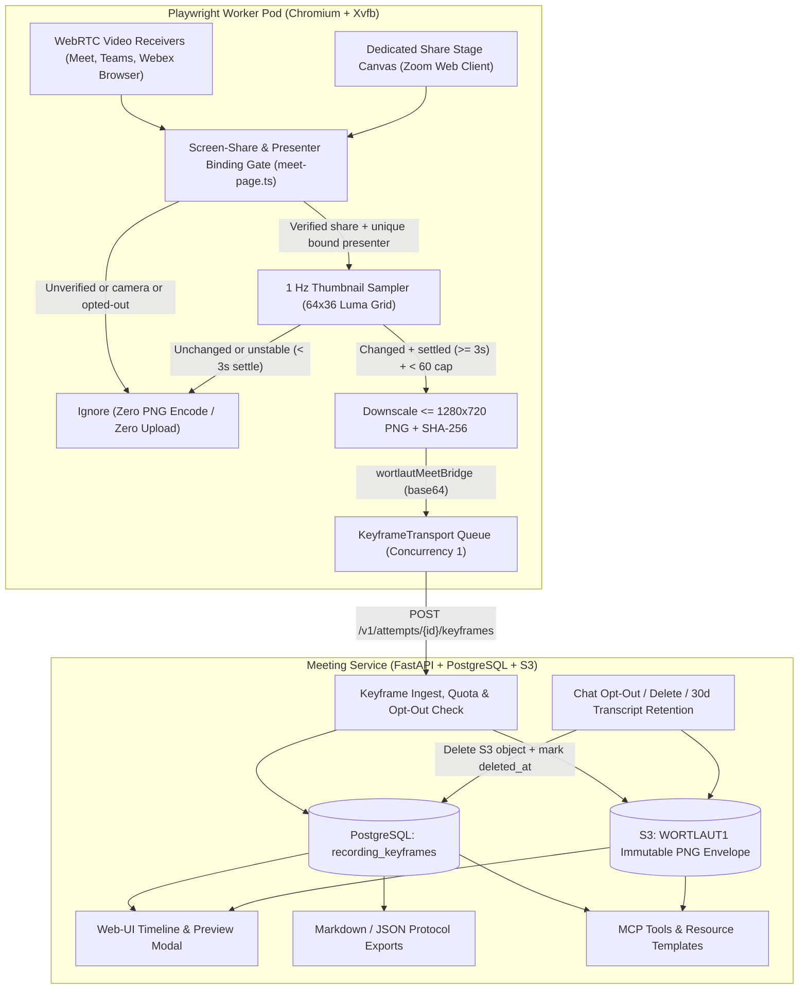

# Slide-Change Keyframes on Screen-Share Tracks Only

*   **Author:** johann
*   **Status:** Draft
*   **Date:** 2026-11-14

--------------------------------------------------------------------------------

## Overview

`wortlaut` joins online meetings across Google Meet, Microsoft Teams, Webex, and Zoom to produce speaker-attributed transcripts without recording continuous video or using voiceprint biometrics. Audio-only transcripts fail whenever participants discuss visual material shared on screen—such as architecture diagrams, slide decks, spreadsheets, or code diffs—because spoken references like *"this bottleneck here"* or *"column C"* carry no meaning without the shared visual state.

This design adds **Slide-Change Keyframes on Screen-Share Tracks Only**: the meeting worker captures sparse static PNG snapshots solely from verified screen-share feeds when the displayed content changes and settles, aligns each snapshot to the meeting timeline, and exposes those snapshots in the Web-UI protocol, Markdown/JSON exports, and Model Context Protocol (MCP) resources. Participant face cameras are never decoded, sampled, or stored.

## The Problem

Engineering, product, and operations meetings routinely revolve around a shared screen. Today, `wortlaut` captures isolated per-participant audio streams via WebRTC (Web Real-Time Communication, the browser media protocol) and transcribes speech into timestamped text, while discarding all visual context. Readers reviewing a protocol days later—or querying a meeting through an MCP coding agent—encounter three recurring gaps:

1.  **Deictic speech loses its referent:** Statements such as *"let's cut the middle queue on this diagram"* or *"we agreed on option two on the slide"* cannot be reconstructed from spoken words alone when the slide text or diagram labels were never read aloud.
2.  **Full meeting video is disproportionate:** Commercial meeting bots solve visual context by recording continuous MP4 video of the entire call, including participant webcams. Continuous video multiplies object-storage volume by orders of magnitude, records facial expressions and home backgrounds, and creates high European data-protection (GDPR) compliance barriers.
3.  **Unfiltered frame capture leaks accidental desktop state and threatens audio reliability:** Snapping frames whenever pixels move on any incoming video feed creates three failure modes:
    *   **Camera misclassification:** If the worker cannot prove from conference signaling that an incoming video feed is a screen share rather than a participant webcam, a single misclassified frame records a person's face.
    *   **Transient desktop exposure:** Presenters sharing an entire monitor frequently flash chat notifications, email inboxes, password managers, or browser tabs for one to two seconds while switching windows. Immediate change triggers turn accidental flashes into persisted images.
    *   **Worker CPU contention:** `wortlaut` workers run Chromium inside CPU-only Kubernetes pods using a software virtual framebuffer (`Xvfb`) alongside real-time audio resampling (`AudioWorklet`). Continuous high-resolution video decoding and pixel comparison during terminal scrolling, cursor movement, or embedded video playback can starve the audio clock and generate hundreds of redundant images.

`wortlaut` needs a way to preserve the discrete visual states presenters intentionally show to the room—slides, diagrams, documents, and static views—without recording participant cameras, capturing transient window-switch accidents, violating live chat opt-out rules, or degrading audio capture.

## Goals

*   **Zero participant-camera capture:** Capture static frames exclusively from media sources positively identified by provider signaling or dedicated screen-share DOM (Document Object Model) surfaces as screen shares. If screen-share vs. camera identity is unknown or ambiguous, capture zero frames (fail closed).
*   **Settled visual state capture:** Record a keyframe only after a visual change exceeds a structural difference threshold *and* remains stable across a 3-second settle window, filtering out transient window switches, mouse movement, and live scrolling.
*   **Bounded resource and storage footprint:** Cap keyframe evaluation rate (at most 1 low-resolution comparison sample per second while a screen share is active) and enforce hard per-meeting limits (`<= 60` keyframes per recording and a `5 s` minimum cooldown between captures after the opening slide) with zero increase in `AudioCapture.inspectClock().total_interruptions` (`audio_clock.total_interruptions`).
*   **Timeline-accurate protocol alignment:** Anchor every captured keyframe to the unified UTC recording timeline used by transcript segments so the Web-UI protocol view, Markdown/JSON exports, and MCP clients display each slide inline with the spoken turns that occurred while it was on screen—including across worker rejoins.
*   **Informed participant transparency, opt-out, and access control:** Update `/privacy` and the live in-call chat notice when keyframes are enabled, honor `wortlaut`'s live in-call chat opt-out (`nein` / `opt out`) for presenters, allow authorized recording operators/attendees (`can_access_recording`) to delete individual keyframes, and enforce `Authorization: Bearer` owner/attendee/share-token/MCP access controls on all keyframe reads.

## Non-Goals

*   **Continuous video or animation recording:** Recording MP4/WebM video clips, frame-by-frame screen casts, or embedded video playback shown during a screen share is out of scope.
*   **Participant webcam or gallery capture:** Capturing participant faces, avatars, reactions, or gallery tiles—including speaker-spotlight views—is out of scope.
*   **Automated cloud vision or biometric analysis:** Sending keyframes to external vision models, running facial detection/recognition, or computing participant attention scores is out of scope.
*   **Capturing rapid transient edits:** Capturing every line scrolled in a terminal or every keystroke typed live in an editor before the view settles is out of scope; the feature targets settled visual states.
*   **Bypassing provider media boundaries:** Circumventing conference host permissions or fabricating screen-share support on providers or runtime modes where signaling cannot separate screen share from camera video is out of scope; unverified or unsupported modes report their `keyframes.capability` state explicitly.

## Open Questions

None.

## Critical User Journeys (CUJs)

### CUJ 1: Reviewing an Architecture Discussion with Slide Context

*   **Given**: A user records a 45-minute Google Meet, Microsoft Teams, Webex, or Zoom architecture review in `wortlaut` during which a colleague shares 8 slides and a system diagram, while 5 participants have their face cameras turned on.
*   **When**: The meeting ends and an authorized user opens the protocol in the `wortlaut` Web-UI (or reads the recording via an authenticated MCP client).
*   **Then**: Only the 8 settled screen-share states appear inline at the timestamps where each slide or diagram appeared; zero participant webcam frames were captured or uploaded; clicking a keyframe opens the full-size preview modal; and authorized recording operators/attendees can delete any individual keyframe from the protocol.

### CUJ 2: Filtering Accidental Window Switches During Desktop Share

*   **Given**: `wortlaut` is capturing an active meeting where a presenter shares their entire desktop and alt-tabs past a private chat window and password manager for 1.5 seconds before stopping on a spreadsheet for 40 seconds.
*   **When**: The worker's screen-share observer evaluates incoming screen-share frames.
*   **Then**: The 1.5-second intermediate views fail the 3-second stability settle window and are discarded in memory without encoding a PNG or transmitting bytes to the meeting service; once the spreadsheet remains stable across the settle window, a single keyframe is captured and anchored to the UTC timestamp when the spreadsheet first appeared.

### CUJ 3: Live In-Call Opt-Out by a Screen-Sharing Presenter

*   **Given**: `wortlaut` posts its in-call chat notice (informing participants that spoken statements and static screen-share snapshots can be excluded via `nein` / `opt out`), and participant Alice shares her screen generating two keyframes before typing `nein` (or `opt out`) in chat.
*   **When**: `wortlaut` detects Alice's chat opt-out message.
*   **Then**: Future screen-share frames from Alice are suppressed immediately in the worker alongside her audio stream, and any keyframes already uploaded from Alice's screen share are deleted from S3 object storage and marked soft-deleted in PostgreSQL so none appear in the protocol, exports, or MCP responses.

## Technical Plan (Architecture)

### High-Level Data Flow

### 1. Strict Source Admission & Presenter Binding (Worker)

All four browser providers execute [`meet-page.ts`](../../worker/src/meet-page.ts) via [`installMeetCapture`](../../worker/runtime/meet.ts). The worker never samples arbitrary `<video>` or `<canvas>` elements; every candidate visual source must pass two independent gates inside `meet-page.ts` before a single pixel is read:

1.  **Positive Screen-Share Classification (Fail-Closed Camera Exclusion):**
    *   **Microsoft Teams ([`meet-page.ts`](../../worker/src/meet-page.ts)):** Extend conference roster/signaling parsing to record video CSIs (Contributing Source Identifiers, the conference signaling media-source IDs) in a dedicated `share_video_csis` set—isolated from `audio_csis`—exclusively from entries typed as screen/application sharing, while denylisting standard participant camera entries.
    *   **Webex Browser ([`meet-page.ts`](../../worker/src/meet-page.ts)):** Extend session and `multistream` `VIDEO` signaling parsing to map `SLIDES` slot SSRCs and CSIs to their owning `participant_id` while denylisting `MAIN` camera SSRCs. In legacy Webex Guest-Issuer SDK mode (`enable_webex_browser=False` via [`webex.ts`](../../worker/src/webex.ts) / [`page.ts`](../../worker/src/page.ts)), incoming share video remains disabled and the worker reports `keyframes.capability = "unsupported"`.
    *   **Google Meet ([`meet-page.ts`](../../worker/src/meet-page.ts)):** Admit a remote `RTCRtpReceiver` (`track.kind === "video"`) only when per-`m=video` SDP signaling or Meet's screencast DOM/data-channel state positively classifies that specific stream/track as a presentation feed, excluding all camera `[data-participant-id]` tiles, `pc.getSenders()`, and `wortlaut`'s own virtual status tile (`__wortlautVirtualVideo` in [`video-tile.ts`](../../worker/runtime/video-tile.ts)).
    *   **Zoom Web Client ([`meet-page.ts`](../../worker/src/meet-page.ts), [`zoom-browser.ts`](../../worker/runtime/zoom-browser.ts)):** Keep participant camera gallery feeds disabled (`stopIncomingVideoIfPossible`), and admit only Zoom's dedicated screen-share stage `<canvas>` inside a verified active sharing container—never bare Speaker View (`#sv-active-video`) or gallery/avatar surfaces.
2.  **Mandatory Pre-Capture Presenter Binding & Subscribed Element Reuse:**
    *   Before sampling begins, the screen-share source must resolve to **one unique** non-opted-out `participant_id` (via WebRTC signaling on Meet, Teams, and Webex Browser, or by matching Zoom's active screen-share presenter banner to a unique roster `participant_id` in `meet-page.ts`). If `participant_id` is unbound, ambiguous (`> 1` roster name match on Zoom), belongs to `wortlaut`, or matches `isParticipantOptedOut(participant_id, participant_name)`, the tick is discarded (`dropped_unverified` or `dropped_opted_out`).
    *   For admitted WebRTC video tracks, `meet-page.ts` samples the conference web client's already-subscribed presentation `<video>` element bound to that `MediaStreamTrack` (attaching a single muted fallback `<video>` only if no subscribed DOM `<video>` is present, and tearing it down immediately on opt-out, unbind, or track end). Reusing the subscribed presentation `<video>` ensures the conference SFU (Selective Forwarding Unit) continues forwarding frames without allocating duplicate Chromium `/dev/shm` video framebuffers.
    *   An active, presenter-bound screen share counts as room activity in [`main.ts`](../../worker/runtime/main.ts)'s `shouldStopForEmptyRoom()` check so silent diagram walkthroughs do not trigger premature empty-room disconnects.

### 2. Low-Overhead Change Detection & Settle Filter (`worker/src/keyframes.ts`)

To preserve `AudioWorklet` clock stability (`AudioCapture.inspectClock().total_interruptions`) inside CPU-only `Xvfb` worker pods, [`keyframes.ts`](../../worker/src/keyframes.ts) evaluates admitted screen shares at **1 Hz** on a **64 × 36 grayscale grid** (`2,304` bytes):

1.  **Blank / Transition Rejection:** Uniform black, white, or empty loading buffers failing minimum luminance variance are skipped without starting a candidate window.
2.  **Structural Block-Difference Filter:** The `64 × 36` grid is partitioned into `16 × 9` blocks so full-slide transitions and localized diagram/code updates trigger a candidate change while blinking cursors, mouse pointers, and clock ticks are ignored.
3.  **3-Second Settle Window & Onset UTC Timestamping:** A candidate visual state must remain stable across `3` consecutive 1 Hz ticks before encoding. Transient window switches or live scrolling reset the candidate without encoding a PNG. When the opening slide (`lastCommittedAtMs = null`) or a subsequent slide (`>= 5,000 ms` after the previous commit, up to `< 60` keyframes) settles, the sampler downscales the frame proportionally within `1280 × 720`, encodes `image/png` (`<= 1.5 MiB`), computes WebCrypto SHA-256, and anchors `captured_at` to the UTC onset timestamp when the settled view first appeared (via [`capture.ts`](../../worker/src/capture.ts)'s monotonic-to-UTC clock).

### 3. Decoupled Worker-to-Service Upload Protocol

In `wortlaut`, a `Recording` represents the logical meeting protocol, while an `Attempt` represents one ephemeral Kubernetes worker pod execution for that `Recording` (replaceable on pod restart or `POST /v1/recordings/{id}/rejoin`). Keyframe PNGs (`~60–250 KiB` each) never traverse the `/v1/attempts/{attempt_id}/audio` WebSocket ([`transport.ts`](../../worker/src/transport.ts)), isolating real-time PCM audio from PNG upload backpressure:

*   **Page-to-Node Bridge:** `meet-page.ts` sends base64-encoded PNG frames over the existing [`wortlautMeetBridge`](../../worker/runtime/meet.ts) (`MeetBridgeMessage` union extended with `type: 'keyframe'`), reusing `source.frame === captureFrame` cross-origin iframe verification and bridge backpressure bounds without adding a second Playwright `exposeBinding`.
*   **HTTP Upload Endpoint:** `POST /v1/attempts/{attempt_id}/keyframes` accepts raw `Content-Type: image/png` bytes with `Authorization: Bearer <attempt_credential>`, `X-Worker-ID: <worker_id>`, and base64url JSON metadata in `X-Wortlaut-Keyframe` (avoiding any new `python-multipart` dependency).
*   **Authentication & Queue Semantics:** [`app.py`](../../services/meeting/src/wortlaut/app.py) authenticates the worker via `authenticated_attempt(attempt_id, db, authorization)` + `X-Worker-ID` ownership check under the `Recording` row lock. Node-side `worker/runtime/keyframe-transport.ts` uploads sequentially (concurrency `1`, max `8` queued frames, retrying transient `5xx`/network errors via [`http.ts`](../../worker/runtime/http.ts) conventions while never retrying `4xx`, halting further capture on `409 keyframe_limit_reached` / `409 keyframes_disabled`, and dropping opted-out frames on `409 presenter_opted_out`), and drains with a 10-second bound during `stop()`.
*   **Diagnostics:** `POST /v1/attempts/{attempt_id}/status` (`WorkerStatus` in [`app.py`](../../services/meeting/src/wortlaut/app.py)) reports `keyframes: {capability, active_share, evaluated_ticks, emitted, uploaded, dropped_unverified, dropped_opted_out, dropped_queue_full}` where `capability` is `"disabled" | "unsupported" | "unverified" | "active"`.

### 4. Persistence, S3 Envelope, Opt-Out Purge, & Retention (`services/meeting`)

*   **Database Schema ([`models.py`](../../services/meeting/src/wortlaut/models.py), migration `0029_recording_keyframes.py`):**
    Table `recording_keyframes` stores `id`, `recording_id`, `attempt_id`, `sequence` (`UniqueConstraint("attempt_id", "sequence")`), `provider_source_id`, non-null `participant_id`, nullable `participant_name`, `captured_at` (indexed with `recording_id`), `width`, `height`, `byte_size`, `sha256`, `object_key`, and nullable `deleted_at`. Timeline offsets are **not** stored on `recording_keyframes`; [`exports.py`](../../services/meeting/src/wortlaut/exports.py) derives `offset_seconds` dynamically from `captured_at` relative to the unified multi-attempt recording timeline origin.
*   **Immutable S3 Storage & Cluster Quota ([`storage.py`](../../services/meeting/src/wortlaut/storage.py), [`ingest.py`](../../services/meeting/src/wortlaut/ingest.py)):**
    PNG bytes are stored at `keyframes/{recording_id}/{attempt_id}/{sequence:04d}.png` inside [`AudioStorage`](../../services/meeting/src/wortlaut/storage.py)'s existing `WORTLAUT1` envelope (`IfNoneMatch="*"`, deterministic JSON `contract` header, SHA-256 verification). Active `RecordingKeyframe.byte_size` (`deleted_at IS NULL`) is folded into `capacity_reached()` ([`ingest.py`](../../services/meeting/src/wortlaut/ingest.py)) under `pg_advisory_xact_lock(749836123)` against `max_stored_audio_bytes` (`507 storage_capacity_reached`) and exposed in `/metrics`.
*   **Participant Transparency (`/privacy` & Chat Intro):**
    [`ui.py`](../../services/meeting/src/wortlaut/ui.py) updates `/privacy` (DE/EN) and `_build_instance_info(settings)`, and [`app.py`](../../services/meeting/src/wortlaut/app.py) updates `build_chat_intro()` when `enable_keyframes=True` so participants are informed before sharing their screen that cameras are never recorded and static screen-share snapshots are stored for up to 30 days with `nein` / `opt out` deletion.
*   **Live Opt-Out & Authorized Deletion:**
    *   `purge_opted_out_keyframes(db, recording, attempts)` ([`processing.py`](../../services/meeting/src/wortlaut/processing.py)) runs synchronously alongside `purge_opted_out_transcript_segments` in `POST /v1/attempts/{attempt_id}/status` and `PATCH /v1/recordings/{recording_id}`. It sets `deleted_at = now` and `participant_name = None`, deletes each S3 object via `storage.delete_object(kf.object_key)`, and clears `object_key = ""` once S3 deletion succeeds (leaving non-empty `object_key` on transient S3 errors so `retention_pass` retries S3 deletion automatically).
    *   `DELETE /v1/recordings/{recording_id}/keyframes/{keyframe_id}` (guarded by `principal: AuthPrincipal` + `can_access_recording(db, principal, recording)`) deletes the S3 object synchronously, sets `deleted_at = now` and `object_key = ""`, and returns `204`.
*   **30-Day Protocol-Parity Retention ([`retention.py`](../../services/meeting/src/wortlaut/retention.py)):**
    *   The 24-hour raw-audio cleanup (`audio/{recording_id}/`) leaves `keyframes/{recording_id}/` untouched.
    *   When `WORTLAUT_TRANSCRIPT_RETENTION_DAYS` (`transcript_retention_days`, default `30`) expires in `retention_pass`, `storage.delete_recording_keyframes(recording.id)` purges all `keyframes/{recording_id}/` S3 objects simultaneously with `TranscriptSegment` deletion (`transcript_deleted_at = now`), while `remove_audio_metadata()` and `DELETE /v1/recordings/{recording_id}` delete `RecordingKeyframe` rows and any remaining `keyframes/{recording_id}/` objects.

### 5. Delivery Across Web-UI, Protocol Exports, Mail, & MCP

*   **Authenticated Image Route ([`app.py`](../../services/meeting/src/wortlaut/app.py)):**
    `GET /v1/recordings/{recording_id}/keyframes/{keyframe_id}.png` authenticates exclusively via `_authenticate_recording_access` (`Authorization: Bearer <token>` supporting operator token, OIDC session/ID token, `wortlaut-read-...` share token, or `mcp:read` OAuth 2.1 token—never URL query tokens), returns `410` if `transcript_deleted_at` or `metadata_deleted_at` is set, verifies `deleted_at IS NULL` and non-opted-out presenter status, verifies the `WORTLAUT1` S3 object, and returns `image/png` with `Cache-Control: private, max-age=3600` and `Content-Security-Policy: default-src 'none'`.
*   **Protocol Serialization, Exports, & Mail ([`exports.py`](../../services/meeting/src/wortlaut/exports.py), [`mail.py`](../../services/meeting/src/wortlaut/mail.py)):**
    *   `export_data()` queries active (`deleted_at IS NULL`) keyframes ordered by `(captured_at, sequence)`, filters out opted-out presenters, resolves `presenter` through `protocol_meta.speaker_overrides` using the same three-key lookup as transcript segments, computes `offset_seconds = round(max(0.0, (kf.captured_at - origin).total_seconds()), 3)` against the recording's unified `time_origin_utc`, and attaches `keyframes` (`id`, `captured_at`, `offset_seconds`, `presenter`, `participant_id`, `provider_source_id`, `width`, `height`, `image_path`).
    *   Markdown export (`render_export(..., "md")` used by `GET /v1/recordings/{id}/exports/md`, MCP `export_protocol`, and `mail.py` `wortlaut-{id}.md` attachments) interleaves credential-free chronological slide link markers (`> **[MM:SS] Screen share (Presenter):** [Open protocol view]({api_url}/ui#view=meetings&id={recording_id})`) rather than broken relative `/v1/...` image embeds or PNG email attachments.
*   **Web-UI Timeline ([`worker/src/ui`](../../worker/src/ui)):**
    *   `GET /v1/recordings/{id}/transcript` (`TranscriptExport`) includes `keyframes`.
    *   [`TranscriptTab.tsx`](../../worker/src/ui/components/TranscriptTab.tsx) merges `keyframes` chronologically with `GroupedTurn` items (even when `groupedTurns.length === 0`), loads thumbnails via `fetchKeyframeBlobUrl` (`Authorization: Bearer` + `URL.createObjectURL` + `URL.revokeObjectURL` cleanup), opens a full-size preview modal on click, and exposes a delete action for `isOperator` principals.
*   **MCP Server ([`mcp_server.py`](../../services/meeting/src/wortlaut/mcp_server.py)):**
    *   `get_recording` and `get_transcript` (applying `speaker`, `start_seconds`, and `end_seconds` filters) include `keyframes` with `resource_uri: "wortlaut://recordings/{id}/keyframes/{kf_id}.png"`.
    *   `_list_resource_templates` registers `wortlaut://recordings/{recording_id}/keyframes/{keyframe_id}.png` (keeping `_list_resources` O(1) without per-keyframe fan-out), and `resources/read` serves `image/png` base64 `blob` content under `mcp:read` + `can_access_recording`.

## Alternatives Considered

### Alternative A: Continuous MP4/WebM Screen or Meeting Video Recording

*   **Pros**: Preserves live animations, terminal typing, mouse gestures, and full motion without tuning change-detection thresholds or settle windows.
*   **Cons**: Multiplies object-storage usage from a few megabytes per call to hundreds of megabytes or gigabytes; requires continuous H.264/VP8/AV1 encoding inside CPU-only `Xvfb` worker pods; and—if recorded from composite meeting views—captures participant face cameras and personal backgrounds.
*   **Reason for Rejection**: Violates `wortlaut`'s zero-camera privacy boundary, introduces high European data-protection (GDPR) risk, and threatens real-time `AudioWorklet` clock stability under software rendering.

### Alternative B: Uniform DOM Presentation-Stage Screenshots Across All Providers

*   **Pros**: Uses a single Playwright DOM element screenshot or stage `<canvas>`/`<video>` capture loop across Google Meet, Microsoft Teams, Webex, and Zoom without per-provider WebRTC SSRC/signaling mapping.
*   **Cons**: Conference web clients composite floating participant face-camera tiles, active-speaker overlays, live caption banners, and UI controls on top of the presentation stage, and often keep decoding incoming camera streams in the background when the stage layout is open.
*   **Reason for Rejection**: Cannot guarantee zero participant-camera capture on Meet, Teams, and Webex Browser where uncomposited WebRTC screen-share `MediaStreamTrack` feeds are available from `RTCPeerConnection`.

### Alternative C: WebRTC Screen-Share Tracks Only (Excluding Zoom)

*   **Pros**: Avoids maintaining DOM `<canvas>` selectors for the Zoom Web Client and keeps all capture at the WebRTC `RTCRtpReceiver` layer.
*   **Cons**: Produces zero keyframes on Zoom calls because the Zoom Web Client renders remote screen shares onto WebAssembly-backed `<canvas>` elements rather than standard per-participant WebRTC video receivers.
*   **Reason for Rejection**: Leaves one of `wortlaut`'s four supported conference platforms without slide context despite Zoom maintaining a dedicated screen-share stage `<canvas>` when sharing is active.

### Alternative D: 24-Hour Raw-Media Expiry or a Third Retention Clock

*   **Pros**: Expiring keyframes after 24 hours (`WORTLAUT_AUDIO_RETENTION_HOURS`) minimizes image storage duration; adding a separate `WORTLAUT_KEYFRAME_RETENTION_HOURS` setting lets operators tune image retention independently of audio and text.
*   **Cons**: 24-hour expiry deletes architecture diagrams and slides before absent teammates or recurring weekly syncs read the protocol; a third retention clock introduces partially expired protocols ("transcript present, slides expired") across the Web-UI, Markdown exports, and MCP resources.
*   **Reason for Rejection**: Aligning keyframe retention with the 30-day transcript/protocol lifetime (`WORTLAUT_TRANSCRIPT_RETENTION_DAYS`) keeps visual context readable for as long as the protocol exists while supporting immediate deletion on presenter opt-out or authorized removal.

### Alternative E: Capturing Verified Screen Shares Before Presenter Identity Binds

*   **Pros**: Captures the opening slide even if participant-roster or signaling attribution lags by several seconds at the start of a screen share.
*   **Cons**: Stores media without a proven participant session owner, violating `wortlaut`'s attribution contract and requiring collateral deletion of all unattributed slides if *any* participant later opts out via chat (`nein` / `opt out`).
*   **Reason for Rejection**: Requiring a unique bound, non-opted-out presenter identity before sampling ensures every stored keyframe has a verified session owner and isolates opt-out purges to the objecting participant.

### Alternative F: Multiplexing Keyframe PNGs Over the Audio Ingest WebSocket

*   **Pros**: Reuses the existing `/v1/attempts/{attempt_id}/audio` WebSocket connection without adding an HTTP ingest route.
*   **Cons**: Each `60–250 KiB` PNG frame shares TCP send buffers with real-time 16 kHz PCM audio chunks; a burst of slides or slow link pushes `WebSocket.bufferedAmount` past `AudioTransport`'s 1 MiB threshold, pausing audio transmission or dropping audio chunks (`worker_buffer_limit`).
*   **Reason for Rejection**: Out-of-band HTTP upload (`POST /v1/attempts/{attempt_id}/keyframes`) isolates real-time audio capture from image upload latency and backpressure.

### Alternative G: OCR / Vision-LLM Text Extraction Without Retaining PNG Images

*   **Pros**: Stores only extracted slide text in PostgreSQL, avoiding binary image objects in S3 and eliminating accidental visual exposure of non-text desktop elements.
*   **Cons**: Destroys spatial relationships in system architecture diagrams, sequence arrows, charts, and UI mockups; introduces vision-model GPU memory contention alongside `Qwen3-ASR-1.7B` (or external LLM latency/hallucinations); and still leaks sensitive text if private chat messages are OCR-extracted.
*   **Reason for Rejection**: Visual topology (boxes, arrows, chart curves, highlighted code lines) is the primary information missing from spoken transcripts and cannot be reduced to plain OCR text.

## Risks & Mitigations

*   **SFU viewport subscription starvation (Meet, Teams, Webex Browser):** Conference SFUs pause video RTP forwarding if an incoming presentation `MediaStreamTrack` is never attached to the active web client stage. *Detection:* `evaluated_ticks === 0` or `stddev < 4.0` blank frames in `Attempt.diagnostics.keyframes`. *Mitigation:* Sample the conference web client's already-subscribed presentation `<video>` element matching the signaling-verified share `MediaStreamTrack`, creating a single `[data-wortlaut-keyframe-probe="1"]` `<video>` element only as fallback.
*   **Zoom DOM selector drift or duplicate display names:** Upstream Zoom Web Client DOM changes—or two attendees sharing the same display name—could misclassify Speaker View video or misattribute a presenter. *Detection:* `dropped_unverified` counter spikes in `Attempt.diagnostics.keyframes`. *Mitigation:* Never admit bare `#sv-active-video canvas`; require structural nesting inside `.sharing-layout-container` / `canvas#sharee-container-canvas` **and** require the active share banner name to match `=== 1` unique `participant_id` in the Zoom roster, failing closed otherwise.
*   **Worker pod `/dev/shm` (`256Mi`) memory exhaustion on 4K screen shares:** Worker pods mount a `256Mi` `/dev/shm` `emptyDir` ([`controller.py`](../../services/meeting/src/wortlaut/controller.py)). Allocating duplicate high-resolution `<video>` decoders or serializing raw byte arrays as JSON maps over CDP can exhaust shared memory or renderer heap. *Detection:* Worker exit diagnostics and `audio_clock.total_interruptions`. *Mitigation:* Reuse the page's subscribed `<video>` element, reuse one `64 × 36` luma `<canvas>` and one `<= 1280 × 720` export `<canvas>`, transmit base64 strings over `wortlautMeetBridge`, and verify 4K (`3840 × 2160`) synthetic input in `worker/test/keyframes.test.ts`.
*   **Transient S3 delete failure during live presenter opt-out:** If S3 returns a transient `5xx` during `purge_opted_out_keyframes`, the image must neither remain readable nor be forgotten in S3. *Detection:* Rows with `deleted_at IS NOT NULL AND object_key != ''`. *Mitigation:* Commit `deleted_at = now` immediately (blocking all API/export/MCP reads) while clearing `object_key = ""` only after `storage.delete_object()` succeeds so periodic `retention_pass` retries S3 deletion until cleared.
*   **Premature `empty_room_timeout` during silent screen-share walkthroughs:** A presenter walking through a diagram or waiting silently while participants read a slide produces zero speech samples. *Detection:* `empty_room_timeout` stop reason during active share. *Mitigation:* Expose `keyframes.active_share` from `meet-page.ts` and treat `active_share === true` as room activity in `shouldStopForEmptyRoom()`.

--------------------------------------------------------------------------------

## Non-Functional Requirements

*   **Security & Privacy:**
    *   **Fail-closed source verification:** Any video receiver or `<canvas>` lacking positive screen-share classification *and* a unique bound, non-opted-out presenter `participant_id` is never sampled or uploaded.
    *   **Revocable header-only authentication:** Keyframes are served exclusively through `Authorization: Bearer` (`_authenticate_recording_access` with `Cache-Control: private`, `Content-Security-Policy: default-src 'none'`) and MCP `mcp:read` authorization—never via `?token=` query parameters, public S3 URLs, or PNG email attachments.
    *   **Tamper & collision protection:** Stored S3 objects use the `WORTLAUT1` immutable header with `IfNoneMatch="*"` and SHA-256 verification on both deterministic contract metadata and PNG bytes.
*   **Performance & Resource Footprint:**
    *   **Worker CPU budget:** Thumbnail comparison runs at 1 Hz on `64 × 36` pixels (`2,304` luma bytes) only while a verified screen share is active; `<= 1280 × 720` PNG encoding runs at most 60 times per attempt, keeping `AudioCapture.inspectClock().total_interruptions` unchanged.
    *   **Storage ceiling:** Hard limits of `<= 60` keyframes per recording and `<= 1.5 MiB` per PNG bound per-recording usage to `<= 90 MiB`, and active `RecordingKeyframe.byte_size` counts toward cluster-wide `max_stored_audio_bytes` in `capacity_reached()`.
*   **Rollout & Rollback:**
    *   **Configuration toggle:** Controlled by `WORTLAUT_ENABLE_KEYFRAMES` (`enable_keyframes: bool = True` in [`settings.py`](../../services/meeting/src/wortlaut/settings.py), passed in worker bootstrap config) so operators can disable screen-share keyframe capture without redeploying images or rolling back migration `0029`.
    *   **Backward compatibility:** Recordings created before migration `0029`—or recorded with `WORTLAUT_ENABLE_KEYFRAMES=false`—return `keyframes: []` across API, Web-UI, exports, and MCP with zero schema or client breakage.

--------------------------------------------------------------------------------

### Additional Resources

*   Architecture & privacy rules: [AGENTS.md](../../AGENTS.md)
*   Operations & setup specification: [README.md](../../README.md)
*   Environment configuration reference: [configuration.md](../configuration.md)

### Future Improvements

*   **Client-side sensitive-region redaction:** Allow authorized operators/attendees to draw a blur/blackout rectangle over a region of a captured keyframe in the Web-UI rather than deleting the entire slide.
*   **Optional local OCR indexing for search:** Run CPU-only local text extraction over committed keyframes asynchronously in `services/meeting` so `list_recordings(query=...)` can match slide titles and diagram labels that were never spoken aloud, while still displaying the original PNG.

--------------------------------------------------------------------------------

## Detailed Implementation Plan

### Target Files to Create/Modify

#### 1. [`../../services/meeting/src/wortlaut/settings.py`](../../services/meeting/src/wortlaut/settings.py) (Modify)

*   **Type / Scope**: Python Service Configuration (`Settings`)
*   **Proposed Changes**: Add `enable_keyframes: bool = True` (`WORTLAUT_ENABLE_KEYFRAMES`), matching the `enable_<feature>` naming pattern (`enable_google_meet`, `enable_teams`, `enable_zoom`, `enable_processing`, `enable_llm_summary`). Keep `MAX_KEYFRAMES_PER_RECORDING = 60` and `KEYFRAME_SETTLE_TICKS = 3` as module constants rather than environment variables.

#### 2. [`../../services/meeting/src/wortlaut/models.py`](../../services/meeting/src/wortlaut/models.py) (Modify)

*   **Type / Scope**: SQLAlchemy ORM Schema
*   **Proposed Changes**: Add `RecordingKeyframe` mapped to `recording_keyframes` with columns `id` (`Uuid` PK), `recording_id` (`Uuid` FK to `recordings.id`, indexed), `attempt_id` (`Uuid` FK to `attempts.id`, indexed), `sequence` (`Integer`), `provider_source_id` (`String(200)`), `participant_id` (`String(200)`, `nullable=False`), `participant_name` (`String(200)`, `nullable=True`), `captured_at` (`DateTime(timezone=True)`, `nullable=False`), `width` (`Integer`, `nullable=False`), `height` (`Integer`, `nullable=False`), `byte_size` (`Integer`, `nullable=False`), `sha256` (`String(64)`, `nullable=False`), `object_key` (`String(512)`, `nullable=False`), and `deleted_at` (`DateTime(timezone=True)`, `nullable=True`), plus `UniqueConstraint("attempt_id", "sequence", name="uq_recording_keyframes_attempt_seq")` and composite index `ix_recording_keyframes_rec_captured` on `("recording_id", "captured_at")`. Needed to enforce non-null presenter session attribution and deduplicate retried worker uploads without persisting per-attempt timeline drift.

#### 3. `../../services/meeting/migrations/versions/0029_recording_keyframes.py` (Create)

*   **Type / Scope**: Alembic PostgreSQL Migration
*   **Proposed Changes**: Create revision `"0029"` (`down_revision = "0028"`) using `sa.Uuid()` (matching [`0028_mcp_oauth.py`](../../services/meeting/migrations/versions/0028_mcp_oauth.py)) to create `recording_keyframes`, its foreign keys, `uq_recording_keyframes_attempt_seq`, and `ix_recording_keyframes_rec_captured` in `upgrade()` and drop them in `downgrade()`.

#### 4. [`../../services/meeting/src/wortlaut/storage.py`](../../services/meeting/src/wortlaut/storage.py) (Modify)

*   **Type / Scope**: Python S3 Object Storage Client (`AudioStorage`)
*   **Proposed Changes**: Reuse `AudioStorage.put(key, png_bytes, contract)` and `AudioStorage.read(key)` unmodified for `WORTLAUT1` framing; add `delete_object(key: str)` (ignoring missing-key races idempotently) and `delete_recording_keyframes(recording_id: uuid.UUID)` paginating and batch-deleting `Prefix=f"keyframes/{recording_id}/"`. Keeping keyframes under `keyframes/{recording_id}/` preserves 30-day keyframes across the 24-hour `delete_recording` raw-audio pass (`audio/{recording_id}/`).

#### 5. [`../../services/meeting/src/wortlaut/processing.py`](../../services/meeting/src/wortlaut/processing.py) (Modify)

*   **Type / Scope**: Python Privacy & Opt-Out Processing
*   **Proposed Changes**: Add `purge_opted_out_keyframes(db, recording, attempts=None)` reusing `collect_opted_out_speakers` and `is_speaker_opted_out` to find active (`deleted_at IS NULL`) `RecordingKeyframe` rows matching any opted-out `participant_id` or `participant_name`, set `kf.deleted_at = now` and `kf.participant_name = None`, call `storage.delete_object(kf.object_key)` inside a `try/except` that sets `kf.object_key = ""` on success and logs transient S3 failures so `retention_pass` retries any remaining `object_key != ""`. Needed so live chat opt-out (`nein` / `opt out`) purges uploaded screen-share snapshots synchronously alongside transcript opt-out updates.

#### 6. [`../../services/meeting/src/wortlaut/ingest.py`](../../services/meeting/src/wortlaut/ingest.py) (Modify)

*   **Type / Scope**: Python Worker Ingest Validation, S3 Quota, & Persistence
*   **Proposed Changes**:
    *   Define `MAX_KEYFRAMES_PER_RECORDING = 60` and `MAX_KEYFRAME_BYTES = 1_572_864`.
    *   Update `capacity_reached(db, sample_count, incoming_bytes)` to include `SUM(RecordingKeyframe.byte_size) WHERE deleted_at IS NULL` alongside `AudioChunk.object_size` against `settings.max_stored_audio_bytes` under `pg_advisory_xact_lock(749836123)`.
    *   Add `KeyframeIngestMetadata` Pydantic model (`sequence: int = Field(ge=0, lt=1000)`, `provider_source_id: str = Field(min_length=1, max_length=200)`, `participant_id: str = Field(min_length=1, max_length=200)`, `participant_name: str | None = Field(default=None, max_length=200)`, `captured_at: AwareDatetime`, `width: int = Field(ge=1, le=1280)`, `height: int = Field(ge=1, le=720)`, `sha256: str = Field(pattern=r"^[0-9a-f]{64}$")`).
    *   Add `ingest_keyframe(db, attempt, recording, meta, png_bytes) -> tuple[RecordingKeyframe, bool]`: check `settings.enable_keyframes` (`409 keyframes_disabled`); verify PNG 8-byte signature `\x89PNG\r\n\x1a\n` and `IHDR` width/height match `meta.width`/`meta.height`, `1 <= len(png_bytes) <= MAX_KEYFRAME_BYTES`, and `hashlib.sha256(png_bytes).hexdigest() == meta.sha256` (`400` on validation mismatch); handle existing `(attempt.id, meta.sequence)` row (`200` idempotent `(existing, True)` if `existing.sha256 == meta.sha256` and `existing.deleted_at is None`, `409 presenter_opted_out` if soft-deleted, `409 keyframe_sequence_conflict` if `sha256` differs); check `is_speaker_opted_out` (`409 presenter_opted_out`); enforce `COUNT(*) WHERE recording_id == recording.id AND deleted_at IS NULL < MAX_KEYFRAMES_PER_RECORDING` (`409 keyframe_limit_reached`); check `capacity_reached(db, 0, object_size)` under `pg_advisory_xact_lock(749836123)` (`507 storage_capacity_reached`); write `keyframes/{recording.id}/{attempt.id}/{meta.sequence:04d}.png` with deterministic `contract = {"kind": "keyframe", "recording_id": str(recording.id), "attempt_id": str(attempt.id), "sequence": meta.sequence, "provider_source_id": meta.provider_source_id, "participant_id": meta.participant_id, "captured_at": meta.captured_at.isoformat(), "width": meta.width, "height": meta.height, "sha256": meta.sha256}`; and insert `RecordingKeyframe` (`byte_size = object_size`). Needed to enforce server-side integrity, S3 quota, and opt-out rules without trusting worker inputs.

#### 7. [`../../services/meeting/src/wortlaut/retention.py`](../../services/meeting/src/wortlaut/retention.py) (Modify)

*   **Type / Scope**: Python Retention & Lifecycle Cleanup
*   **Proposed Changes**:
    *   In `retention_pass`, retry `storage.delete_object(kf.object_key)` -> `kf.object_key = ""` for any `RecordingKeyframe` rows with `deleted_at IS NOT NULL AND object_key != ""`.
    *   Inside `retention_pass`'s `transcript_retention_days` (`WORTLAUT_TRANSCRIPT_RETENTION_DAYS`) expiration block (where `TranscriptSegment` rows are deleted and `recording.transcript_deleted_at = now` is set), call `storage.delete_recording_keyframes(recording.id)` and update `RecordingKeyframe` rows for that recording (`deleted_at = coalesce(deleted_at, now)`, `object_key = ""`, `participant_name = None`).
    *   Inside `remove_audio_metadata()`, call `storage.delete_recording_keyframes(recording.id)` idempotently and execute `delete(RecordingKeyframe).where(RecordingKeyframe.recording_id == recording.id)`.

#### 8. [`../../services/meeting/src/wortlaut/exports.py`](../../services/meeting/src/wortlaut/exports.py) (Modify)

*   **Type / Scope**: Python Protocol Serialization & Markdown Export
*   **Proposed Changes**: In `export_data()`, query `RecordingKeyframe` rows (`recording_id == recording.id`, `deleted_at IS NULL`) ordered by `(captured_at, sequence)`; include `min(kf.captured_at)` as fallback timeline anchor when `streams` is empty; filter out opted-out presenters via `is_speaker_opted_out`; resolve `presenter` through `protocol_meta["speaker_overrides"]` using the existing three-key lookup (`provider_source_id`, `participant_id`, fallback speaker label / `participant_name`); compute `offset_seconds = round(max(0.0, (kf.captured_at - origin).total_seconds()), 3)`; and attach `keyframes: [{id, captured_at, offset_seconds, presenter, participant_id, provider_source_id, width, height, image_path: f"/v1/recordings/{recording.id}/keyframes/{kf.id}.png"}]`. In `render_export(..., "md")`, interleave chronological credential-free slide markers (`> **[MM:SS] Screen share ({presenter}):** [{ui_url}#view=meetings&id={recording.id}]({ui_url}#view=meetings&id={recording.id})`) with transcript segments while keeping [`mail.py`](../../services/meeting/src/wortlaut/mail.py) free of PNG attachments.

#### 9. [`../../services/meeting/src/wortlaut/ui.py`](../../services/meeting/src/wortlaut/ui.py) (Modify)

*   **Type / Scope**: Python SPA Bootstrap & Public `/privacy` Transparency Page
*   **Proposed Changes**: Add `"enable_keyframes": settings.enable_keyframes` to `_build_instance_info(settings)` (`window.__WORTLAUT_BOOT__.instance`). Update `/privacy` rendering (`PRIVACY_HTML` DE and `PRIVACY_HTML_EN` EN) so that when `settings.enable_keyframes` is `True`, the notice states that participant camera video is never recorded and only settled static snapshots of active screen shares are stored (up to `WORTLAUT_TRANSCRIPT_RETENTION_DAYS`, default 30 days) and immediately deleted upon `nein` / `opt out` or operator deletion; preserve existing wording when `settings.enable_keyframes` is `False`.

#### 10. [`../../services/meeting/src/wortlaut/app.py`](../../services/meeting/src/wortlaut/app.py) (Modify)

*   **Type / Scope**: FastAPI HTTP Routes, Chat Notice, Metrics, & Worker Status
*   **Proposed Changes**:
    *   Update `build_chat_intro()` to mention static screen-share snapshots alongside spoken statements when `settings.enable_keyframes` is `True`.
    *   Include `"enable_keyframes": settings.enable_keyframes` in `GET /v1/attempts/{attempt_id}/bootstrap`.
    *   Add `KeyframeAttemptTelemetry` (`capability: Literal["disabled", "unsupported", "unverified", "active"]`, `active_share: bool = False`, and `ge=0` counters `evaluated_ticks`, `emitted`, `uploaded`, `dropped_unverified`, `dropped_opted_out`, `dropped_queue_full`) as optional `keyframes: KeyframeAttemptTelemetry | None = None` on `WorkerStatus` (`POST /v1/attempts/{attempt_id}/status`), include `"keyframes": None` in `worker_status`'s ended-status replay baseline dictionary (`app.py:2245-2254`), and invoke `purge_opted_out_keyframes` whenever `participant_sources` or `PATCH /v1/recordings/{recording_id}` (`ProtocolUpdateRequest`) updates opt-outs.
    *   Include stored keyframe byte count/gauge in `/metrics`.
    *   Add `POST /v1/attempts/{attempt_id}/keyframes` authenticating with `authenticated_attempt(attempt_id, db, authorization)` + `x_worker_id: Annotated[str, Header()]` (`attempt.worker_id == x_worker_id`, `recording.audio_deleted_at is None`, `recording.transcript_deleted_at is None`), decoding base64url JSON header `X-Wortlaut-Keyframe` into `KeyframeIngestMetadata`, calling `ingest_keyframe`, and returning `201` (or `200` on duplicate) `{"id": str(kf.id), "sequence": kf.sequence, "duplicate": duplicate}`.
    *   Add `GET /v1/recordings/{recording_id}/keyframes/{keyframe_id}.png` guarded by `_authenticate_recording_access(db, recording_id, authorization)`, returning `410` if `recording.transcript_deleted_at` or `recording.metadata_deleted_at` is set, verifying `kf.deleted_at is None` and non-opted-out presenter (`404` otherwise), reading via `get_storage().read(kf.object_key)`, and returning `Response(png_bytes, media_type="image/png", headers={"Cache-Control": "private, max-age=3600", "Content-Security-Policy": "default-src 'none'"})`.
    *   Add `DELETE /v1/recordings/{recording_id}/keyframes/{keyframe_id}` guarded by `principal: AuthPrincipal` + `can_access_recording(db, principal, recording)` (`404` if unauthorized or already deleted), calling `get_storage().delete_object(kf.object_key)`, setting `kf.deleted_at = now` and `kf.object_key = ""`, and returning `Response(status_code=204)`.
    *   Update `DELETE /v1/recordings/{recording_id}` (`delete_recording`) to call `get_storage().delete_recording_keyframes(recording.id)` and `db.execute(delete(RecordingKeyframe).where(RecordingKeyframe.recording_id == recording.id))`.

#### 11. [`../../services/meeting/src/wortlaut/mcp_server.py`](../../services/meeting/src/wortlaut/mcp_server.py) (Modify)

*   **Type / Scope**: Python MCP Streamable HTTP Server
*   **Proposed Changes**: Attach `keyframes` (with `resource_uri: f"wortlaut://recordings/{recording.id}/keyframes/{kf['id']}.png"`) to `get_recording` and `get_transcript` structured outputs (filtering `keyframes` in `get_transcript` by `speaker`, `start_seconds`, and `end_seconds`); register URI template `wortlaut://recordings/{recording_id}/keyframes/{keyframe_id}.png` (`mimeType: "image/png"`) in `_list_resource_templates` without enumerating individual keyframes in `_list_resources`; and handle `wortlaut://recordings/{recording_id}/keyframes/{keyframe_id}.png` in `resources/read` (`mcp:read` scope + `can_access_recording` + `transcript_deleted_at is None` + `deleted_at is None` + non-opted-out presenter check) returning MCP `blob` content (`mimeType: "image/png"`, base64-encoded PNG).

#### 12. [`../../worker/src/capture.ts`](../../worker/src/capture.ts) (Modify)

*   **Type / Scope**: TypeScript Browser Monotonic Audio Clock
*   **Proposed Changes**: Expose public `nowUtc(): string` on `AudioCapture` returning the monotonic-anchored ISO-8601 UTC timestamp (`observedUtc(this.context.currentTime)` when initialized) so `ScreenShareKeyframeSampler` shares the exact monotonic-to-UTC clock used by `AudioStream` chunks.

#### 13. `../../worker/src/keyframes.ts` (Create)

*   **Type / Scope**: TypeScript Browser-Context Sampler Module
*   **Proposed Changes**: Implement `ScreenShareKeyframeSampler` in an isolated, unit-testable module operating at 1 Hz over an admitted `<video>` or `<canvas>` element: extract a `64 × 36` luma grid (`Y = (77 * R + 150 * G + 29 * B) >> 8` on a reusable `2D` `<canvas>` with `willReadFrequently: true`), skip blank/uniform frames (`stddev < 4.0`), partition into `16 × 9` (`4 × 4` pixel) blocks (`MAD >= 12.0` or `>= 6` blocks changing block-mean by `>= 22.0`), track `lastCommittedGrid`, `candidateGrid`, `candidateOnsetUtc`, `stableTicks`, and `lastCommittedAtMs` (initialized to `null` so the opening slide commits immediately at `stableTicks === 3`, with `5,000 ms` minimum cooldown on subsequent slides and `< 60` max emitted frames), scale proportionally within `1280 × 720` (never upscaling), encode via `canvas.toBlob("image/png")` (`<= 1,572,864` bytes), compute WebCrypto `SHA-256`, encode chunked `btoa` base64, and invoke the sink callback.

#### 14. `../../worker/runtime/keyframe-transport.ts` (Create)

*   **Type / Scope**: TypeScript Node/Playwright HTTP Upload Queue
*   **Proposed Changes**: Place in `worker/runtime/` (compiled under [`tsconfig.worker.json`](../../worker/tsconfig.worker.json) with `.js` relative imports). Implement `KeyframeTransport` queuing up to `8` frames in memory (`dropped_queue_full++` on overflow), uploading sequentially (concurrency `1`) to `POST /v1/attempts/{attempt_id}/keyframes` with `Authorization: Bearer <credential>`, `X-Worker-ID: <workerId>`, and `X-Wortlaut-Keyframe: <base64url-json>` using [`http.ts`](../../worker/runtime/http.ts) timeout/`redirect: 'error'` conventions, retrying transient `5xx`/network errors (`1s`, `2s`, `4s`), never retrying `4xx` (halting further sampler/transport work on `409 keyframe_limit_reached` / `409 keyframes_disabled` and incrementing `dropped_opted_out` on `409 presenter_opted_out`), and exposing `drain(timeoutMs = 10000)`.

#### 15. [`../../worker/src/meet-page.ts`](../../worker/src/meet-page.ts) (Modify)

*   **Type / Scope**: TypeScript Browser Signaling, Admission Gate, & Zoom Share Stage Observer
*   **Proposed Changes**:
    *   Extend `MeetBridgeMessage` with `type: 'keyframe'` carrying metadata + base64 PNG string over `window.wortlautMeetBridge` (respecting existing bridge backpressure limits).
    *   Track `share_video_csis` and camera denylists strictly separate from `audio_csis`:
        *   **Teams**: `call.mediaStreams` entries with `type === 'applicationsharing-video' | 'sharing-video'` or `content === 'screen'` vs. camera `type === 'video'`.
        *   **Webex**: `devices[*].mediaSessions` and `multistream` `outer.mediaFamily === 'VIDEO'` `streamStates` mapping `mediaContent === 'SLIDES'` (`slotSsrc -> stCsi -> participant_id`) vs. denylisted `mediaContent === 'MAIN'`.
        *   **Google Meet**: Per-`m=video` SDP section parsing (`a=content:slides` / `a=msid` -> `mid`/SSRC) plus screencast DOM (`[data-is-screencast="true"]` / presentation sub-device) while denylisting camera `[data-participant-id]` `<video>` stream/track IDs, `pc.getSenders()`, `__wortlautVirtualVideo === true`, and `label === 'wortlaut Live-Protokoll'`.
        *   **Zoom (`config.provider === 'zoom'`)**: Observe only `canvas#sharee-container-canvas` or `<canvas>` nested inside `.sharing-layout-container` / `[class*="sharee-container"]` (never bare `#sv-active-video canvas`, and rejecting `.gallery-video-container`, `.speaker-active-container`, `.video-avatar`), resolving the active share banner (`[class*="share-info"]`, `[aria-label*="screen" i]`, `/You are viewing (.+?)(?:'s|s) screen/i`, `/Sie sehen den Bildschirm von (.+)/i`) to `=== 1` unique non-opted-out `participant_id` in `participants` (incrementing `dropped_unverified` otherwise).
    *   For admitted WebRTC tracks, sample the conference page's subscribed `<video>` whose `srcObject` contains the verified `MediaStreamTrack` (creating a single muted `<video autoplay playsInline data-wortlaut-keyframe-probe="1">` ignored by `scanDomParticipants` only if none is attached, and tearing down `pause(); srcObject = null; remove()` on opt-out, unbind, or `stop()`).
    *   Use `capture.nowUtc()` (with `new Date().toISOString()` fallback when `AudioCapture` is not active on Zoom) and surface `keyframes: {capability, active_share, evaluated_ticks, emitted, uploaded, dropped_unverified, dropped_opted_out, dropped_queue_full}` in `inspect()`.

#### 16. [`../../worker/runtime/meet.ts`](../../worker/runtime/meet.ts) (Modify)

*   **Type / Scope**: TypeScript Google Meet & Shared Capture Bridge
*   **Proposed Changes**: Add `enable_keyframes?: boolean` to `MeetBootstrap` and `installMeetCapture` config; handle `message.type === 'keyframe'` inside `wortlautMeetBridge` (under the existing `source.frame === captureFrame` and `attempt_id` checks) by decoding base64 to `Uint8Array` and forwarding to `CaptureSink.keyframe`; wire `KeyframeTransport` in `MeetBrowser` (`inspect()` merges transport `uploaded`/`dropped_queue_full` counters, and `stop()` drains `KeyframeTransport` alongside `AudioTransport`).

#### 17. [`../../worker/runtime/teams-browser.ts`](../../worker/runtime/teams-browser.ts) (Modify)

*   **Type / Scope**: TypeScript Microsoft Teams Worker Runtime
*   **Proposed Changes**: Add `enable_keyframes?: boolean` to `TeamsBootstrap`, instantiate `KeyframeTransport`, pass its `keyframe` callback to `installMeetCapture`, merge `KeyframeTransport` stats in `inspect()`, and drain `KeyframeTransport` in `stop()`.

#### 18. [`../../worker/runtime/webex-browser.ts`](../../worker/runtime/webex-browser.ts) (Modify)

*   **Type / Scope**: TypeScript Webex Browser Worker Runtime
*   **Proposed Changes**: Add `enable_keyframes?: boolean` to `WebexBrowserBootstrap`, instantiate `KeyframeTransport`, pass its `keyframe` callback to `installMeetCapture`, merge `KeyframeTransport` stats in `inspect()`, and drain `KeyframeTransport` in `stop()`.

#### 19. [`../../worker/runtime/zoom-browser.ts`](../../worker/runtime/zoom-browser.ts) (Modify)

*   **Type / Scope**: TypeScript Zoom Web Client Worker Runtime
*   **Proposed Changes**: Add `enable_keyframes?: boolean` to `ZoomBootstrap`, keep `stopIncomingVideoIfPossible()` disabling camera gallery feeds, instantiate `KeyframeTransport`, pass its `keyframe` callback to `installMeetCapture`, merge `KeyframeTransport` stats in `inspect()`, and drain `KeyframeTransport` in `stop()`.

#### 20. [`../../worker/runtime/main.ts`](../../worker/runtime/main.ts) (Modify)

*   **Type / Scope**: TypeScript Worker Entrypoint, Empty-Room Check, & Status Loop
*   **Proposed Changes**: Forward `keyframes` from `meet.inspect()` (or `{capability: bootstrap.enable_keyframes === false ? 'disabled' : 'unsupported', active_share: false, evaluated_ticks: 0, emitted: 0, uploaded: 0, dropped_unverified: 0, dropped_opted_out: 0, dropped_queue_full: 0}` when `meet` is `undefined` in Webex Guest-Issuer SDK mode) in `POST /v1/attempts/{attempt_id}/status` payloads, and update `shouldStopForEmptyRoom()` to treat `keyframes?.active_share === true` as active room presence.

#### 21. [`../../worker/src/ui/types.ts`](../../worker/src/ui/types.ts) (Modify)

*   **Type / Scope**: TypeScript Web-UI Domain Types
*   **Proposed Changes**: Add `enable_keyframes?: boolean` to `InstanceInfo`, add `RecordingKeyframe` (`id`, `captured_at`, `offset_seconds`, `presenter`, `participant_id`, `provider_source_id`, `width`, `height`, `image_path`) and `KeyframeDiagnostics` interfaces, add `keyframes?: RecordingKeyframe[]` to `TranscriptExport`, and type `AttemptInfo.diagnostics.keyframes?: KeyframeDiagnostics`.

#### 22. [`../../worker/src/ui/api.ts`](../../worker/src/ui/api.ts) (Modify)

*   **Type / Scope**: TypeScript Web-UI API Client
*   **Proposed Changes**: Add `fetchKeyframeBlobUrl(imagePath: string, token?: string): Promise<string>` sending `Authorization: Bearer ${normalizeBearerToken(token)}` via `fetch()` and returning `URL.createObjectURL(blob)` for both operator/OIDC sessions and `wortlaut-read-...` share tokens (matching `fetchAudioSnippetBlobUrl` with zero URL query tokens), plus `deleteRecordingKeyframe(recordingId: string, keyframeId: string): Promise<void>` and `matchesKeyframeSourceFilter(kf, selectedSourceFilter)` matching `participant:`, `speaker:`, and `source:` filter keys.

#### 23. [`../../worker/src/ui/i18n.tsx`](../../worker/src/ui/i18n.tsx) (Modify)

*   **Type / Scope**: TypeScript Bilingual (`de` / `en`) Localization Dictionary
*   **Proposed Changes**: Add German and English translation keys for inline screen-share cards, slide timestamp labels, full-size preview modal controls, keyframe delete actions/confirmations, and diagnostics counters.

#### 24. [`../../worker/src/ui/components/TranscriptTab.tsx`](../../worker/src/ui/components/TranscriptTab.tsx) (Modify)

*   **Type / Scope**: React Protocol & Transcript Timeline Component
*   **Proposed Changes**: Merge `keyframes` chronologically with `GroupedTurn` items by `offset_seconds` (updating the empty-state guard to `groupedTurns.length === 0 && filteredKeyframes.length === 0` so silent screen shares render, and filtering by `selectedSourceFilter` and `searchQuery`), render compact inline slide cards with lazy-loaded blob URLs (`fetchKeyframeBlobUrl` with `URL.revokeObjectURL` cleanup on unmount), open a full-size preview modal on click, and render a delete button when `isOperator` is `true` (`deleteRecordingKeyframe` -> `onProtocolUpdated()`). Needed so readers see shared slides inline with the spoken turns referencing them.

#### 25. [`../../worker/src/ui/components/MeetingDetailView.tsx`](../../worker/src/ui/components/MeetingDetailView.tsx) (Modify)

*   **Type / Scope**: React Recording Detail Container
*   **Proposed Changes**: Pass `transcript.keyframes ?? []` down to `TranscriptTab`, interleave credential-free slide link markers in `handleCopyTranscript`'s client-side Markdown fallback while `recording.processing` is `pending` or `processing`, and re-fetch transcript state in `onProtocolUpdated` after single-frame deletion.

#### 26. [`../../worker/src/ui/components/DiagnosticsTab.tsx`](../../worker/src/ui/components/DiagnosticsTab.tsx) (Modify)

*   **Type / Scope**: React Attempt Diagnostics Inspector
*   **Proposed Changes**: Import `useI18n()` and render `attempt.diagnostics.keyframes` (`capability`, `active_share`, `evaluated_ticks`, `emitted`, `uploaded`, `dropped_unverified`, `dropped_opted_out`, `dropped_queue_full`) when present on an attempt for operator debugging of provider screen-share admission.

#### 27. `../../worker/test/keyframes.test.ts` (Create)

*   **Type / Scope**: Worker Unit & Browser Capture Tests
*   **Proposed Changes**: Test `ScreenShareKeyframeSampler`, `meet-page.ts` signaling/Zoom admission gates, `shouldStopForEmptyRoom` active-share liveness, and `KeyframeTransport`: verify solid/blank frames are skipped, cursor-sized 1-block changes do not fire, 1.5-second transient window switches are discarded without encoding a PNG, the opening slide commits at tick 3 (`lastCommittedAtMs = null`) and subsequent 3-second settled slides honor the 5-second cooldown anchored to `capture.nowUtc()`, 4K (`3840 × 2160`) input downscales to `<= 1280 × 720` with zero increase in `AudioCapture.inspectClock().total_interruptions`, camera/unverified/duplicate-Zoom-name/`__wortlautVirtualVideo`/opted-out sources emit zero frames, and `KeyframeTransport` retries `503` while halting without retry on `409 keyframe_limit_reached`.

#### 28. `../../services/meeting/tests/test_keyframes.py` (Create)

*   **Type / Scope**: Python + PostgreSQL 17 + S3 (`RustFS`) Integration Tests
*   **Proposed Changes**: Exercise real PostgreSQL and S3 boundaries: verify migration `0029`, worker `POST /v1/attempts/{id}/keyframes` (`X-Worker-ID` + `authenticated_attempt`), PNG/`IHDR`/SHA-256 validation, idempotent `(attempt_id, sequence)` retry, `<= 60` per-recording cap, `507` `capacity_reached` enforcement, multi-attempt (`/rejoin`) dynamic `offset_seconds` alignment in `export_data()`, `/privacy` and `build_chat_intro` conditional wording, synchronous S3 + DB deletion on live `POST /status` `opted_out` and `PATCH /v1/recordings/{id}` `opted_out_speakers` (including `retention_pass` retry when `object_key != ""`), `DELETE /v1/recordings/{id}/keyframes/{kf_id}` (`can_access_recording` vs. `404` for unrelated users and `401`/`403` for reader tokens), 24-hour audio retention preserving keyframes while 30-day `WORTLAUT_TRANSCRIPT_RETENTION_DAYS` purges keyframe S3 objects and returns `410`, `DELETE /v1/recordings/{id}` purging `keyframes/{id}/`, `Authorization: Bearer` access for owner / attendee / `wortlaut-read-...` share token / MCP `mcp:read` (and `401` on `?token=` query strings), MCP `_list_resource_templates` + `resources/read` blob output, and credential-free Markdown export links.

#### 29. [`../configuration.md`](../configuration.md) (Modify)

*   **Type / Scope**: Operator Configuration Reference
*   **Proposed Changes**: Document `WORTLAUT_ENABLE_KEYFRAMES` (`true` default) and its interaction with `WORTLAUT_TRANSCRIPT_RETENTION_DAYS`, `WORTLAUT_MAX_STORED_AUDIO_BYTES`, `/privacy`, and `WORTLAUT_ENABLE_CHAT_INTRO`.

#### 30. [`../../README.md`](../../README.md) (Modify)

*   **Type / Scope**: Primary English Architecture & Operations Documentation
*   **Proposed Changes**: Document screen-share-only keyframe capture, fail-closed camera exclusion across Meet/Teams/Webex Browser/Zoom (and `"unsupported"` status in Webex Guest-Issuer SDK mode), `/privacy` and chat-intro transparency, 30-day `WORTLAUT_TRANSCRIPT_RETENTION_DAYS` parity, live presenter chat opt-out purging, single-frame deletion, MCP `wortlaut://recordings/{id}/keyframes/{kf_id}.png` resource template, and link to `./docs/configuration.md`.

#### 31. [`../../README.de.md`](../../README.de.md) (Modify)

*   **Type / Scope**: German Architecture & Operations Documentation Mirror
*   **Proposed Changes**: Mirror the screen-share keyframe specification, fail-closed privacy rules, `/privacy` notice behavior, MCP keyframe resource template URI, and `./docs/configuration.md` link in German so `README.md` and `README.de.md` stay synchronized.

### Phasing & Checkpoints

1.  **Phase 1 — Backend Schema, S3 Storage, Opt-Out, Retention, Privacy Notice, & HTTP API (Targets #1–#10, #28):**
    Implement `settings.py`, `models.py`, migration `0029_recording_keyframes.py`, `storage.py`, `processing.py`, `ingest.py`, `retention.py`, `exports.py`, `ui.py`, `app.py`, and `services/meeting/tests/test_keyframes.py`.
    *   *Checkpoint:* `uv --directory services/meeting run ruff check src tests` and `make test-local` (or `uv --directory services/meeting run pytest tests/test_keyframes.py` against local PostgreSQL + RustFS).
2.  **Phase 2 — MCP Resource Template & Tool Outputs (Target #11):**
    Extend `mcp_server.py` (`get_recording`, `get_transcript`, `_list_resource_templates`, `resources/read`) and MCP keyframe assertions in `tests/test_keyframes.py` / `tests/test_mcp.py`.
    *   *Checkpoint:* `uv --directory services/meeting run pytest tests/test_mcp.py tests/test_keyframes.py`.
3.  **Phase 3 — Worker Clock, Sampler, Transport, & Provider Admission Gates (Targets #12–#20, #27):**
    Implement `capture.ts`, `keyframes.ts`, `worker/runtime/keyframe-transport.ts`, `meet-page.ts`, `meet.ts`, `teams-browser.ts`, `webex-browser.ts`, `zoom-browser.ts`, `main.ts`, and `worker/test/keyframes.test.ts`.
    *   *Checkpoint:* `npm --prefix worker run typecheck && npm --prefix worker exec vitest run test/keyframes.test.ts`.
4.  **Phase 4 — Web-UI Timeline, Diagnostics, & Documentation (Targets #21–#26, #29–#31):**
    Implement `types.ts`, `api.ts`, `i18n.tsx`, `TranscriptTab.tsx`, `MeetingDetailView.tsx`, `DiagnosticsTab.tsx`, `docs/configuration.md`, `README.md`, and `README.de.md`.
    *   *Checkpoint:* `npm --prefix worker run build && make lint && make test-local`.

### Verification Plan

*   **Compilation/Build**: `npm --prefix worker run build` (bundles both worker runtime and Web-UI assets without errors).
*   **Static Analysis & Linting**: `make lint` (`uv run --directory services/meeting ruff check src tests` plus `npm --prefix worker run typecheck` covering both `tsconfig.json` and `tsconfig.worker.json` with zero errors).
*   **Unit & Browser Worker Tests**: `npm --prefix worker test` (including `worker/test/keyframes.test.ts` verifying settle-window filtering, 4K downscaling, camera-track exclusion, Zoom share-container + unique-roster gating, `shouldStopForEmptyRoom` active-share liveness, transport `4xx`/`5xx` handling, and zero increase in `AudioCapture.inspectClock().total_interruptions`).
*   **PostgreSQL/S3 Integration Suite**: `make test-local` (`./scripts/test-local.sh` spinning up disposable PostgreSQL 17 and RustFS S3 containers and running all `pytest` suites including `services/meeting/tests/test_keyframes.py` and `services/meeting/tests/test_mcp.py`, followed by worker tests).
*   **Live Provider Verification Boundary ([AGENTS.md](../../AGENTS.md))**: Report synthetic worker/S3 integration test results separately from live Google Meet, Microsoft Teams, Webex Browser, and Zoom call tests; do not claim live provider sign-off for a given platform until an actual screen-share + active-camera call on that platform confirms `dropped_unverified` excludes camera tracks and captures only settled shared slides.

--------------------------------------------------------------------------------

<!-- Provenance: Indicates initial structural drafting via EGM. -->

*Drafted with EGM*
